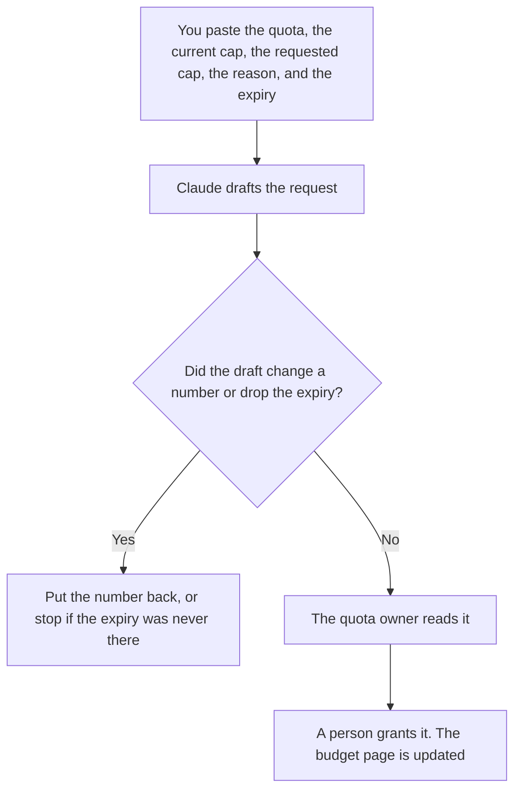

**A quota exception request written with AI asks for a named cap to be raised until a date, for a reason a person already wrote.** The model may format the request. It may not pick the new cap, extend the date, or argue that the limit is unfair. The monthly pool you are excepting is [what an AI request budget is](/blog/what-is-ai-request-budget-2026/). A pattern block, which is not fixed by raising the cap, is [what an AI abuse rate limit is](/blog/what-is-ai-abuse-rate-limit-2026/). A different exception, for a security control, is [how to write a security exception request with AI](/blog/how-to-write-a-security-exception-request-with-ai-2026/).

Claude's prices are from claude.com/pricing on October 24, 2026. Notion, ChatGPT, and Cursor prices are from directory pages checked October 16, 2026. chatgpt.com/pricing returned HTTP 403 on October 24. Published October 24, 2026. We did not score approvals.

## What belongs in the request

| Row | Who owns it | The model may |
|---|---|---|
| The quota name and the current cap | The owner of the limit | Copy them. It may not rename the quota |
| The requested cap | The person asking, with a number they chose | Copy the number. It may not round it up |
| The reason | A fact you pasted, such as a launch date or a migrated workload | Shorten it. It may not add a customer logo |
| The expiry | You | Copy the date. If there is no date, write Expiry missing and stop |
| What this does not allow | The approver's policy | Keep abuse rules and other teams' budgets out of the grant |

An exception without an expiry is a new permanent cap. Write it as a cap change, not as a temporary request. An exception that exists because a key is being shared across products is often an abuse-pattern problem. Raising the cap will not fix a key that should have been split. Say that in the reason if it is true, and do not ask the model to hide it.

## Where it is written

**The draft.** [Claude](/tools/claude/) Pro is $17 a month billed annually, $200 up front, or $20 monthly, when the quota names live in a Project and the request should use those names. The review is [Claude review](/blog/claude-review-2026/).

**The log of open exceptions.** [Notion AI](/tools/notion-ai/) Business is $20 a seat a month if that is the register. Plus at $10 is not the full AI tier. The invoice is [Notion AI pricing explained](/blog/notion-ai-pricing-explained-2026/). A request that is not in the register will be forgotten on the expiry date.

**One request, from a card.** [ChatGPT](/tools/chatgpt/) Plus is $20 a month. Free can format a single card. Discard a version that calls the current cap "arbitrary." The review is [ChatGPT review](/blog/chatgpt-review-2026/).

**The config, after approval.** [Cursor](/tools/cursor/) Plus is $8 a month, or $80 a year, if the cap lives in code or config you review. The request is not the diff. The ladder is [Cursor pricing explained](/blog/cursor-pricing-explained-2026/).

A prompt that holds the line:

"Format a quota exception from the name, caps, reason, and expiry I pasted. Do not change a number. Do not add a business outcome. If the expiry is missing, write Expiry missing and stop."

## What not to delegate

Do not ask the model what the cap should be. Do not grant the exception in the same chat that drafted it. Do not paste a customer payload to "show load." A count and a window are enough. The person who approves is the owner of that quota, not the person who is over it, unless your policy says they are the same role.

## FAQ

### How is this different from raising the request budget?

The budget is the standing cap. The exception is a dated raise, with a reason. When the date passes, the standing cap returns. If you want the standing cap to change, write that request and do not call it temporary.

### How is this different from an abuse limit?

An abuse limit stops a pattern even when budget remains. An exception gives more budget until a date. If the key is doing something the abuse rules forbid, an exception is the wrong form. Fix the pattern, or deny the request.

### Can the model estimate the right cap from last month's usage?

Only if you paste last month's number and you choose the new cap yourself. A suggested cap is not the request. Put your number in the requested-cap cell before you draft.

### Who may approve it?

The owner named on the quota. A model does not approve. A request with no expiry does not go to the register as an exception. It goes back to the author.

## Last verified

October 24, 2026 for Claude. October 16, 2026 for Notion, ChatGPT, and Cursor. Published October 24, 2026.

**Sources:** [Claude pricing](https://claude.com/pricing), [Notion pricing](https://www.notion.com/pricing), [ChatGPT pricing](https://chatgpt.com/pricing/), [Cursor pricing](https://cursor.com/help/account-and-billing/pricing).

*Published by Andrew for [AI Tools Optimizer](https://aitoolsoptimizer.com).*

[Claude](/tools/claude/) is in the [chatbots and assistants directory](/tools/category/chatbots-assistants/). Directory pages may use affiliate links. A purchase through them may earn us a commission at no extra cost to you.
