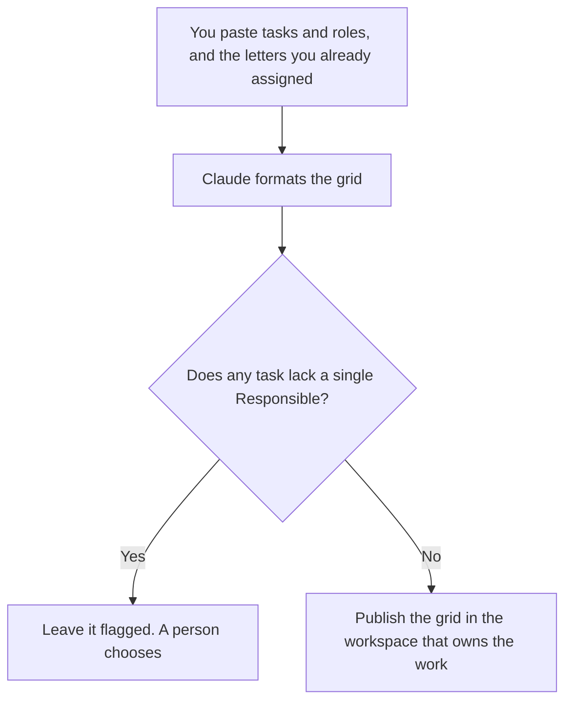

**A RACI chart written with AI is a grid of tasks and roles you already named, with one Responsible, and the Accountable, Consulted, and Informed marks you already chose.** The model may align the columns and catch a task with nobody Responsible. It may not invent a role, a task, or a letter. An empty cell stays empty until a person fills it.

The status habit after the chart exists is [how to write a status update with AI](/blog/how-to-write-a-status-update-with-ai-2026/). The targets the chart should not replace are [how to write OKRs with AI](/blog/how-to-write-okrs-with-ai-2026/). The launch list that often needs a RACI is [how to create a product launch checklist with AI](/blog/how-to-create-a-product-launch-checklist-with-ai-2026/). A made-up owner is [what an AI hallucination is](/blog/what-is-ai-hallucination-2026/).

Prices are US list prices excluding tax from directory pages checked October 16, 2026. Published October 24, 2026. We did not score project success. RACI is Responsible, Accountable, Consulted, Informed. This page uses those four letters and no extras.

## The rules the grid has to keep

| Rule | You decide | The model may |
|---|---|---|
| The task list | Tasks you will actually track | Split a task you wrote into two only if you asked. It may not add "alignment" |
| The roles | Roles, not surprise names | Use the role titles you pasted |
| Responsible | Exactly one R per task, unless you wrote an exception | Flag a task with zero or two. It may not pick the winner |
| Accountable | The role you named, often one | Copy it. It may not make everyone A |
| Consulted and Informed | The marks you pasted | Format them. It may not add a consultee "for safety" |
| A missing mark | Stays missing | Write Missing. It may not default to I |

A chart with every cell filled by a model is a chart nobody agreed to. The value of the draft is the gaps it shows, not the letters it guesses.

## Where the chart lives

**The draft.** [Claude](/tools/claude/) Pro is $20 a month, or $17 billed annually. A Project can hold the role list so the next version does not rename "Support lead" to "Customer hero." Free works for one grid. The review is [Claude review](/blog/claude-review-2026/).

**The page.** [Notion AI](/tools/notion-ai/) Business is $20 a seat a month if the wiki is Notion. Plus at $10 is not the full AI tier. Put the review date on the page. A RACI from last year's launch is a hazard. The invoice is [Notion AI pricing explained](/blog/notion-ai-pricing-explained-2026/). The docs choice, if the team argues Notion versus ClickUp, is [Notion AI vs ClickUp for docs](/blog/notion-ai-vs-clickup-for-docs-2026/).

**The tasks.** [ClickUp Brain](/tools/clickup-brain/) is from $9 a user a month on top of a ClickUp plan. Unlimited is $7 a user a month billed yearly, or $10 monthly. The chart can live next to the tasks if ClickUp is already the home. Do not move the company wiki to get the grid. Confirm the add-on stacks on your plan.

**A quick paste.** [ChatGPT](/tools/chatgpt/) Plus is $20 a month if you want the template in a project. The chart is still published in one home. Two chats are not two RACIs.

A prompt that holds the line:

"Build a RACI table from the tasks, roles, and letters I pasted. One Responsible per task unless I marked an exception. Do not add a task or a role. If a letter is missing, write Missing. Do not use names that are not in my list. Flag any task with zero or two Responsibles."

## What not to delegate

Do not ask who "should" own a messy task. That is a management decision. Do not let the model turn a RACI into a project plan with dates it invented. Dates belong in the checklist or the status note, from dates you set. Do not email the grid as a change announcement until the letters are signed. The email is [how to write a change management email with AI](/blog/how-to-write-a-change-management-email-with-ai-2026/).

The person who accepts a letter is [what human-in-the-loop AI is](/blog/what-is-human-in-the-loop-ai-2026/).

## FAQ

### Can every task have two Responsibles?

Only where you wrote that exception. The default this page uses is one R, so a task has a name to ask. If your team allows pairs, say so in the paste and keep the pair. The model does not get to add the second person.

### Is Accountable the same as Responsible?

No. Responsible does the work. Accountable is the role you named as answerable. The model should not merge them because the grid looks simpler with one column.

### What about a task we might do later?

Leave it off. A RACI of hypothetical work assigns real people to fiction. Add the task when it is real.

### Do we need a paid plan?

No. Free Claude or ChatGPT can format one grid. Pay for Notion or ClickUp when that workspace is already the home of the work, not because a table needs AI.

## Last verified

October 16, 2026 for Claude, Notion AI, ClickUp Brain, and ChatGPT. Published October 24, 2026.

**Sources:** [Claude pricing](https://claude.com/pricing), [Notion pricing](https://www.notion.com/pricing), [ClickUp Brain](https://clickup.com/brain).

*Published by Andrew for [AI Tools Optimizer](https://aitoolsoptimizer.com).*

[Notion AI](/tools/notion-ai/) is in the [productivity and notes directory](/tools/category/productivity-notes/). Directory pages may use affiliate links. A purchase through them may earn us a commission at no extra cost to you.
