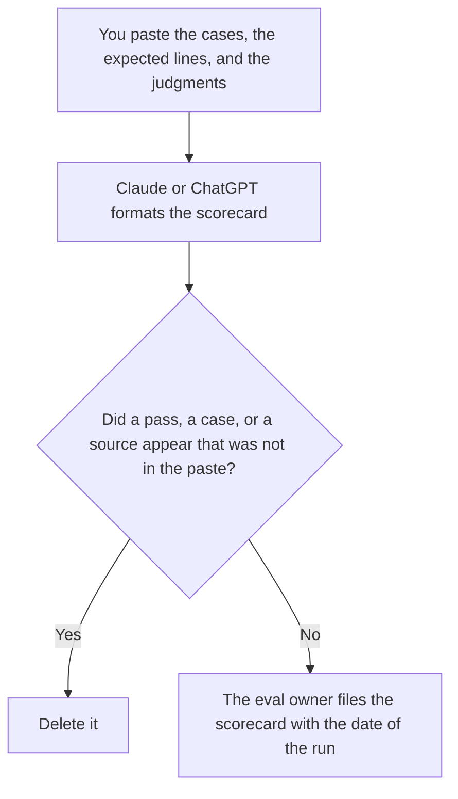

**A RAG eval scorecard written with AI is a table of cases you already ran, with columns you already defined, filled only from judgments a person recorded.** The model may format the table. It may not mark a case passed, invent a citation, or average a blank into a score. The longer write-up of a model run is [how to create a model eval report with AI](/blog/how-to-create-a-model-eval-report-with-ai-2026/). The set you keep and rerun is [what an AI eval regression suite is](/blog/what-is-ai-eval-regression-suite-2026/).

Whether an answer points at a source is [what AI citation coverage is](/blog/what-is-ai-citation-coverage-2026/). The order of candidate passages before the answer is [what AI retrieval hybrid rerank is](/blog/what-is-ai-retrieval-hybrid-rerank-2026/).

Claude's prices are from claude.com/pricing on October 24, 2026. Notion, ChatGPT, and Perplexity prices are from directory pages checked October 16, 2026. chatgpt.com/pricing and perplexity.ai/pro returned HTTP 403 on October 24. Published October 24, 2026. We did not run a RAG eval for this article.

## What the scorecard contains

| Column | Who fills it | The model may |
|---|---|---|
| Case id and question | You | Copy them. It may not add a case |
| Expected source or expected behavior | You | Copy it. If it is blank, write Expected not set |
| What the run returned | The log you pasted | Copy it. It may not "clean up" a citation |
| Pass, fail, or not judged | A person | Copy the mark. A blank stays Not judged |

A scorecard with no definition of pass is a grid of adjectives. Write the rule before you fill the column: the expected source was in the answer, the citation opened, the answer abstained when it should have. One rule per column. Do not change the rule after the average looks low.

Do not publish a single percentage as "RAG quality." Publish the columns, the date, the index version, and the model id. A reader who cannot see those cannot compare the next run.

## Where it is built

**The draft of the grid.** [Claude](/tools/claude/) Pro is $17 a month billed annually, $200 up front, or $20 monthly. Keep the column rules in a Project so the next run uses the same words. The review is [Claude review](/blog/claude-review-2026/).

**The page the team opens.** [Notion AI](/tools/notion-ai/) Business is $20 a seat a month. Put the index version next to the date. The invoice is [Notion AI pricing explained](/blog/notion-ai-pricing-explained-2026/).

**One table from a short paste.** [ChatGPT](/tools/chatgpt/) Plus is $20 a month on the October 16 card. Discard a version that fills Not judged with a pass. The review is [ChatGPT review](/blog/chatgpt-review-2026/).

**A cited spot-check of one source.** [Perplexity](/tools/perplexity/) Pro is $17 a month billed annually on the October 16 card. It does not grade your index. You still open the link. The literature job, which is a different corpus, is [Perplexity vs Elicit for literature maps](/blog/perplexity-vs-elicit-for-literature-maps-2026/).

A prompt that holds the line:

"Build the scorecard from the cases, the expected lines, and the judgments I pasted. If a judgment is missing, write Not judged. Do not add a case. Do not compute a quality score I did not define."

## What not to delegate

Do not ask which RAG stack is better. Do not let the model read an answer and then invent the expected source. The expected line is written before you look at the run, or it is labeled as graded after the fact, and those are different scorecards. Do not drop a failed case to raise the pass count.

## FAQ

### How is this different from a model eval report?

The report is the narrative of a run: what you tested, what changed, what you are not claiming. The scorecard is the grid. The report can link the scorecard. It should not replace the rows with a paragraph. If you only have a story, you do not have a scorecard yet.

### How is this different from citation coverage?

Citation coverage counts claims that point at sources, under a rule. The scorecard can include that count as one column, for the cases you ran. Coverage on one demo answer is not the scorecard. The scorecard names the cases.

### Can the model calculate a pass rate?

Only from marks you pasted, and only with the denominator you wrote. Show the arithmetic. A blank is not a pass and not a fail. If you want a rate, the formula is yours, and Not judged stays out of the numerator and the denominator until you say otherwise.

### Who may call the scorecard current?

The eval owner, with the date and the index version on the page. A formatted table from last quarter is a record. It is not the current index.

## Last verified

October 24, 2026 for Claude. October 16, 2026 for Notion, ChatGPT, and Perplexity. Published October 24, 2026.

**Sources:** [Claude pricing](https://claude.com/pricing), [Notion pricing](https://www.notion.com/pricing), [ChatGPT pricing](https://chatgpt.com/pricing/), [Perplexity](https://www.perplexity.ai/).

*Published by Andrew for [AI Tools Optimizer](https://aitoolsoptimizer.com).*

[Claude](/tools/claude/) is in the [chatbots and assistants directory](/tools/category/chatbots-assistants/). Directory pages may use affiliate links. A purchase through them may earn us a commission at no extra cost to you.
