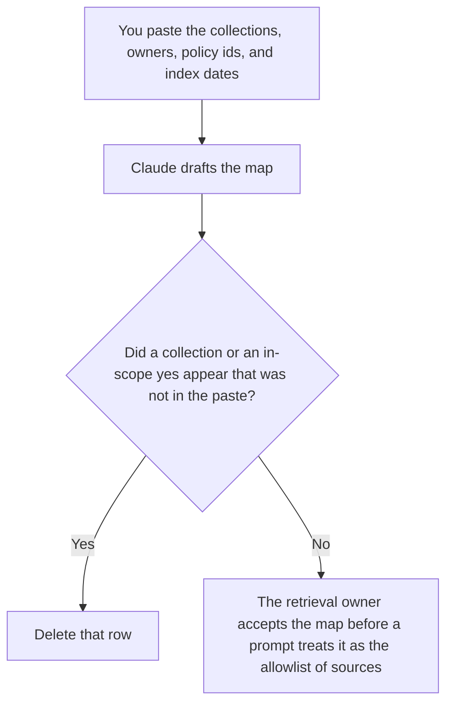

**A retrieval source map created with AI is a draft inventory of the collections a system may retrieve: the name, the owner, the filter policy that binds it, and the date a person said the index was built.** The model may order those rows. It may not add a source, a permission, or a "probably included" collection. The rule that keeps or drops a passage is [what an AI retrieval filter is](/blog/what-is-ai-retrieval-filter-2026/). Which rule binds which collection is [what an AI retrieval filter policy is](/blog/what-is-ai-retrieval-filter-policy-2026/).

The share you meant to get back is [what an AI retrieval recall target is](/blog/what-is-ai-retrieval-recall-target-2026/). The map is the list. The target is the number. A map that adds a wiki "for completeness" changes what the target means.

Claude's prices are the October 24, 2026 read of claude.com/pricing recorded in [Claude pricing explained](/blog/claude-pricing-explained-2026/). Notion and Cursor prices are from directory pages checked October 16, 2026. Perplexity's Pro price is the October 24 figure recorded in [Perplexity pricing explained](/blog/perplexity-pricing-explained-2026/). A refetch of the hub pricing URL timed out that day. Published October 24, 2026. We did not measure recall.

## What the map is allowed to list

| Column | Who fills it | The model may |
|---|---|---|
| Collection name | You | Copy it. It may not rename it to a friendlier title |
| Owner | A person | Copy the name. It may not write "the data team" |
| Filter policy id | You | Copy it. If you have none, write Policy not set |
| Index date | You | Copy it. It may not say "current" |
| In scope | You: yes or no | Copy it. It may not flip a no |

A source map is not a bibliography of pages a chatbot cited once. Those pages can be useful. They are not in the index until a person adds the collection. [Perplexity](/tools/perplexity/) can help you open a vendor's documentation about a connector. The citation does not add the connector to your map. Pro is $17 a month billed annually on the October 24 record. Open the page. The review is [Perplexity review](/blog/perplexity-review-2026/).

If the index date is older than the filter policy's review date, the map should say so. Do not ask the model which date "matters more."

## Where it is drafted

**The draft.** [Claude](/tools/claude/) Pro is $17 a month billed annually, $200 up front, or $20 monthly. The Project holds the column names. The review is [Claude review](/blog/claude-review-2026/).

**The register.** [Notion AI](/tools/notion-ai/) Business is $20 a seat a month. One row per collection. The invoice is [Notion AI pricing explained](/blog/notion-ai-pricing-explained-2026/).

**The diff, if the map is a file the retriever reads.** [Cursor](/tools/cursor/) Plus is $8 a month, or $80 a year. You review the diff that adds a collection. The ladder is [Cursor pricing explained](/blog/cursor-pricing-explained-2026/).

**A cited read of a connector's own docs, when you are checking a name.** Perplexity Pro, as above. The ladder is the pricing article. Enterprise is a different seat. This map does not require it.

A prompt that holds the line:

"Draft the source map from the collections, owners, policy ids, and index dates I pasted. If a policy id is missing, write Policy not set. Do not add a collection. Do not mark a row in scope."

## What not to delegate

Do not ask which folders are "safe to index." Do not paste a customer export so the map "has an example row." Do not point retrieval at a collection because the map draft looks finished. The retrieval owner accepts the rows. In scope stays the value you pasted.

## FAQ

### How is this different from a filter policy?

The policy says which filter binds a collection, a tenant, and a role. The map is the inventory of collections, with a pointer to that policy id. A policy can exist for a collection the map forgot. A map can name a policy id nobody wrote. The gap is the blank cell. Fill it. Do not let retrieval guess.

### How is this different from a retrieval filter?

The filter keeps or drops a passage at query time. The map says which collections exist and whether they are in scope. A filter cannot drop a collection the map never listed if the index still contains it. Fix the index and the map together. A prompt instruction is not a map.

### How is this different from a recall target?

The target is the share of relevant passages you wanted, on cases you froze. The map says which collections those cases are allowed to use. If you add a collection, the target's denominator can change. Record the map version next to the target. Do not "improve recall" by marking a row in scope inside the draft.

### Who may add a collection?

The retrieval owner. A citation from a search tool is not an addition. A missing owner stays missing. A missing index date stays missing until a person reads the job that built the index.

## Last verified

October 24, 2026 for Claude and for Perplexity's annual Pro figure, via the posts cited above. The hub pricing URL timed out on October 24. October 16, 2026 for Notion and Cursor. Published October 24, 2026.

**Sources:** [Claude pricing](https://claude.com/pricing), [Notion pricing](https://www.notion.com/pricing), [Perplexity pricing](https://www.perplexity.ai/hub/pricing), [Cursor pricing](https://cursor.com/help/account-and-billing/pricing).

*Published by Andrew for [AI Tools Optimizer](https://aitoolsoptimizer.com).*

[Perplexity](/tools/perplexity/) is in the [research directory](/tools/category/research-search/). Directory pages may use affiliate links. A purchase through them may earn us a commission at no extra cost to you.
