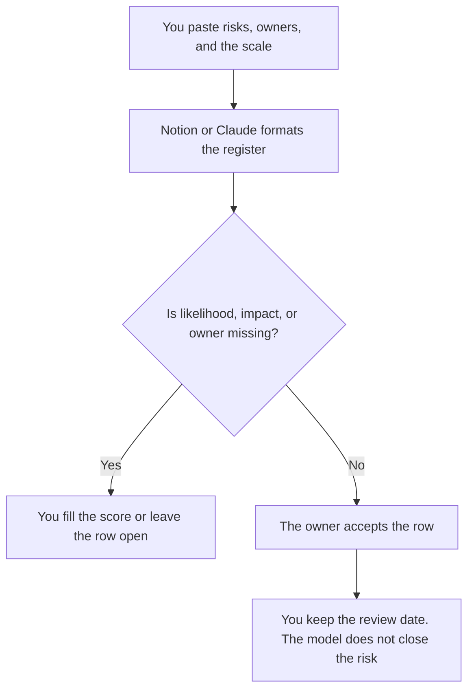

**A risk register created with AI is a table of risks you already named, with an owner, a mitigation, and a score you set.** The model may format the rows and flag a risk with no owner. It may not invent a risk, a likelihood, or a dollar impact. An empty score stays empty.

Who may update a row is [how to create a RACI chart with AI](/blog/how-to-create-a-raci-chart-with-ai-2026/). The write-up after something has already failed is [how to write a postmortem with AI](/blog/how-to-write-a-postmortem-with-ai-2026/). A status that pretends the risk is handled is [how to write a status update with AI](/blog/how-to-write-a-status-update-with-ai-2026/). A made-up impact is [what an AI hallucination is](/blog/what-is-ai-hallucination-2026/).

Prices are US list prices excluding tax from directory pages checked October 16, 2026. Published October 24, 2026. This page is not legal, security, or insurance advice. A register is not a control.

## The columns that have to be real

| Column | Who owns it | The model may |
|---|---|---|
| Risk | A sentence you paste, specific enough to recognize | Copy it. It may not add a generic risk |
| Likelihood | A value on the scale you defined | Leave blank until you set it |
| Impact | A value on that same scale, or a figure you supplied | Copy it. It may not estimate a loss |
| Owner | A role you name | Leave Missing if unnamed |
| Mitigation | The action you already intend, or Missing | Format it. It may not invent a control |
| Status | Open, accepted, or closed, as you marked it | Copy the mark. It may not close a row |
| Review date | The day you will look again | Copy it |

Pick a scale before you draft. A 1 to 5 scale you did not define will be filled with confident middle numbers. Write what 1 and 5 mean in a sentence at the top. The model copies that legend. It does not get to reinterpret it.

## Where the register lives

**The page of record.** [Notion AI](/tools/notion-ai/) Business is $20 a seat a month. The register is a database with the columns above, not a chat log. Plus at $10 is not the full AI tier. The record rule is [what a system of record for AI is](/blog/what-is-a-system-of-record-for-ai-2026/).

**The draft from a messy list.** [Claude](/tools/claude/) Pro is $20 a month, or $17 billed annually. Paste the risks as bullets. Ask for a table and for Missing wherever you did not score. The review is [Claude review](/blog/claude-review-2026/).

**A shorter read for a steering meeting.** [ChatGPT](/tools/chatgpt/) Plus at $20 can list the open rows you already scored. It should not re-rank them. The review is [ChatGPT review](/blog/chatgpt-review-2026/).

**The work tracker, if risks are tasks.** [ClickUp Brain](/tools/clickup-brain/) starts at $9 per user a month. A mitigation that is real work belongs as a task you created. The register points at the task. The model does not create the task from a vibe.

A prompt that holds the line:

"Format a risk register from the rows I pasted. Do not add a risk. Do not fill likelihood or impact. If owner or mitigation is absent, write Missing. Do not close a row. Copy the scale legend I included."

## What not to delegate

Do not ask for a "complete" register for a launch. Completeness is your review, not a template from the internet. Do not paste credentials, incident details under a disclosure limit, or customer data so the model can "assess exposure." Do not treat a generated mitigation as a control you have implemented. The security-docs shelf, when the risk is a security document, is [best AI tools for security ops docs](/blog/best-ai-tools-for-security-ops-docs-2026/).

## FAQ

### Can AI score likelihood?

It can format a score you typed. The score is a judgment. A model that sets it has decided how worried you are. Type the number, or leave the cell blank and review it in the meeting.

### What if two people disagree?

Keep both scores in the notes and write the score the owner accepts. Do not average them with a prompt. Disagreement is a conversation. The register stores the accepted value and the date.

### Is a register a postmortem?

A register is before, or beside, the work. A postmortem is after a failure. When a risk becomes an incident, write the postmortem as its own page and point the register at it. Do not let the model mark the risk closed because the postmortem exists.

### How often should rows be reviewed?

On the review date you put in the column. A register with no dates is a list you will not reopen. The model can sort by that date. It cannot decide that a risk expired.

## Last verified

October 16, 2026 for Notion AI, Claude, ChatGPT, and ClickUp Brain. Published October 24, 2026.

**Sources:** [Notion pricing](https://www.notion.com/pricing), [Claude pricing](https://claude.com/pricing), [ChatGPT pricing](https://chatgpt.com/pricing/).

*Published by Andrew for [AI Tools Optimizer](https://aitoolsoptimizer.com).*

[Notion AI](/tools/notion-ai/) is in the [productivity and notes directory](/tools/category/productivity-notes/). Directory pages may use affiliate links. A purchase through them may earn us a commission at no extra cost to you.
