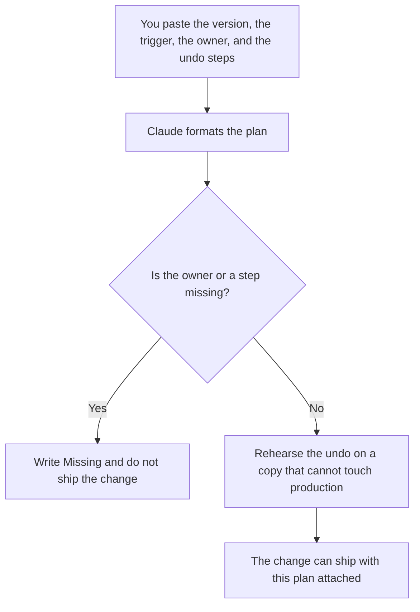

**A rollback plan written with AI is the note that says how you undo a change: what shipped, what "bad" means, who decides, and the steps that return the last version you trust.** The model may order steps you paste. It may not invent a deploy command, a maintenance window, or a promise that rollback is instant. The forward plan, with a flag and a slice of users, is [how to create a feature flag rollout plan with AI](/blog/how-to-create-a-feature-flag-rollout-plan-with-ai-2026/). The small slice itself is [what an AI canary deployment is](/blog/what-is-ai-canary-deployment-2026/).

A migration's backout, which is a planned move rather than a release undo, is [how to write a migration runbook with AI](/blog/how-to-write-a-migration-runbook-with-ai-2026/). The boxes on call ticks are [how to write a runbook checklist with AI](/blog/how-to-write-a-runbook-checklist-with-ai-2026/).

Prices are US list prices excluding tax from directory pages checked October 16, 2026. Published October 24, 2026. We did not score releases.

## What fits in the plan

| Block | Who owns it | The model may |
|---|---|---|
| The change | The version or flag you named | Copy it. It may not rename the release |
| The trigger | The symptom that means you roll back | Copy it. It may not add a metric |
| The decision | The person who can say go back | Copy the name. If it is missing, stop |
| The steps | The commands or clicks you have used | Place them. It may not compose new ones |
| The data | What rollback does not undo | Copy it. A silent "data is fine" is a defect |

Rollback that does not restore a database write is still a plan. Say so in the data block. A plan that pretends the rows return is worse than a short plan that tells support what will still be wrong.

## Where the plan is written

**The draft.** [Claude](/tools/claude/) Pro is $20 a month, or $17 billed annually, when the plan sits beside the last release's note. The review is [Claude review](/blog/claude-review-2026/).

**The commands.** [Cursor](/tools/cursor/) Plus is $8 a month, or $80 a year, when the steps quote the repo. You read every flag. A generated `--force` is not a step. The ladder is [Cursor pricing explained](/blog/cursor-pricing-explained-2026/).

**The page.** [Notion AI](/tools/notion-ai/) Business is $20 a seat a month if the bridge call has the page open. The chat is not the plan.

**A short card.** [ChatGPT](/tools/chatgpt/) Plus at $20 a month can format a one-page undo. Discard a trigger it wrote because every launch "should watch error rate" if you did not name the metric and the threshold.

A prompt that holds the line:

"Format a rollback plan from the version, the trigger, the decision owner, the undo steps, and the data caveat I pasted. Do not add a command or a threshold. If the owner is missing, write Owner missing and stop."

## What not to delegate

Do not ask the model whether you should roll back during an incident. The trigger was written before the incident. Do not rehearse against production. Do not ship a flag with no undo and call the checklist a plan. The customer-facing list of what changed, after you are stable, is [how to write a changelog with AI](/blog/how-to-write-a-changelog-with-ai-2026/).

## FAQ

### How is rollback different from a feature-flag rollout?

The rollout says who sees the new behavior, in what order. The rollback says how you return to the previous behavior when the trigger hits. You can have a flag and still have no undo if the flag's off position was never tested. Write both.

### What if the data already changed?

Say which writes stick. The plan then includes what support tells the customer, in words you already approved. The model does not draft an apology that admits a fact you have not confirmed.

### Who is allowed to start it?

One person, named before the release. A channel full of opinions is not a decision. The plan includes how that person is reached.

### How do I know the steps still work?

Someone runs them on a copy after the last change to the deploy. A plan copied from the previous release is wrong if the command changed. The date on the plan should be the date of that rehearsal.

## Last verified

October 16, 2026 for Claude, Cursor, Notion AI, and ChatGPT. Published October 24, 2026.

**Sources:** [Claude pricing](https://claude.com/pricing), [Cursor pricing](https://cursor.com/help/account-and-billing/pricing), [Notion pricing](https://www.notion.com/pricing), [ChatGPT pricing](https://chatgpt.com/pricing/).

*Published by Andrew for [AI Tools Optimizer](https://aitoolsoptimizer.com).*

[Claude](/tools/claude/) is in the [chatbots and assistants directory](/tools/category/chatbots-assistants/). Directory pages may use affiliate links. A purchase through them may earn us a commission at no extra cost to you.
