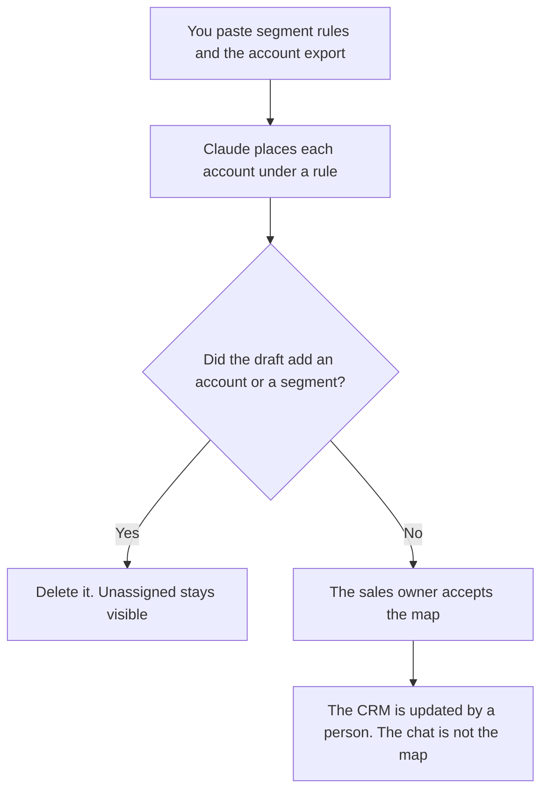

**A sales territory plan written with AI is a coverage map for segments, accounts, and rules a person already decided.** The model may format the table you pasted. It may not invent a quota, a total addressable market, an account list, or a rep's capacity. The plan says who covers which named accounts, and what happens to an account that fits none of the rules. The CRM stays the record.

The stage rules the coverage should match are [best AI tools for sales ops](/blog/best-ai-tools-for-sales-ops-2026/). The enrichment stack behind the list is [best AI tools for RevOps](/blog/best-ai-tools-for-revops-2026/). The questions a rep asks once they have the account are [how to create a sales discovery script with AI](/blog/how-to-create-a-sales-discovery-script-with-ai-2026/).

Prices are US list prices excluding tax. Claude, Notion, and HubSpot are from directory pages checked October 16, 2026. HubSpot's Starter figure was labeled limited-time. Clay's Launch headline is the October 16 directory figure, which the RevOps article still used on October 24, 2026. Published October 24, 2026. We did not score coverage. This page does not calculate a quota.

## The lines that have to be real

| Line | Who owns it | The model may |
|---|---|---|
| Segment rules | The definitions you wrote: size, region, product, named accounts | Copy them. It may not add a segment |
| Account list | The rows from the CRM, with ids | Place each row under a rule. It may not add an account |
| Owner | The rep or pod you assigned | Copy the name. It may not balance the book |
| Exceptions | The accounts you marked keep, drop, or shared | Keep the mark. It may not "clean up" an exception |
| What is unassigned | The rows that match no rule | List them. It may not hide them |
| Quota or target | Only a number finance or the CRO already signed | Leave it out if you did not paste one |

An account the model found on the web is not in the territory until someone adds it to the CRM under your rules. Research on a named account is a later step. The plan is the assignment.

## Where the map is written

**The draft.** [Claude](/tools/claude/) Pro is $20 a month, or $17 billed annually, when the rules live in a Project and the export is the only new paste. The review is [Claude review](/blog/claude-review-2026/).

**The record.** [HubSpot](/tools/hubspot/) has a free CRM. A limited-time Starter from $7 or $10 per seat a month was on the October 16 card. Confirm the offer before you quote it. The territory field in the CRM is the plan that reps see. The invoice context is [HubSpot pricing explained](/blog/hubspot-pricing-explained-2026/).

**The narrative.** [Notion AI](/tools/notion-ai/) Business is $20 a seat a month if leadership wants a page that states the rules in sentences, next to a link to the CRM view. The page does not override the CRM.

**A list you are allowed to build.** [Clay](/tools/clay/) Launch headlines at $167 a month billed annually. Free is 500 actions and 100 data credits a month. Clay can research rows. It does not assign the territory. Use it only on accounts you are allowed to look up, and only after the rules exist. The sliders are [Clay pricing explained](/blog/clay-pricing-explained-2026/).

A prompt that holds the line:

"Assign each account in this export to one segment using only the rules I pasted. If an account matches none, write Unassigned. Do not add accounts. Do not suggest a quota, a revenue number, or a rep I did not name. Do not drop exceptions."

## What not to delegate

Do not ask the model to make the territories fair. Fair is a decision the owner makes after seeing the unassigned pile and the counts. Do not let a generated market size become a target. Do not email a list because it appeared in the plan. Permission to contact an account is a separate rule. The sending tools on the RevOps page do not create that permission.

A one-page leave-behind for a single account is a different document, and this site already has a sales one-pager workflow. This page stops at coverage.

## FAQ

### Can AI build the account list?

It can format a list you exported. An account it discovered is a suggestion someone has to accept into the CRM. Until that happens, it is not in the territory.

### Should the plan include quota?

Only the number a person who is allowed to set quota has already signed. This workflow does not derive quota from headcount, from last year, or from a market figure. If the number is not in your paste, the cell stays blank.

### Is this sales ops or RevOps?

Sales ops owns the stage and field rules the coverage has to respect. RevOps owns the enrichment and routing stack. This page is the assignment map. Link the other two when the rules or the data are the actual problem.

### What about a rep who covers a geography and a named list?

Write both rules, and write which one wins when an account matches both. The model will pick silently if you leave that sentence out. The sentence is yours.

## Last verified

October 16, 2026 for Claude, HubSpot, Notion AI, and Clay. The RevOps article's October 24, 2026 read still headlined Clay Launch at $167 a month on the annual toggle. Published October 24, 2026.

**Sources:** [Claude pricing](https://claude.com/pricing), [HubSpot CRM Starter](https://www.hubspot.com/products/crm/starter), [Notion pricing](https://www.notion.com/pricing), [Clay pricing](https://www.clay.com/pricing).

*Published by Andrew for [AI Tools Optimizer](https://aitoolsoptimizer.com).*

[HubSpot](/tools/hubspot/) is in the [marketing and SEO directory](/tools/category/marketing-seo/). Directory pages may use affiliate links. A purchase through them may earn us a commission at no extra cost to you.
