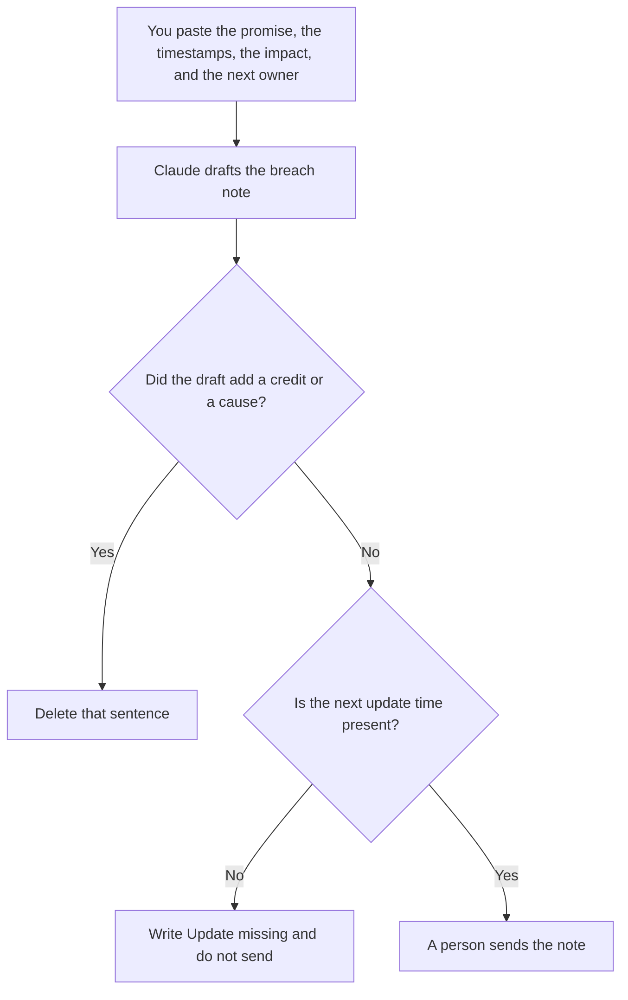

**An SLA breach note written with AI tells the reader which promise missed, by how far, who owns the next update, and what you will not promise yet.** The model may format that note from numbers you paste. It may not invent a credit, a root cause, or a new response-time target. The clocks you already agreed are [how to create a support escalation matrix with AI](/blog/how-to-create-a-support-escalation-matrix-with-ai-2026/). The habit of checking the promise against logs is [what AI SLA monitoring is](/blog/what-is-ai-sla-monitoring-2026/).

The public status sentence, if customers can see the incident, is [how to write a status page update with AI](/blog/how-to-write-a-status-page-update-with-ai-2026/). The hour's roles are [what AI incident response is](/blog/what-is-ai-incident-response-2026/).

Prices are US list prices excluding tax from directory pages checked October 16, 2026. Published October 24, 2026. We did not score response times.

## What the note is allowed to say

| Line | Source | The model may |
|---|---|---|
| The promise | The SLA text you pasted | Quote it. It may not tighten or loosen it |
| The miss | The timestamp and the target you pasted | Subtract only if you ask it to show the arithmetic |
| The impact | Who was affected, in words you wrote | Copy it. It may not estimate a customer count |
| The next owner | A person or role you named | Copy it. If the name is missing, stop |
| The next update | A time you chose | Copy it. It may not say "shortly" |
| The remedy | Only a remedy finance or counsel already approved | Leave the line blank if you did not paste one |

A breach note that explains the bug is a postmortem. That document comes later, with evidence. This note is the acknowledgment. The target you missed should match the escalation matrix. If the matrix says one hour and the note says four, fix the source before you send either.

## Where the note is written

**The draft.** [Claude](/tools/claude/) Pro is $20 a month, or $17 billed annually, when the note has to stay formal and short. The review is [Claude review](/blog/claude-review-2026/).

**The page support will reopen.** [Notion AI](/tools/notion-ai/) Business is $20 a seat a month if the breach log lives there. Link the ticket. Do not make the chat the record.

**The desk.** [Zendesk AI](/tools/zendesk-ai/) Suite Team is $55 per agent per month paid yearly on the directory card. The note can be a macro only after a person has approved the wording. Support Team at $19 does not include the AI agents on that card. The stack is [best AI tools for support teams](/blog/best-ai-tools-for-support-teams-2026/).

**The sentence a customer will read.** [Grammarly](/tools/grammarly/) Pro is $12 per member per month billed annually, or $30 monthly. It edits tone. It does not know your SLA.

A prompt that holds the line:

"Draft a breach note from the promise, timestamps, impact, next owner, and next update time I pasted. Do not add a credit, a root cause, or an apology that admits a fact I did not paste. If the next update time is missing, write Update missing and stop."

## What not to delegate

Do not let the model decide the remedy. A credit is a finance decision. Do not name a customer in a note that will be forwarded widely. Do not send the note from the model. A person who owns the account or the incident sends it.

## FAQ

### How is this different from a status page update?

The status page is public and short. The breach note is for the customer or the internal owner who was promised a specific clock. They can share facts. They should not invent different clocks. If both go out, a person checks that the times match.

### Can the note include a cause?

Only a cause you have confirmed and pasted. "We are still confirming the cause" is a complete sentence. A guessed cause becomes the quote in the customer's reply.

### What if we missed by a minute?

Say the miss you measured. Do not round it into a story. The matrix and the monitoring definition decide whether that minute counts. The model does not get a vote.

### Who is the next owner?

A named role that is awake for the next update. "The team" is not an owner. If you cannot name the role, the note is not ready.

## Last verified

October 16, 2026 for Claude, Notion AI, Zendesk AI, and Grammarly. Published October 24, 2026.

**Sources:** [Claude pricing](https://claude.com/pricing), [Notion pricing](https://www.notion.com/pricing), [Zendesk](https://www.zendesk.com), [Grammarly pricing](https://www.grammarly.com/plans).

*Published by Andrew for [AI Tools Optimizer](https://aitoolsoptimizer.com).*

[Zendesk AI](/tools/zendesk-ai/) is in the [customer support directory](/tools/category/customer-support/). Directory pages may use affiliate links. A purchase through them may earn us a commission at no extra cost to you.
