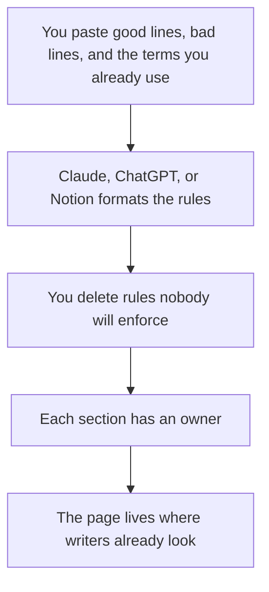

**A style guide written with AI is a set of decisions you already make, turned into rules a new writer can apply: the term, the capitalization, the example, and the owner.** The model can format the page. It cannot decide whether you say "sign in" or "log in." Paste three examples you like and three you do not. Delete any rule you would not enforce.

Tone is a thinner document. That workflow is [how to create a brand voice with AI](/blog/how-to-create-a-brand-voice-with-ai-2026/). The reusable prompts that point at this guide live in [what a prompt library is](/blog/what-is-a-prompt-library-2026/). The fact pass on anything the guide will govern is [how to fact-check AI writing](/blog/how-to-fact-check-ai-writing-2026/).

Prices are US list prices excluding tax from directory pages checked October 16, 2026. Published October 24, 2026. We did not score prose.

## What goes on the page

| Rule | You provide | The model may |
|---|---|---|
| Term | The word you use, and the word you avoid | List them. It may not pick a synonym you did not choose |
| Capitalization | "AI Tools Optimizer," not a creative variant | Show one correct line and one incorrect line |
| Numbers and dates | The pattern you already publish | Format an example. It may not invent a style from a textbook |
| Punctuation | The serial comma, the hyphen, the exclamation policy | Write the example |
| Product names | The official spelling | Flag a draft that drifts. It may not rename the product |
| Voice | A pointer to the voice card | Stay out of personality if this page is the mechanics |

A style guide that says "be clear and human" will not change a draft. A style guide that says "use 'customer,' not 'user,' in help articles" will. Write the second kind. One approved paragraph above the rules is [what few-shot prompting is](/blog/what-is-few-shot-prompting-2026/).

## Where it lives

**A Project, while you are drafting the guide.** [Claude](/tools/claude/) Pro is $20 a month, or $17 billed annually. Put two published pages in the Project so the rules match the site, not a generic manual. The container is [Claude Projects vs ChatGPT Projects](/blog/claude-projects-vs-chatgpt-projects-2026/).

**The team's chat.** [ChatGPT](/tools/chatgpt/) Plus is $20 and includes projects. Go at $8 is enough to format a short list. The ladder is [ChatGPT Go vs Plus vs Pro](/blog/chatgpt-go-vs-plus-vs-pro-2026/).

**The wiki, which should be the system of record for the rules.** [Notion AI](/tools/notion-ai/) Business is $20 a seat. A style guide that only exists inside a chat will drift. The page is the record. The chat is the scratch pad. That split is [what a system of record for AI is](/blog/what-is-a-system-of-record-for-ai-2026/). The card is [Notion AI pricing explained](/blog/notion-ai-pricing-explained-2026/).

**The sentence-level pass.** [Grammarly](/tools/grammarly/) Pro is $12 a member a month billed annually and can follow tone. A style guide is still yours. Grammarly will not know that your product name takes a capital T. The card is [Grammarly pricing explained](/blog/grammarly-pricing-explained-2026/). The editing split is [Grammarly vs ChatGPT for editing](/blog/grammarly-vs-chatgpt-for-editing-2026/).

**The visual side, if the guide includes a logo and colors.** [Canva](/tools/canva/) Brand Kits are a reason teams buy Pro, at $18 a month or $180 a year for one person. The writing rules and the kit are related and not the same file. The invoice is [Canva Magic Studio pricing explained](/blog/canva-magic-studio-pricing-explained-2026/).

A prompt that holds the line:

"Turn these notes into a style guide with columns for Rule, Correct, Incorrect, and Owner. Use only the examples I pasted. If I did not decide a point, put it under Open questions. Do not import rules from a generic style manual."

## How to keep it short

Start with ten rules you already correct in reviews. Add a rule when the same edit happens twice. A forty-page guide generated in an afternoon will not be maintained. The owner reviews it when a product name changes, not on a vague quarterly reminder.

Writers who need a brief before they draft should point at this page from [how to build a content brief with AI](/blog/how-to-build-a-content-brief-with-ai-2026/). Internal announcements should follow the same terms: [best AI tools for internal comms](/blog/best-ai-tools-for-internal-comms-2026/).

The person who merges a rule is [what human-in-the-loop AI is](/blog/what-is-human-in-the-loop-ai-2026/). A model that "updates the guide" by chatting has not updated the guide.

## FAQ

### Is a style guide the same as a brand voice?

No. Voice is how you sound. A style guide is the mechanical rules: names, case, numbers, the words you avoid. You can ship voice first. You still need the rules when two writers spell the product two ways.

### Can AI enforce the guide?

It can rewrite a draft against the rules you paste in the same prompt. It will not enforce a PDF nobody attached. Put the ten rules in the prompt, or in the Project, every time.

### How is this different from Grammarly's style settings?

Grammarly can apply settings inside its product. The guide is the source those settings should copy. If they disagree, the guide wins, and someone updates the settings.

### What if we do not have examples yet?

Write one correct sentence yourself before you ask for a guide. Without an example, the model will borrow a textbook. Open questions are an acceptable section. Invented policy is not.

## Last verified

October 16, 2026 for Claude, ChatGPT, Notion, Grammarly, and Canva prices named above. Published October 24, 2026.

**Sources:** [Claude pricing](https://claude.com/pricing), [Notion pricing](https://www.notion.com/pricing), [Canva pricing](https://www.canva.com/pricing/).

*Published by Andrew for [AI Tools Optimizer](https://aitoolsoptimizer.com).*

[Grammarly](/tools/grammarly/) is in the [writing directory](/tools/category/writing/). Directory pages may use affiliate links. A purchase through them may earn us a commission at no extra cost to you.
