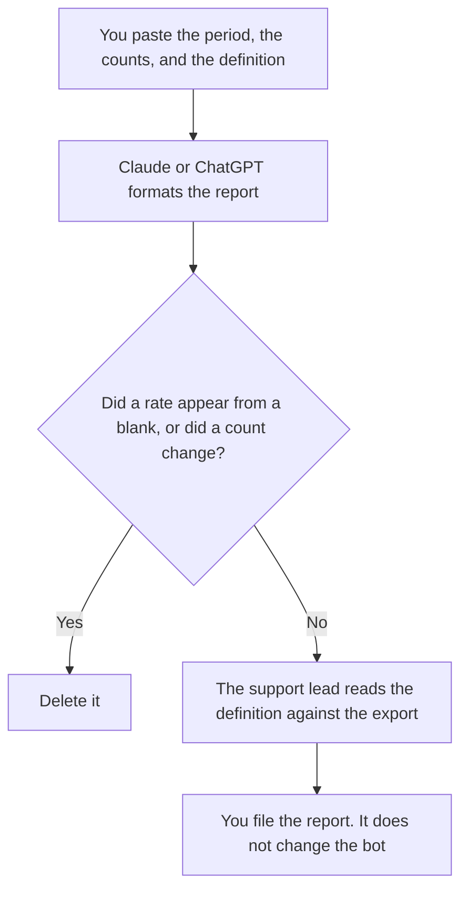

**A support deflection report written with AI states the period, the contact count, the deflected count, the escalated count, and the definition of "deflected" that a person already wrote.** The model may format that report. It may not invent a count, compute a rate from a blank, or decide that a bot reply was good. The note that retires a macro is [how to write a support macro retirement note with AI](/blog/how-to-write-a-support-macro-retirement-note-with-ai-2026/). The plan for a live pile-up is [how to create a support swarm plan with AI](/blog/how-to-create-a-support-swarm-plan-with-ai-2026/).

Claude's prices are from claude.com/pricing on October 24, 2026. Notion and Zendesk prices below are from directory pages checked October 16, 2026, except where a pricing article is named. ChatGPT Plus is $20 a month on learn.chatgpt.com/docs/pricing on October 24, 2026. Published October 24, 2026. We did not score support tools.

## What the report contains

| Line | Who owns it | The model may |
|---|---|---|
| The period, in the zone you wrote | You | Copy it. A blank stays Period missing |
| Contacts, deflected, escalated | The export you pasted | Copy the integers. It may not estimate a missing one |
| The definition of deflected | The support lead | Copy it. A helpful-sounding bot is not the definition |
| What was excluded | You | Keep the exclusions. Dropping one changes the rate |
| The reader | You | Copy the name |

Deflected means whatever the lead wrote. If the definition is "the customer did not open a ticket after the help-center article," a chat that merely answered is not deflected unless the export says so. A rate is allowed when all three integers are in the paste and a person checks the division. If one integer is missing, the rate line says Missing.

## Where it is written

**The draft, when every month uses the same headings.** [Claude](/tools/claude/) Pro is $17 a month billed annually, $200 up front, or $20 monthly. Put the definition at the top of the Project so a later month cannot drift. The review is [Claude review](/blog/claude-review-2026/).

**The page leadership will reopen.** [Notion AI](/tools/notion-ai/) Business is $20 a seat a month if that is the report home. Plus at $10 is not the full AI tier on the October 16 card. The invoice is [Notion AI pricing explained](/blog/notion-ai-pricing-explained-2026/).

**One month, from a short export.** [ChatGPT](/tools/chatgpt/) Plus is $20 a month. Business is $20 a user a month billed annually for two or more users, or $25 monthly, on the October 24 page, when the export is company data. The review is [ChatGPT review](/blog/chatgpt-review-2026/).

**The help desk, if that is where the counts come from.** [Zendesk AI](/tools/zendesk-ai/) prices in this directory are the ones in [Zendesk AI pricing explained](/blog/zendesk-ai-pricing-explained-2026/). This report does not assume a Zendesk plan. Paste the export you have. The product does not get to redefine deflected inside the draft.

A prompt that holds the line:

"Write the deflection report from the period, the counts, the definition, and the exclusions I pasted. If a number is missing, write Missing. Do not calculate a rate unless all three counts are present. Do not judge whether the bot was helpful."

## What not to delegate

Do not paste ticket bodies so the example looks real. Counts are enough. Do not let the model propose a new definition in the same draft that reports last month. A new definition is a new report, labeled as a new definition. Do not retire a macro because the rate moved. That retirement is the other article.

## FAQ

### How is this different from a macro retirement note?

The retirement note says a specific reply is going away, on a date, with a replacement or with none. This report says what the counts were under the definition you used. A rate can inform that note. It is not the note.

### How is this different from a swarm plan?

A swarm plan is how you staff a live surge. This report is after the period, about what the numbers were. Do not use the swarm template to describe last month, and do not use this report to page people.

### Can the model pull the counts from the help desk?

Only from an export you paste or a figure a person has already confirmed. A model that "knows" last Tuesday's volume is using a stale thread. Paste the integers.

### Who may publish the rate?

The support lead, after they check the arithmetic and the definition. A formatted page is not a publish. If the definition changed mid-period, the report says that, in a line you wrote.

## Last verified

October 24, 2026 for Claude and for ChatGPT Plus and Business. October 16, 2026 for Notion. Zendesk figures, if you need them, stay in the Zendesk pricing article and its date. Published October 24, 2026.

**Sources:** [Claude pricing](https://claude.com/pricing), [Notion pricing](https://www.notion.com/pricing), [ChatGPT and Codex pricing](https://learn.chatgpt.com/docs/pricing), [Zendesk](https://www.zendesk.com).

*Published by Andrew for [AI Tools Optimizer](https://aitoolsoptimizer.com).*

[Zendesk AI](/tools/zendesk-ai/) is in the [customer support directory](/tools/category/customer-support/). Directory pages may use affiliate links. A purchase through them may earn us a commission at no extra cost to you.
