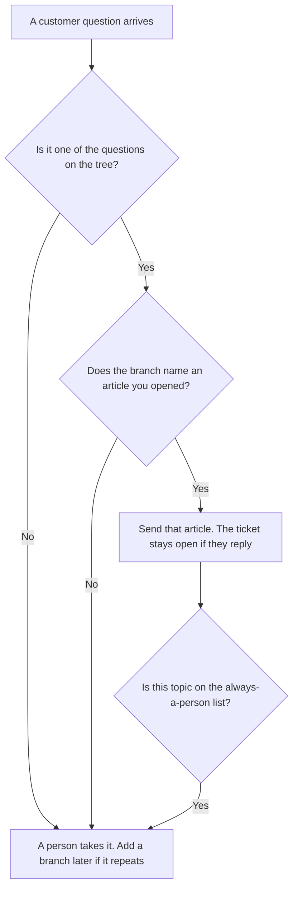

**A support deflection tree written with AI is a set of questions you already see, each pointing at a help article that exists, or at a person when the article does not.** The model may format the branches. It may not invent an article, close a ticket, or promise a resolution. The severity, the owner, and the clock, which are a different table, are [how to create a support escalation matrix with AI](/blog/how-to-create-a-support-escalation-matrix-with-ai-2026/). The labels on the shelf are [how to create a knowledge base taxonomy with AI](/blog/how-to-create-a-knowledge-base-taxonomy-with-ai-2026/). This page is the fork: send this article, or stop and escalate.

The pages a person can open are [how to build a help center with AI](/blog/how-to-build-a-help-center-with-ai-2026/). The moment a case leaves the model is [what AI human escalation is](/blog/what-is-ai-human-escalation-2026/).

Prices are US list prices excluding tax from directory pages checked October 16, 2026. Published October 24, 2026. We did not score deflection rate. A branch that points at a missing article is a dead end with a confident tone.

## What a branch has to name

| Branch | Who owns it | The model may |
|---|---|---|
| The question | A wording you took from real tickets | Copy it. It may not invent a frequent question |
| The article | A URL or title that already exists | Link it. It may not draft the article inside the tree |
| The stop | The cases that always reach a person: billing, security, anger, a bug you named | Keep the stop. It may not route those to an article |
| The owner | A person who can edit the branch | Copy the name |
| Last checked | The date someone opened the article and it still answered the question | Copy the date. It may not mark the link current |

Deflection is a successful article, not a closed ticket. If the customer replies that the article failed, the tree has done its job by getting out of the way. An automated close on that reply is a policy you did not write on this page.

## Where the tree is written

**The page.** [Notion AI](/tools/notion-ai/) Business is $20 a seat a month if the tree is a database: question, article, stop rule, owner, date. Free includes a trial. The trial is not a support process. The seat article is [Notion AI pricing explained](/blog/notion-ai-pricing-explained-2026/).

**The formatting.** [Claude](/tools/claude/) Pro is $20 a month, or $17 billed annually, when you paste the questions and the article titles and want them in one shape. A branch with no article title stays Missing. The review is [Claude review](/blog/claude-review-2026/).

**A bot, later.** [Chatbase](/tools/chatbase/) Hobby is $32 a month billed yearly, or $40 monthly, and only after the articles exist. The bot quotes the tree. It does not grow new branches. The build order is [how to build a knowledge-base chatbot](/blog/how-to-build-a-knowledge-base-chatbot-2026/).

**The help desk.** [Zendesk AI](/tools/zendesk-ai/) is a different meter: Support Team from $19 an agent a month paid yearly, and AI agents from Suite Team at $55, on the directory card. Buy it when the queue already lives there. A deflection tree in a chatbot that agents cannot see will disagree with the macro they send.

A prompt that holds the line:

"Format a deflection tree from the questions and article titles I pasted. If a question has no article, write Escalate. Do not invent an article or a resolution. Keep every topic I marked as always-a-person on the escalate branch."

## What not to delegate

Do not ask which articles you should write. That decision comes from tickets a person counted. Do not let the tree swallow billing, account access, or anything your escalation matrix marks severe. Do not report a deflection rate the model estimated. A rate is tickets that received an article and did not reopen, divided by tickets you measured. If you have not measured it, you do not have it.

## FAQ

### Is this the escalation matrix?

The matrix says how severe a case is, who owns the next step, and the clock. The tree says which questions never become cases because an article answers them, and which questions must become cases anyway. A tree that invents a response time has become a fake matrix. Keep the clock on the matrix page.

### Can the model write the missing articles?

Not inside the tree. A missing article is a writing task with an owner, using the help-center workflow, and then a person adds the link. A tree full of "article coming soon" deflects nothing and looks finished.

### When do we add a branch?

When the same question has shown up enough that a person is tired of pasting the same link, and the article exists. One ticket is not a branch. A branch without a date checked will point at a renamed page. Recheck the links when you change the taxonomy.

### Should the bot close the ticket?

Only under a rule a person wrote for that branch, such as "send the article and leave the ticket open for 48 hours." This page does not set that rule. Closing by default hides the cases the article failed.

## Last verified

October 16, 2026 for Notion AI, Claude, Chatbase, and Zendesk. Published October 24, 2026.

**Sources:** [Notion pricing](https://www.notion.com/pricing), [Claude pricing](https://claude.com/pricing), [Chatbase pricing](https://www.chatbase.co/pricing), [Zendesk pricing](https://www.zendesk.com/pricing/).

*Published by Andrew for [AI Tools Optimizer](https://aitoolsoptimizer.com).*

[Zendesk AI](/tools/zendesk-ai/) is in the [customer support directory](/tools/category/customer-support/). Directory pages may use affiliate links. A purchase through them may earn us a commission at no extra cost to you.
