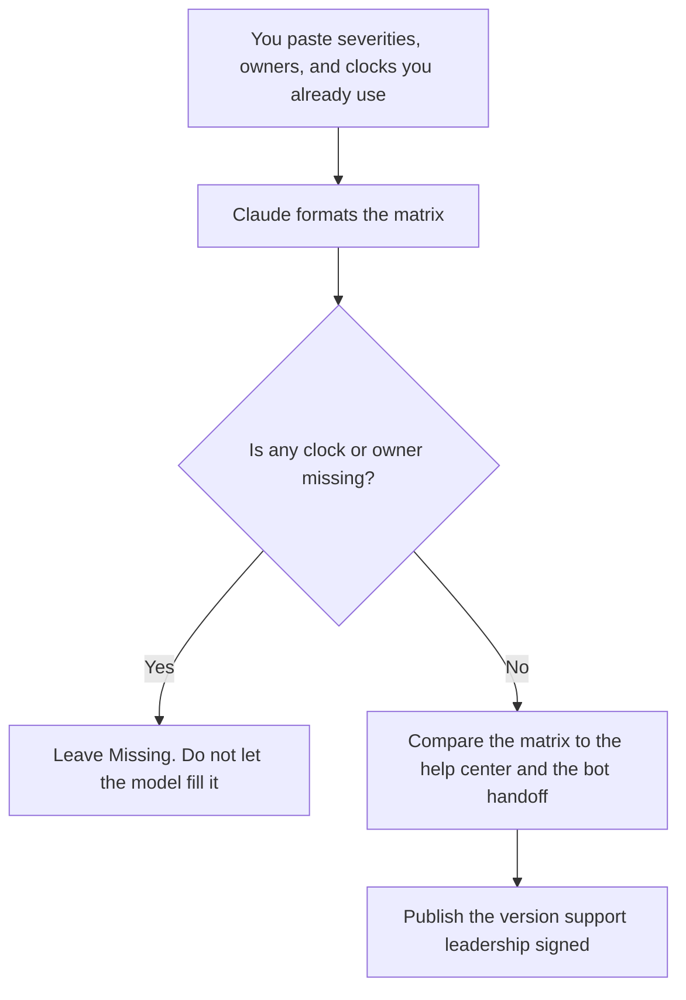

**A support escalation matrix written with AI is a table of severity, the owner of the next step, and the clock you already decided.** The model may format the rows and make the language consistent. It may not invent a response time, a severity, or a promise to the customer. A blank cell stays blank until a person fills it. A fluent SLA you did not approve is a contract.

The help center those rows should match is [how to build a help center with AI](/blog/how-to-build-a-help-center-with-ai-2026/). The bot that should hand off instead of guessing is [how to build an FAQ chatbot from docs](/blog/how-to-build-an-faq-chatbot-from-docs-2026/). The hour after a customer-visible failure is [what AI incident response is](/blog/what-is-ai-incident-response-2026/). The person who still owns the case is [what human-in-the-loop AI is](/blog/what-is-human-in-the-loop-ai-2026/).

Prices are US list prices excluding tax from directory pages checked October 16, 2026. Published October 24, 2026. We did not score handle time. This page does not set your support policy.

## The columns that have to be real

| Column | Who owns it | The model may |
|---|---|---|
| Severity name | You. Use the names your team already says | Rename nothing. It may not add "Sev-0" |
| Customer impact | A sentence you paste per row | Tighten the sentence. It may not widen the impact |
| First owner | A role you name | Repeat the role. It may not assign a person who left |
| Clock | A number you paste, with the unit and the calendar | Copy it. It may not write "ASAP" or "immediately" |
| Next owner | The role if the clock is missed | Leave it blank if you did not name one |
| Customer words | The sentence support is allowed to send | Draft from that sentence only. No new remedy |
| Stop rule | When you wake an incident | Format it. It may not soften a paging rule |

"Urgent" is not a severity until you define the impact and the clock. Four severities you will staff beat seven you will ignore. The model will happily invent a fifth. Refuse it.

## Where the matrix is kept

**The draft.** [Claude](/tools/claude/) Pro is $20 a month, or $17 billed annually. Put the current policy in a Project so a later edit does not resurrect a retired severity. Free can take a short paste, with usage limits. The review is [Claude review](/blog/claude-review-2026/).

**The page on call.** [Notion AI](/tools/notion-ai/) Business is $20 a seat a month if the matrix lives in Notion. Plus at $10 is not the full AI tier. The page needs an owner and a review date. The invoice is [Notion AI pricing explained](/blog/notion-ai-pricing-explained-2026/). The record is [what a system of record for AI is](/blog/what-is-a-system-of-record-for-ai-2026/).

**The bot that must escalate.** [Chatbase](/tools/chatbase/) Hobby is $32 a month billed yearly, or $40 monthly. The bot answers from docs you approve, and the handoff row in this matrix is what it does when the doc is silent. A bot that apologizes and invents a refund has skipped the matrix. The build is [how to build a knowledge base chatbot](/blog/how-to-build-a-knowledge-base-chatbot-2026/).

**The help desk.** [Zendesk AI](/tools/zendesk-ai/) records Support Team at $19 an agent a month paid yearly, and AI agents from Suite Team at $55. The product can hold macros. The clocks in the macros have to be the clocks in the matrix. This page does not invent the rest of Zendesk's edition grid.

A prompt that holds the line:

"Format an escalation matrix from these rows only. Do not add a severity. Do not invent a response time, a credit, or a workaround. If a cell is empty, write Missing. Use the customer-facing sentence I pasted, or write Missing if I did not paste one. Keep internal-only notes out of the customer column."

A promise the model added is [what an AI hallucination is](/blog/what-is-ai-hallucination-2026/). The publish check is [how to fact-check AI writing](/blog/how-to-fact-check-ai-writing-2026/).

## What the matrix is not

It is not the status page, and it is not the incident channel map, though the top severity should point at the incident path you already run. It is not a customer-education course. Learners who need a lesson belong in [best AI tools for customer education](/blog/best-ai-tools-for-customer-education-2026/). It is not a feature announcement. If you are emailing a change that will cause tickets, write that email on purpose: [how to create a feature announce email with AI](/blog/how-to-create-a-feature-announce-email-with-ai-2026/).

Do not paste a real customer's private ticket into a personal chatbot to "try the matrix." Use a redacted example. The severity definitions are not a reason to spread the ticket.

## FAQ

### Can AI suggest better severities?

It can brainstorm in a private doc. The matrix you publish uses the severities you staff. A cleaner taxonomy that nobody pagers is a worse matrix. Decide in the meeting. Then let the model format.

### Should response times be in the customer help center?

Only the numbers you are willing to owe. Many teams keep a tighter internal clock and a narrower public statement. Paste both, labeled, if both exist. Do not let the model copy the internal clock into the public article.

### What if we do not have clocks yet?

Publish the owners and write Missing for the clocks. Staffing a severity with no clock is an honest gap. A made-up "within 15 minutes" is a policy. Missing is the correct output of this workflow until leadership picks a number.

### How often do we revise it?

When ownership or the product changes, and on the review date in the header. A feature launch that adds a new failure mode needs a row before the email sends. The model can add a row only from the impact you paste.

## Last verified

October 16, 2026 for Claude, Notion AI, Chatbase, and Zendesk AI. Published October 24, 2026.

**Sources:** [Claude pricing](https://claude.com/pricing), [Notion pricing](https://www.notion.com/pricing), [Chatbase pricing](https://www.chatbase.co/pricing).

*Published by Andrew for [AI Tools Optimizer](https://aitoolsoptimizer.com).*

[Chatbase](/tools/chatbase/) is in the [customer support directory](/tools/category/customer-support/). Directory pages may use affiliate links. A purchase through them may earn us a commission at no extra cost to you.
