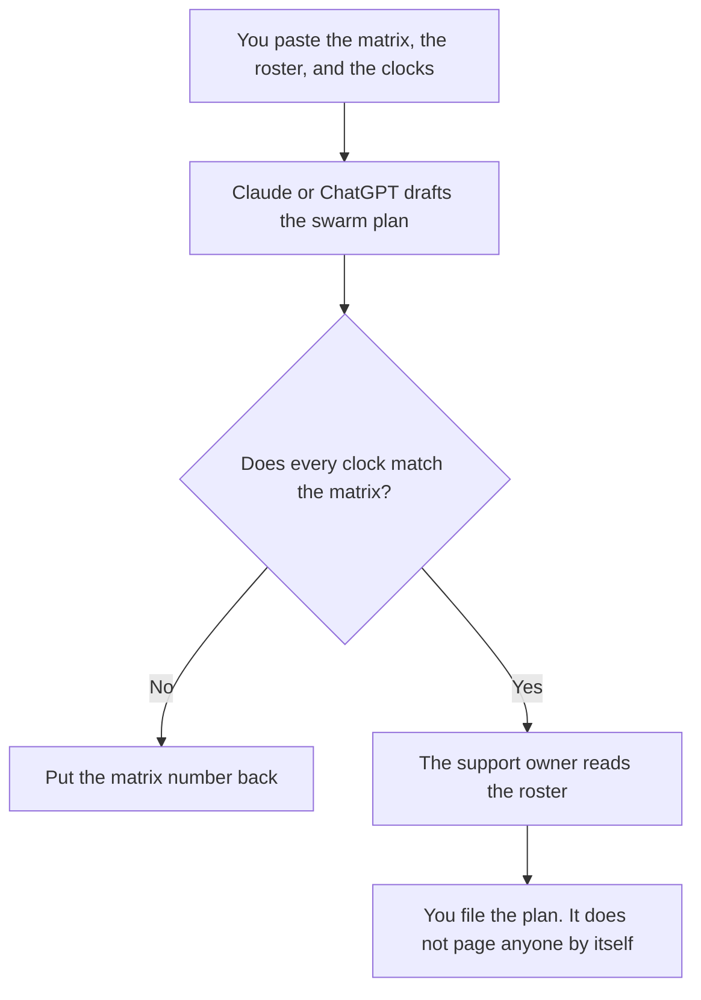

**A support swarm plan written with AI names who joins, at which severity, for how long, and who stands down, using only the roster and the clocks a person already approved.** The model may format the plan. It may not invent a response time, add a hero who was not on the roster, or promise the customer a channel you do not have. The standing matrix, which this plan should match, is [how to create a support escalation matrix with AI](/blog/how-to-create-a-support-escalation-matrix-with-ai-2026/).

The team shelf is [best AI tools for support teams](/blog/best-ai-tools-for-support-teams-2026/). The launch gate that asks whether this plan exists is [how to create a launch readiness checklist with AI](/blog/how-to-create-a-launch-readiness-checklist-with-ai-2026/).

Claude's prices are from claude.com/pricing on October 24, 2026. Notion, Zendesk, and ChatGPT prices are from directory pages checked October 16. chatgpt.com/pricing returned HTTP 403 on October 24. Published October 24, 2026. We did not score support operations. This page does not set an SLA.

## What the plan contains

| Row | Who owns it | The model may |
|---|---|---|
| Severity | The matrix you already use | Copy the name. It may not invent Sev 0 |
| Who joins | The roster | Copy the role or the name. It may not add "the on-call engineer" unless you wrote that role |
| The clock | The number you approved | Copy it, with the unit. It may not tighten it |
| The channel | You | Copy it. A blank channel stays Channel missing |
| Stand-down | The condition you wrote | Copy it. It may not say "when social mentions drop" unless you wrote that |

A swarm is temporary extra people on a known severity. It is not a new product tier and it is not a chatbot deflection tree. If a bot will answer while humans swarm, say which bot, and do not let the plan claim the bot resolves the severity. Deflection, if you need that separate tree, is [how to create a support deflection tree with AI](/blog/how-to-create-a-support-deflection-tree-with-ai-2026/).

## Where it is written

**The draft.** [Claude](/tools/claude/) Pro is $17 a month billed annually, $200 up front, or $20 monthly, when the plan has to use the same severity names as the last incident. The review is [Claude review](/blog/claude-review-2026/).

**The page the incident lead opens.** [Notion AI](/tools/notion-ai/) Business is $20 a seat a month. The plan lives there. A chat transcript does not page the roster. The invoice is [Notion AI pricing explained](/blog/notion-ai-pricing-explained-2026/).

**The queue, if that is the system of record.** [Zendesk AI](/tools/zendesk-ai/) Suite Team is $55 an agent a month paid yearly on the October 16 card, which is the tier that card ties to AI agents. Support Team is $19 and is email and ticketing on that card. Copilot is a $50 add-on. The swarm plan does not require Copilot. Quote the card's date until you re-check Zendesk's pricing page. The macros the swarm will reuse, if you have them, are [how to write a support macro library with AI](/blog/how-to-write-a-support-macro-library-with-ai-2026/).

**One plan, from a short roster.** [ChatGPT](/tools/chatgpt/) Plus is $20 a month on the October 16 card. Discard a version that adds a war-room slogan. The review is [ChatGPT review](/blog/chatgpt-review-2026/).

A prompt that holds the line:

"Write a support swarm plan from the severities, roster, clocks, channel, and stand-down rule I pasted. Do not add a person. Do not change a clock. If the channel is missing, write Channel missing."

## What not to delegate

Do not ask the model who is best under pressure. Do not put personal phone numbers in a prompt that will be reused as a template. Do not page from the draft. The customer-facing words during the swarm stay on the migration or advisory notice a person approved, not on a generated status that invents an ETA.

## FAQ

### How is this different from an escalation matrix?

The matrix is the standing rule: severity, owner, clock. The swarm plan is who joins in addition, for a launch or an incident, and when they leave. If the plan's clock disagrees with the matrix, the matrix wins until a person changes the matrix.

### How is this different from a deflection tree?

Deflection is what a bot or a help article answers without a person. A swarm is people. A plan that says the bot will "cover the surge" has skipped the roster. Write the bot on its own row, with the articles it is allowed to use.

### Can the model build the roster from the org chart?

Only from names you paste. An org chart in a chat is not a schedule. If someone is on leave, the paste should already say so. The model will not know.

### Who may declare the swarm over?

The owner named in the stand-down rule. A quiet hour is not stand-down unless the rule says that. A model that announces "all clear" in a draft is early.

## Last verified

October 24, 2026 for Claude. October 16, 2026 for Notion, Zendesk, and ChatGPT. Published October 24, 2026.

**Sources:** [Claude pricing](https://claude.com/pricing), [Notion pricing](https://www.notion.com/pricing), [Zendesk pricing](https://www.zendesk.com/pricing/), [ChatGPT pricing](https://chatgpt.com/pricing/).

*Published by Andrew for [AI Tools Optimizer](https://aitoolsoptimizer.com).*

[Zendesk AI](/tools/zendesk-ai/) is in the [customer support directory](/tools/category/customer-support/). Directory pages may use affiliate links. A purchase through them may earn us a commission at no extra cost to you.
