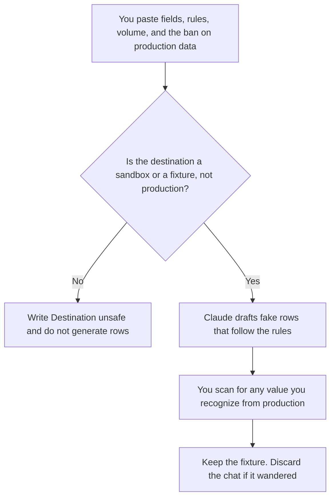

**A test data plan written with AI is a page that says which fields a test needs, the rules those fields must follow, where the rows may live, and the ban on copying production.** The model may draft fake values that follow rules you wrote. It may not paste a real customer, a real card, or a real address. The place a test must not touch production is [what an AI tool sandbox is](/blog/what-is-ai-tool-sandbox-2026/). The rows you re-run to judge a model, which is a different set, are [what an AI eval dataset is](/blog/what-is-ai-eval-dataset-2026/).

The checklist that says how a migration is checked is [how to write a migration runbook with AI](/blog/how-to-write-a-migration-runbook-with-ai-2026/). The undo if a test writes somewhere it should not is [how to create a rollback plan with AI](/blog/how-to-create-a-rollback-plan-with-ai-2026/).

Prices are US list prices excluding tax from directory pages checked October 16, 2026. Published October 24, 2026. We did not generate a sample database. This page is not a privacy policy.

## What fits in the plan

| Block | Who owns it | The model may |
|---|---|---|
| Fields | The columns you named | List them. It may not add a column of real-looking government IDs |
| Rules | Formats and relationships you wrote | Apply them to fake rows. It may not relax them |
| Volume | A count you chose | Repeat up to that count. It may not "make it realistic" by copying production |
| Home | The sandbox or the fixture file | Name it. If the home is production, stop |
| Ban | What must never appear | Copy the ban. A row that violates it is a defect |

A fake email at a domain you own is a rule. A fake email at a real customer's domain is a leak. If you cannot tell, do not generate the column. Leave it blank and say the rule is missing.

## Where the plan is written

**The draft.** [Claude](/tools/claude/) Pro is $20 a month, or $17 billed annually, when the field list is long. Use a business-appropriate account if the rules themselves describe sensitive fields. The review is [Claude review](/blog/claude-review-2026/).

**The fixture in the repo.** [Cursor](/tools/cursor/) Plus is $8 a month, or $80 a year, when the rows become a file. You read the diff. A generated row that includes a phone number you did not ask for comes out. The ladder is [Cursor pricing explained](/blog/cursor-pricing-explained-2026/).

**A small set.** [ChatGPT](/tools/chatgpt/) Plus at $20 a month can draft a dozen rows. Business, at $20 a user a month billed annually, is the row when the schema is confidential. Do not paste a production export "as an example."

**The page.** [Notion AI](/tools/notion-ai/) Business is $20 a seat a month if the plan is what QA opens. The fixture file is still the data. The page points at it.

A prompt that holds the line:

"Draft fake test rows for the fields and rules I pasted, up to the count I named. Do not use real people, real emails, or real account numbers. If I did not name a non-production destination, write Destination missing and stop."

## What not to delegate

Do not ask the model to anonymize a production dump inside a chat. That dump is already in the prompt. Do not commit fixtures that fail the ban. Do not point a test at production because the sandbox was down. The quality set you use to judge answers, if this plan is about a model rather than an app database, stays on the eval-dataset page so the two files do not get mixed.

## FAQ

### Can I start from a production sample if I delete the names?

Not in the chat, and not as the default. A deleted column can come back in a free-text field. Build the rows from rules. If your security team has an approved masking pipeline, that pipeline is the path, and this prompt is not a substitute for it.

### How many rows?

The count that exercises the rule: a blank, a maximum, a duplicate, a row that should fail. A million rows is a generation job with its own review. The plan names the count before the model runs.

### Where may the file live?

In the repo if it contains nothing real, or in the sandbox's fixture store. It may not live in a ticket, a slide, or a personal drive. The plan names the home.

### Who throws the file away?

The owner, on a date the plan includes, if the fixture was temporary. A test file that sits for a year becomes something people treat as real. Date it.

## Last verified

October 16, 2026 for Claude, Cursor, ChatGPT, and Notion AI. Published October 24, 2026.

**Sources:** [Claude pricing](https://claude.com/pricing), [Cursor pricing](https://cursor.com/help/account-and-billing/pricing), [ChatGPT pricing](https://chatgpt.com/pricing/), [Notion pricing](https://www.notion.com/pricing).

*Published by Andrew for [AI Tools Optimizer](https://aitoolsoptimizer.com).*

[Cursor](/tools/cursor/) is in the [coding directory](/tools/category/coding/). Directory pages may use affiliate links. A purchase through them may earn us a commission at no extra cost to you.
