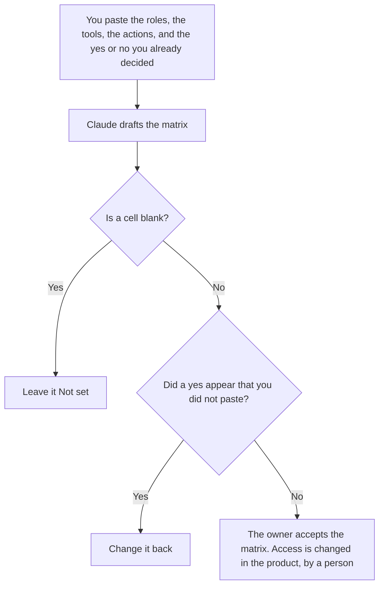

**A tool permission matrix created with AI is a draft grid of role, tool, and action that a person already filled in.** The model may align the cells. It may not mark a cell yes, add a tool, or add a role. A rule that blocks a call before anyone is asked is [what an AI tool permission gate is](/blog/what-is-ai-tool-permission-gate-2026/). The person's yes on a single call is [what an AI tool permission prompt is](/blog/what-is-ai-tool-permission-prompt-2026/). Who is responsible for a task, rather than which tool they may use, is [how to create a RACI chart with AI](/blog/how-to-create-a-raci-chart-with-ai-2026/).

The set of tools an agent may propose is [what an AI tool allowlist is](/blog/what-is-ai-tool-allowlist-2026/). The matrix can name that list. It is not the list.

Claude's prices are the October 24, 2026 read of claude.com/pricing recorded in [Claude pricing explained](/blog/claude-pricing-explained-2026/). Notion and Cursor prices are from directory pages checked October 16, 2026. ChatGPT's Plus price is the October 24 plan-page figure recorded in [ChatGPT pricing explained](/blog/chatgpt-pricing-explained-2026/). Published October 24, 2026. We did not score access reviews. A grid is not a grant.

## What a cell is allowed to say

| Field | Who owns it | The model may |
|---|---|---|
| Role | You | Copy it. It may not merge two roles |
| Tool | You | Copy it. It may not add a tool "the role will need" |
| Action | You: draft, send, delete, or the verbs you listed | Copy it. It may not upgrade draft to send |
| Decision | You: yes, no, or blank | Copy yes or no. A blank stays Not set |
| Environment | You | Copy production or test. It may not copy a test yes onto production |

A cell that says "yes, with care" is not a decision you wrote. Use yes, no, or Not set. A test environment yes does not apply to production unless you filled that cell. The model does not infer it.

The gate is what the software does at runtime. The matrix is the document a person maintains so the gate has something to match. Updating the matrix does not change the product. A person still changes the grant. Say that in the file so a reader does not treat the page as access.

## Where it is drafted

**The draft.** [Claude](/tools/claude/) Pro is $17 a month billed annually, $200 up front, or $20 monthly. Keep the verb list in a Project so send and draft do not get renamed. The review is [Claude review](/blog/claude-review-2026/).

**The file the company keeps.** [Notion AI](/tools/notion-ai/) Business is $20 a seat a month. One database, one row per role-tool-action, the environment in a property. The invoice is [Notion AI pricing explained](/blog/notion-ai-pricing-explained-2026/).

**The diff, if the matrix is a file in a repo.** [Cursor](/tools/cursor/) Plus is $8 a month, or $80 a year. You review a diff that flips a cell to yes. The model does not merge it. The ladder is [Cursor pricing explained](/blog/cursor-pricing-explained-2026/).

**One grid from a short paste.** [ChatGPT](/tools/chatgpt/) Plus is $20 a month. Discard a version that fills blank cells. The ladder is [ChatGPT pricing explained](/blog/chatgpt-pricing-explained-2026/).

A prompt that holds the line:

"Draft the permission matrix from the roles, tools, actions, and decisions I pasted. If a decision is missing, write Not set. Do not change a no to a yes. Do not add a tool. Do not add a role."

## What not to delegate

Do not ask which roles "should" have send. Do not copy a test yes into production to make the grid look finished. Do not treat the published page as the grant. The owner of access changes the product. Not set stays not set until that owner writes yes or no.

## FAQ

### How is this different from a permission gate?

The gate is a rule the software enforces before a person is even asked. The matrix is the human-readable grid of role, tool, and action that the gate should match. A gate can exist without a matrix, and then nobody can audit it. A matrix can exist without a gate, and then the page is only a page. Write the matrix. Implement the gate separately. Do not claim the draft configured the product.

### How is this different from a permission prompt?

The prompt is one person saying yes to one call that the gate allowed to be asked. The matrix is the standing decision for a role. A prompt yes does not flip a cell to yes for everyone in the role. A cell set to no means the prompt should not appear. The prompt page is the moment. This page is the grid.

### How is this different from a RACI chart?

RACI says who is responsible, accountable, consulted, and informed for a piece of work. The matrix says which role may draft, send, or delete with a named tool. A person can be accountable for a newsletter and still have no on the send action for the tool. Do not collapse the two grids. A RACI "A" is not a tool permission.

### Who may change a cell to yes?

The owner of access, in the matrix and in the product. A formatted table is not a grant. A blank cell is Not set, which is not a yes. Production and test are different cells even when the role and the tool match.

## Last verified

October 24, 2026 for Claude and for ChatGPT's plan page, via the posts cited above. October 16, 2026 for Notion and Cursor. Published October 24, 2026.

**Sources:** [Claude pricing](https://claude.com/pricing), [Notion pricing](https://www.notion.com/pricing), [Cursor pricing](https://cursor.com/help/account-and-billing/pricing), [ChatGPT and Codex pricing](https://learn.chatgpt.com/docs/pricing).

*Published by Andrew for [AI Tools Optimizer](https://aitoolsoptimizer.com).*

[Cursor](/tools/cursor/) is in the [coding directory](/tools/category/coding/). Directory pages may use affiliate links. A purchase through them may earn us a commission at no extra cost to you.
