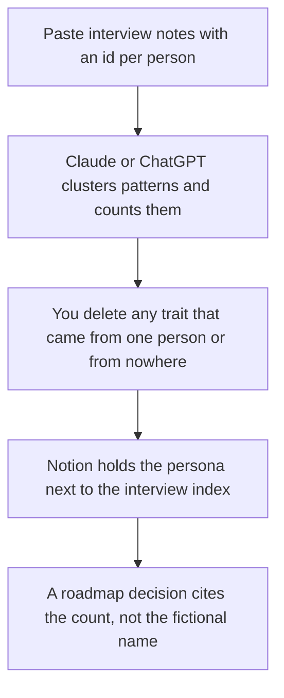

**A user persona written with AI is a one-page composite of patterns in interviews you actually ran, with a count of how many people said each line.** The model can cluster notes. It cannot invent a quote, an age, a city, or a job title to make the page feel specific. If only one person said it, the page says one person. A persona without the interviews under it is a character, and a character is a poor guide for a roadmap.

The questions you ask before any persona exists are [how to create a user interview guide with AI](/blog/how-to-create-a-user-interview-guide-with-ai-2026/). The notes from those calls are [how to use AI for user interview notes](/blog/how-to-use-ai-for-user-interview-notes-2026/). A product feature that changes per user is a different word: [what AI personalization is](/blog/what-is-ai-personalization-2026/).

Prices are US list prices excluding tax from directory pages checked October 16, 2026. Published October 24, 2026. We did not score research quality. A persona is not a segment size.

## What the page is allowed to claim

| Block | Write it from | Leave it off the page |
|---|---|---|
| Who | The role words participants used, plus how many interviews | A name, a photo, and an age you made up |
| Job to be done | Tasks that showed up in more than one interview | A motivational slogan |
| Trigger | What they said prompted the search | A funnel stage they did not mention |
| Friction | Frictions you heard, with a count | A competitor dig you wanted |
| Quote | A line you have permission to use, or a paraphrase labeled as one | A punchy line nobody said |
| Not them | Who you did not interview | A claim about "the market" |

A persona named "Marketing Mary, 34, Austin" with no interviews behind the city is [a hallucination](/blog/what-is-ai-hallucination-2026/) in a planning doc. The check is [how to fact-check AI writing](/blog/how-to-fact-check-ai-writing-2026/).

## Where the notes and the page happen

**The cluster.** [Claude](/tools/claude/) Pro is $20 a month, or $17 billed annually, when the notes are long. The directory lists a context window up to 1 million tokens depending on the model. That is capacity, not insight. [ChatGPT](/tools/chatgpt/) Plus at $20 holds the notes in a Project if that is your team's habit. Business is $20 a user a month billed annually, minimum two, when the notes are confidential. The container is [Claude Projects vs ChatGPT Projects](/blog/claude-projects-vs-chatgpt-projects-2026/).

**The page the team will cite.** [Notion AI](/tools/notion-ai/) Business is $20 a seat a month. Link each pattern to interview ids. A persona that cannot be clicked back to a note will be embellished in the next meeting. The invoice is [Notion AI pricing explained](/blog/notion-ai-pricing-explained-2026/).

**Notes without a bot in a research call.** [Granola](/tools/granola/) Basic is free with 30 days of history. Business is $14 a user a month when the study will outlast that window. Consent still applies. The interview comparison is [Otter vs Granola for interviews](/blog/otter-vs-granola-for-interviews-2026/).

**A transcript, if the participant agreed to a bot.** [Otter](/tools/otter-ai/) Pro is $8.33 a user a month billed annually, or $16.99 monthly, and raises the free 30-minute conversation cap. The invoice is [Otter pricing explained](/blog/otter-ai-pricing-explained-2026/).

A prompt that holds the line:

"Cluster these interview notes into one persona. For each trait, give the count of interview ids that support it. If a trait appears once, put it in a footnote, not the headline. Do not invent a name, age, city, salary, or quote. If I did not paste a job title, write Title not stated."

The person who approves the page is [what human-in-the-loop AI is](/blog/what-is-human-in-the-loop-ai-2026/).

## How many interviews, said plainly

Two interviews can produce a hypothesis. They cannot produce a persona you should build a quarter around. Say the sample in the first line: "Patterns from 8 interviews in March 2026, all current customers, none of them administrators." A model that hides the sample is hiding the limit. Add the people you failed to reach under "Not them," so the page does not pretend to be universal.

Recruiting interviews are a different composite. Do not turn a hiring loop into a user persona. The scorecard workflow is [how to create interview scorecards with AI](/blog/how-to-create-interview-scorecards-with-ai-2026/).

## FAQ

### Should the persona have a name and a photo?

Only if your team understands the name is a label and the photo is not a participant. Many teams skip both. A name makes people treat fiction as memory. A role plus a count is harder to misuse.

### Can AI write the persona from analytics instead of interviews?

It can summarize a table you paste: feature use, plan, region. Label that page as a behavioral segment, not as a persona. A segment does not have a quote. Do not ask the model to imagine why the numbers moved.

### How often do we refresh it?

When you have run enough new interviews to change a count, or when the product's buyer changed. A persona from last year's launch is a risk if the users now are administrators and the page still says end users. Put a date on the page.

### Can we put the persona in a prompt so the model "writes as" them?

You can, and you should expect the copy to inherit every fiction you left in the page. Prefer pasting the real constraints: role, friction, and a quote you can stand behind. The brand voice, if you need one, is a separate document.

## Last verified

October 16, 2026 for Claude, ChatGPT, Notion, Granola, and Otter. Otter's checkout may differ from the list price because of promotions recorded that day. Published October 24, 2026.

**Sources:** [Claude pricing](https://claude.com/pricing), [ChatGPT pricing](https://chatgpt.com/pricing/), [Notion pricing](https://www.notion.com/pricing).

*Published by Andrew for [AI Tools Optimizer](https://aitoolsoptimizer.com).*

[Notion AI](/tools/notion-ai/) is in the [productivity and notes directory](/tools/category/productivity-notes/). Directory pages may use affiliate links. A purchase through them may earn us a commission at no extra cost to you.
