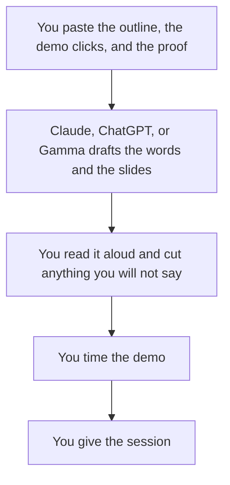

**A webinar script written with AI is your outline, your demo beats, and your call to action, in sentences you are willing to say out loud.** The model can smooth a transition. It cannot know the product well enough to invent a feature on stage. Paste the beats. Cut every claim that is not in your notes.

What you do with the recording afterward is a different job: [how to repurpose a webinar with AI](/blog/how-to-repurpose-a-webinar-with-ai-2026/). The slides, if a deck is the visual, start from [best AI presentation makers](/blog/best-ai-presentation-makers/). The fact pass is [how to fact-check AI writing](/blog/how-to-fact-check-ai-writing-2026/).

Prices are US list prices excluding tax from directory pages checked October 16, 2026. Published October 24, 2026. We did not score scripts.

## What the model may touch

| Beat | You provide | The model may |
|---|---|---|
| Promise | The one sentence the session will deliver | Shorten it. It may not widen the promise |
| Outline | The sections, in order | Add a transition. It may not add a section |
| Demo | The clicks you will really do | Write the words between the clicks. It may not add a click |
| Proof | A number or a customer line you can show | Place it. It may not estimate a result |
| Time | The minutes you have | Mark a cut. It may not pretend a 40-minute demo fits in 12 |
| Ask | The next step, in your words | Make it visible. It may not invent an offer |

A script that says "and then the AI magically builds the dashboard" will strand you on a loading spinner. Write the click. If the click is slow, write the sentence you will say while it loads.

## Where the draft happens

**The words.** [Claude](/tools/claude/) Pro is $20 a month, or $17 billed annually. Put the outline and one transcript you liked, with names removed, in a Project. [ChatGPT](/tools/chatgpt/) Plus is $20. Go at $8 can format a short outline. The container is [Claude Projects vs ChatGPT Projects](/blog/claude-projects-vs-chatgpt-projects-2026/). The ladder is [ChatGPT Go vs Plus vs Pro](/blog/chatgpt-go-vs-plus-vs-pro-2026/).

**The slides.** [Gamma](/tools/gamma/) Plus is $9 a seat a month, or $108 a year, with 1,000 credits. Free credits do not refresh. Build the deck from the approved outline, not from a vaguer prompt than the script. The card is [Gamma pricing explained](/blog/gamma-pricing-explained-2026/). If the deck should match a template library you already use, [Canva](/tools/canva/) Pro is $180 a year for one person. The comparison is [Gamma vs Canva for presentations](/blog/gamma-vs-canva-presentations/).

**The recording, after the session, if you will edit the audio.** [Descript](/tools/descript/) Hobbyist is $16 a person a month billed annually. Free includes 60 media minutes a month. Edit the recording you made. Do not replace the live script with a synthetic host unless you meant to. The card is [Descript pricing explained](/blog/descript-pricing-explained-2026/).

**A voiceover, if the webinar is recorded and the voice is licensed.** [ElevenLabs](/tools/elevenlabs/) Starter is $6 a month. The free plan includes 10,000 credits a month and does not include a commercial license, on the directory card. A company session needs a plan that allows the use. The card is [ElevenLabs pricing explained](/blog/elevenlabs-pricing-explained-2026/).

A prompt that holds the line:

"Here is a 30-minute webinar outline with demo clicks and one proof point. Write a script with approximate timings. Do not add features, statistics, or customer stories that are not in the notes. Mark any beat that will run long. Keep the call to action in my words."

The terms you must say the same way every time belong in [how to create a style guide with AI](/blog/how-to-create-a-style-guide-with-ai-2026/).

## Rehearse the gaps

Read the script once out loud. Time the demo on the real product, not on a slide that pretends the product already finished. Cut a section before you cut the ask. A host who will say the words should be the person who edits them. That person is [what human-in-the-loop AI is](/blog/what-is-human-in-the-loop-ai-2026/).

If the session is also a sales pitch, the claims still have to match what you can deliver. An RFP-sized promise does not belong in a webinar aside. The stricter workflow is [how to write an RFP response with AI](/blog/how-to-write-a-rfp-response-with-ai-2026/).

Afterward, the clips and the post are the repurpose article linked above. Social lines cut from the same outline are [how to create social posts from a blog with AI](/blog/how-to-create-social-posts-from-a-blog-with-ai-2026/), and the same rule applies: do not add a result the session did not state.

## FAQ

### Can AI host the webinar?

A synthetic voice can read a recorded script if the license and the disclosure are settled. A live room usually wants a person who can answer a question that is not on the page. Use the model for the draft. Keep a human on the live answers.

### How long should the script be?

Short enough that you can say it in the slot, with time left for questions. A 30-minute session with a demo often has less talking time than the outline suggests. The timer wins.

### What if we do not have a proof point?

Leave the proof section out. A model asked for "a concrete result" will invent a percentage. The absence is better than a fake 30%.

### Should the slides and the script be generated together?

Generate the outline first, in your words. Then the script. Then the slides from the script. One prompt that does all three will improvise the demo.

## Last verified

October 16, 2026 for Claude, ChatGPT, Gamma, Canva, Descript, and ElevenLabs prices named above. Published October 24, 2026.

**Sources:** [Claude pricing](https://claude.com/pricing), [Gamma pricing](https://gamma.app), [ElevenLabs](https://elevenlabs.io).

*Published by Andrew for [AI Tools Optimizer](https://aitoolsoptimizer.com).*

[Gamma](/tools/gamma/) is in the [presentations directory](/tools/category/presentations/). Directory pages may use affiliate links. A purchase through them may earn us a commission at no extra cost to you.
