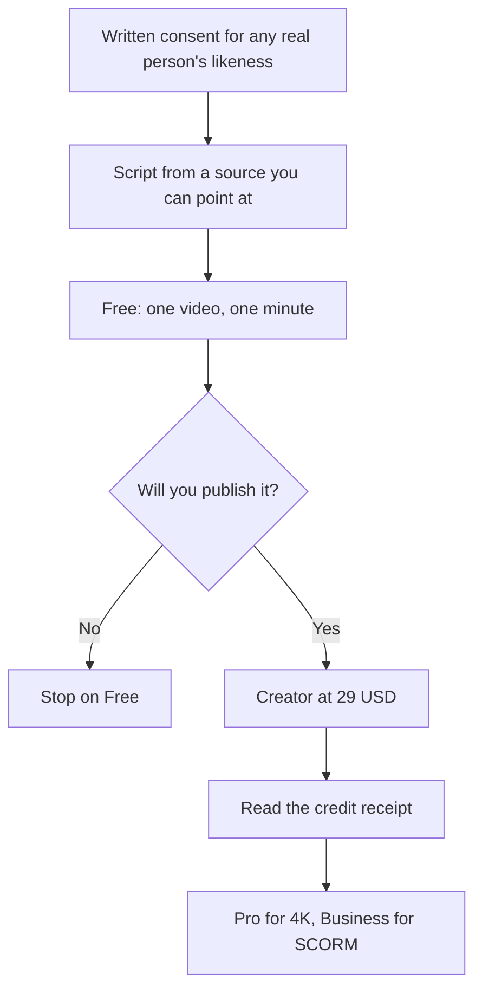

**Create the HeyGen avatar on the free plan, and pay for Creator only when the file has to ship at 1080p without a watermark.** Free includes one custom video avatar, Avatar IV, and 3 videos a month of up to 1 minute, in 30+ languages. Creator at $29 a month is the plan that adds 1080p, watermark removal, voice cloning, videos up to 30 minutes, and 175+ languages, with 600 credits.

Prices are US monthly list prices recorded October 16, 2026. The bill, including why we do not invent a credits-per-minute rate, is [HeyGen pricing explained](/blog/heygen-pricing-explained-2026/). The review is [HeyGen review](/blog/heygen-review-2026/). We did not score likeness quality.

## What you are allowed to make on each plan

| Step | Plan | Limit that matters |
|---|---|---|
| See if a stock or custom avatar is acceptable | Free, $0 | 3 videos, 1 minute, 1 custom video avatar, 30+ languages |
| Publish 1080p, clone a voice, go past one minute | Creator, $29 | 600 credits, 30-minute cap, watermark off, 175+ languages |
| Deliver 4K | Pro, $49 | 1,000 credits |
| SCORM, SSO, or a 60-minute file | Business, $149 | 1,500 credits, 5 custom video avatars, extra seats $20/month |

HeyGen and [Synthesia](/tools/synthesia/) split by buyer. The comparison is [HeyGen vs Synthesia](/blog/heygen-vs-synthesia-2026/). A Synthesia training workflow, which is the other script-to-presenter path, is [how to make training videos with Synthesia](/blog/how-to-make-training-videos-with-synthesia-2026/).

## Step 1: Decide whose face this is

A stock avatar needs no one's permission beyond HeyGen's terms. A custom avatar built from a clip or a photo is a person's likeness. Get consent that says where the avatar will appear and how long you will use it. An employee avatar needs an answer for the day they leave. Business includes 5 custom video avatars. The count is not a substitute for consent.

Do not upload a celebrity, a customer, or a coworker who has not agreed. The product will not supply that agreement.

If the "avatar" is only a voice, stop. [ElevenLabs](/tools/elevenlabs/) Starter at $6 a month includes a commercial license for speech. Professional voice cloning starts at Creator, $22 a month. The steps for a voice are [how to clone a voice with ElevenLabs](/blog/how-to-clone-a-voice-with-elevenlabs/).

## Step 2: Write a one-minute script you can check

The free test is one minute. Use it on the real message, not on "hello, this is a test." Include one fact a viewer might repeat: a price, a date, a policy. You will watch to see whether the avatar says that fact as written.

Keep sentences short. Names and numbers are where generated speech slips. Rewrite the sentence instead of expecting a slider to fix a tongue-twister. If you draft the script in [ChatGPT](/tools/chatgpt/) or [Claude](/tools/claude/), paste only claims you already verified. Plus and Pro are both $20 a month on the monthly list. The writing rule is [how to write a blog post with Claude](/blog/how-to-write-a-blog-post-with-claude-2026/).

## Step 3: Run the free test, then watch it once with the script

Generate with a stock avatar and, if you have consent, with the custom avatar. Free allows one custom video avatar. Compare them on the same script. Reject the format if the avatar distracts from the fact you needed the viewer to hear.

Thirty or more languages are on Free. Creator lists 175+ languages and dialects. You do not need Business to translate a marketing clip. You need Business when the file must be 60 minutes or must enter an LMS.

Disclose a synthetic presenter when the channel, the employer, or the audience requires it. Put the disclosure in the video or the description, not only in an internal brief.

## Step 4: Upgrade from the receipt, not from the feature grid

Creator at $29 is the default publish plan: 1080p, no watermark, voice cloning, longer videos, 600 credits. Make one real video. Read how many credits it used. That number, divided into 600, is your monthly volume for that kind of video. HeyGen did not publish a single minutes-per-credit rate on the summary we used. Your receipt is the rate.

Move to Pro at $49 when the export must be 4K or the 600-credit month ran out. Move to Business at $149 when someone asked for SCORM, SSO, or a video longer than 30 minutes. Extra seats are $20 a month. A collaborator who only reviews does not automatically need that seat. Check the role before you add them.

Yearly billing exists, and Creator's yearly option is where credit rollover was listed. Stay on monthly until the second shipped video. Then read the yearly price in the account.

## Step 5: Leave HeyGen when the job is not an avatar

| Job | Tool |
|---|---|
| Cut an interview you filmed | [Descript](/tools/descript/) or [CapCut](/tools/capcut/) |
| A thumbnail or a title card | [Canva](/tools/canva/). Pro is $18/month or $180/year |
| Generated b-roll, not a presenter | [Runway](/tools/runway/) or another generator in [best AI video generators](/blog/best-ai-video-generators-2026/) |
| A course that must be a company standard with Brand Kits and unlimited minutes | Synthesia Enterprise, which is custom. Price it against HeyGen Business before you book the call |

## FAQ

### Can I create a HeyGen avatar for free?

Yes. Free includes one custom video avatar and 3 videos a month, up to 1 minute, with a narrower language list than Creator. Publishing a clean 1080p file is the $29 Creator plan.

### Does voice cloning cost extra?

Voice cloning is included from Creator on the page we checked. It does not include the right to clone a voice you do not have permission to use.

### How many credits does one video use?

HeyGen's plan summary gives allowances, not a universal per-minute rate. Generate one video and read the receipt. Creator includes 600 credits. Pro includes 1,000. Business includes 1,500.

### Is HeyGen or Synthesia better for avatars?

HeyGen Creator is the self-serve path for a custom avatar, 1080p, and a long language list at $29. Synthesia is the path when Enterprise controls, an LMS package, and a brand kit are the purchase. Use the comparison linked above if both are in the room.

## Last verified

October 16, 2026 for plan prices, video caps, and which features start on Creator and Business. Published October 24, 2026.

**Sources:** [HeyGen pricing](https://www.heygen.com/pricing), [Synthesia pricing](https://www.synthesia.io/pricing).

[HeyGen](/tools/heygen/) is in the [video directory](/tools/category/video/). Directory pages may use affiliate links. A purchase through them may earn us a commission at no extra cost to you.
