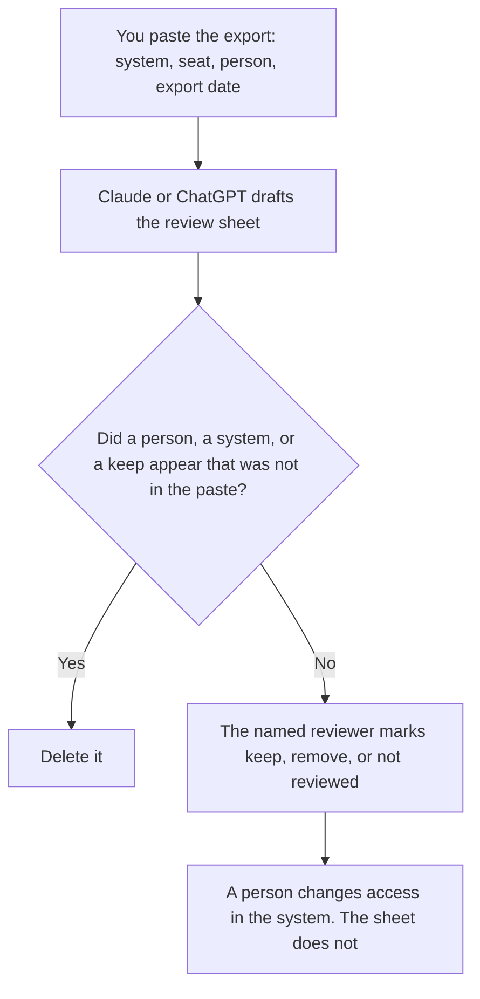

**An AI access review written with AI is a draft that lists each seat a person already exported, the person on it, the system, and whether a named reviewer still approves that seat.** The model may order the rows. It may not revoke a seat, invent a user, or mark a row approved because the account looks active. The list of tools a workflow may call is [what an AI tool allowlist is](/blog/what-is-ai-tool-allowlist-2026/). How long the prompt is kept is [what an AI data retention policy is](/blog/what-is-ai-data-retention-policy-2026/). The note you file about that retention choice is [how to write a data retention note for AI with AI](/blog/how-to-write-a-data-retention-note-for-ai-with-ai-2026/).

This page is not a security audit. It is the review sheet. A person still decides.

Claude's prices are from claude.com/pricing on October 24, 2026. Notion's price is from the directory page checked October 16, 2026. ChatGPT's Plus price is from learn.chatgpt.com/docs/pricing on October 24. Zapier's prices are from the directory checked October 16. A live fetch of Zapier's pricing page returned HTTP 401 on October 24, so that figure stays on the directory record. Published October 24, 2026. We did not test access controls.

## What the review is allowed to say

| Column | Who fills it | The model may |
|---|---|---|
| System and seat | You, from an export | Copy it. It may not add a system it "usually" sees |
| Person | You | Copy the name. A blank stays Person not on the export |
| Reviewer decision | The reviewer | Leave it blank until they write keep, remove, or not reviewed |
| Date of the export | You | Copy it. It may not use today's date as if it were the export |

A row that says "likely still needed" is not a decision. Not reviewed is an honest cell. Remove is a decision a person will carry out in the admin tool, not in the chat. Keep is a decision with a date. An old export is not a current directory. Write the export date on the sheet.

## Where it is drafted

**The draft.** [Claude](/tools/claude/) Pro is $17 a month billed annually, $200 up front, or $20 monthly. Keep the column names in a Project so the next quarter's review matches. The review is [Claude review](/blog/claude-review-2026/).

**The sheet the next reviewer opens.** [Notion AI](/tools/notion-ai/) Business is $20 a seat a month. One row per seat. Plus at $10 is not the full AI tier. The invoice is [Notion AI pricing explained](/blog/notion-ai-pricing-explained-2026/).

**One sheet from a short export.** [ChatGPT](/tools/chatgpt/) Plus is $20 a month. Discard a version that fills the decision column. The ladder is [ChatGPT pricing explained](/blog/chatgpt-pricing-explained-2026/).

**A notification after a person marks remove, if you already have that Zap.** [Zapier](/tools/zapier/) Professional is $19.99 a month billed annually, with 750 tasks, on the October 16 card. The Zap tells a person. It does not remove the seat unless you built that action on purpose and own the consequence. The invoice is [Zapier pricing explained](/blog/zapier-pricing-explained-2026/).

A prompt that holds the line:

"Draft the access review from the export I pasted. Leave the decision column as Not reviewed. If a person is missing, write Person not on the export. Do not add a seat. Do not mark keep or remove."

## What not to delegate

Do not ask which seats are safe to delete. Do not paste passwords or recovery codes into the chat to "complete the export." Do not treat a formatted sheet as a completed review. The named reviewer marks the row. An admin changes the seat in the system that owns it.

## FAQ

### How is this different from an allowlist?

The allowlist says which tools a workflow may call. The access review says which people still have seats in the systems you listed. A tool can be allowed while a person who left still has a seat. A person can be correct on the review while a tool is off the allowlist. They are different lists. Review both on the cadence you wrote down.

### How is this different from a retention note?

The retention note says how long prompts and files are kept, in words a person already chose. The access review says who can open the system. Deleting a seat does not delete retained data. Shortening retention does not remove a seat. Do not let one document imply the other is done.

### How is this different from a rollout plan?

A rollout plan says how you introduce a tool. An access review says who still has it, after it exists. The first review should be on the calendar before the rollout is called done. The plan does not substitute for the export.

### Who may mark a seat remove?

The reviewer your process names, in the system that owns the seat, after they write remove on the row. The model must not mark remove. A Zap must not be the only place the removal happens unless that action is the one you tested and own. Not reviewed stays not reviewed until a person sees the row.

## Last verified

October 24, 2026 for Claude and for ChatGPT's plan page. October 16, 2026 for Notion and Zapier. Published October 24, 2026. Zapier's pricing page returned HTTP 401 on October 24.

**Sources:** [Claude pricing](https://claude.com/pricing), [Notion pricing](https://www.notion.com/pricing), [ChatGPT and Codex pricing](https://learn.chatgpt.com/docs/pricing), [Zapier pricing guide](https://zapier.com/blog/zapier-pricing/).

*Published by Andrew for [AI Tools Optimizer](https://aitoolsoptimizer.com).*

[Claude](/tools/claude/) is in the [chatbots and assistants directory](/tools/category/chatbots-assistants/). Directory pages may use affiliate links. A purchase through them may earn us a commission at no extra cost to you.
