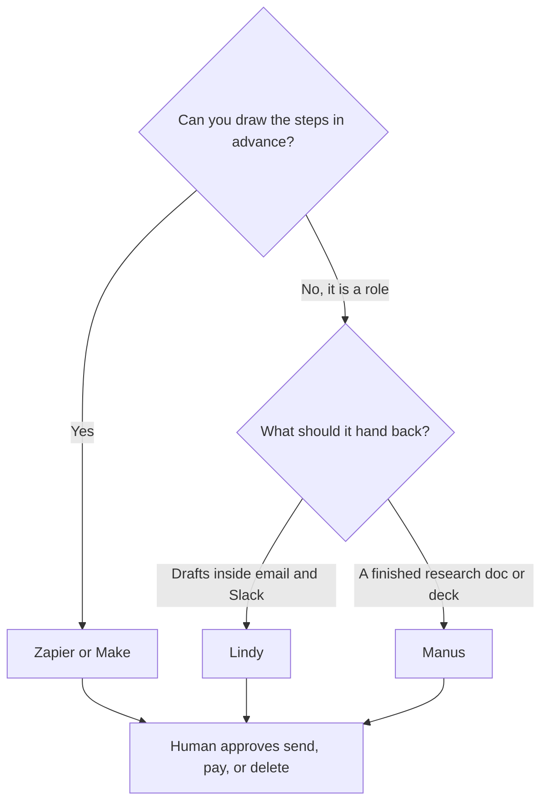

**An AI agent without code is a job description plus a tool that can touch your apps.** Start with one repeating task, connect it read-only, and make a person approve anything that sends, pays, or deletes. [Lindy](/tools/lindy/) and [Manus](/tools/manus/) are agent products. [Zapier](/tools/zapier/) and [Make](/tools/make/) are workflow products that can call a model in the middle. Pick the shape before you pick the brand.

Prices are US list prices, last verified October 16, 2026. [n8n](/tools/n8n/)'s cloud price was shown to us in euros, so it stays in euros. We did not score how often these agents finish a task correctly. The steps below are a setup order. They are not a guarantee the agent will be right.

## Which product matches the job

| The job | Open this | Price to know |
|---|---|---|
| "Watch this inbox and draft the reply" | [Lindy](/tools/lindy/) | $50 in credits for 7 days, no card. Team starts at $49.99/month for 5,000 credits |
| "Research this and hand me a doc, a site, or slides" | [Manus](/tools/manus/) | Free includes 300 refresh credits a day. Pro starts at $20/month for 4,000 credits |
| "When a form arrives, file it and draft a summary" | [Zapier](/tools/zapier/) or [Make](/tools/make/) | Zapier Free is 100 tasks/month. Make Free is 1,000 credits/month, no card |
| A customer-facing bot on your help center | A support product, not a personal agent | See [AI chatbots for business](/blog/best-ai-chatbots-for-business-2026/) |
| An agent that runs inside a wiki you already use | [Notion AI](/tools/notion-ai/) Custom Agents | Business is $20/seat/month. Credits are $10 per 1,000 after a trial |
| A coded agent in a repository | Stop. This guide is the wrong shape | [Cursor vs Claude Code vs Codex](/blog/cursor-vs-claude-code-vs-codex-2026/) |

The comparison of the workflow tools is [Zapier vs Make vs n8n](/blog/zapier-vs-make-vs-n8n/). A build-along for the two visual tools is [how to automate work with Zapier and Make](/blog/how-to-automate-work-with-zapier-and-make/). Manus as a product is the [Manus review](/blog/manus-ai-review-2026/). The category hub is [automation and agents](/tools/category/automation-agents/).

## Step 1: Write the job on one page

Use four lines.

- **Trigger.** What starts the work. A new email, a weekday morning, a link you paste.
- **Inputs.** Which apps it may read. Name them.
- **Output.** A draft in a doc, a row in a sheet, or a Slack message to you. Not a message to the customer, yet.
- **Never.** It does not send email to customers, spend money, delete records, or change a password.

If you cannot fill in "never," you are not ready to connect an account.

## Step 2: Pick the product that matches the shape

**Fixed steps.** Use Zapier or Make. A Zap or a scenario is auditable: you can point at each module. Add the model last, after the row lands in the right place with no model at all. The how-to guide walks a form-to-sheet example and counts tasks and credits. Professional Zapier is $19.99/month billed annually for 750 tasks. Make Core starts at $9/month billed annually for 10,000 credits. Filters, Paths, and Formatter on Zapier do not count as tasks. On Make, routers and error handlers do not spend credits, and most other module actions spend about one.

**A role, not a flowchart.** Use Lindy. You describe the teammate, connect tools, and it runs routines such as inbox triage or a weekly report. The free grant is $50 in credits and it expires after 7 days. No card. Team at $49.99/month pools 5,000 credits. Top-ups are $10 per 1,000 credits. Computer use is on Team, which is how it touches sites that have no integration. That is also how it can do something you did not intend. Keep computer use off until the email draft looks right.

**A deliverable from a goal.** Use Manus. Free is 300 refresh credits a day plus Chat Mode. Pro from $20/month includes 4,000 credits, with a $40 tier at 8,000 credits and a 7-day trial on that tier. Annual billing saves 17%. Ask for a research memo or a slide draft. Read every citation before you forward it. The [Manus review](/blog/manus-ai-review-2026/) covers the credit tiers. Wide Research and a 20-task schedule are Pro features. A first agent does not need them.

**A platform with no free plan.** [Relevance AI](/tools/relevance-ai/) retired its free plan. Pro is $19/month billed annually or $29 monthly, with 2,500 actions a month and $20 a month in vendor credits. Team is $234/month annual. Use Relevance when you are building agent workflows for a company and you already know you will pay. It is a poor first afternoon.

**A custom GPT.** [ChatGPT](/tools/chatgpt/) Plus at $20/month can store instructions and files in a custom GPT. That is a reusable prompt with tools, not an unattended agent in your inbox. It is the right object when the "agent" is a writing format. It is the wrong object when the agent must run while you are offline. Business, at $20/user/month annual, is the workspace version with admin controls.

## Step 3: Connect read-only, then run ten real items

1. Connect the account with the smallest permission that still lets the agent read. If the vendor offers a send scope and a read scope, use read.
2. Point the output at yourself: your email, a private Slack channel, or a doc only you can see.
3. Run ten real inputs, not a demo sentence. Save the failures.
4. Count credits, tasks, or actions for those ten. Multiply by how many times the job happens in a month.
5. Fix the instructions where the same mistake appeared twice. A second tool will not fix a vague "never."

On Lindy, ten inbox drafts may fit inside the $50 trial if you do them in the first week. The credits expire after 7 days, so do not start the trial on a Friday you will not open the laptop.

On Manus, ten small research tasks are what the 300 daily credits are for. A single "research the whole market and build the site" task can spend a large share of a Pro month. Start smaller than the demo videos.

On Zapier, a three-action Zap on 100 runs is 300 tasks. Free stops at 100 tasks. Do the multiplication before you call the free plan enough. The same arithmetic is in the Zapier and Make guide.

## Step 4: Add one action a human still approves

When the ten drafts are acceptable, allow one outbound step that waits. Examples: a Slack message to you with an Approve button, a draft saved in the email tool, a row marked "ready" that you send yourself.

Skip this step and the agent will eventually mail the wrong person. The tools will do what the connection allows. Approval is your configuration, not a default you should assume.

Lindy Enterprise adds HIPAA with a BAA, SSO, and audit logs. That is a procurement conversation, not part of the first build. Manus Team starts at $20 per seat per month and adds usage analytics. Zapier Team at $69/month annual is shared admin, not a smarter model.

## What to leave for later

- **n8n**, if a developer will self-host. Community Edition is free. Cloud Starter was €20/month billed annually in the currency we were shown. See the [n8n review](/blog/n8n-cloud-review-2026/).
- **Notion Custom Agents**, if the work already lives in Notion. They bill at $10 per 1,000 credits after a trial, on top of Business seats. See the [Notion AI review](/blog/notion-ai-review-2026/).
- **A coding agent**, if the task is a repository. No-code agents are the wrong tool for a pull request.

## FAQ

### Can I build an AI agent with no coding?

Yes. Lindy, Manus, Zapier, and Make all run from a browser. You still write the job, the limits, and the approval step. Those are the parts that decide whether it is safe to leave on.

### What is the cheapest way to try one?

Manus Free includes 300 refresh credits a day. Make Free includes 1,000 credits a month with no card. Lindy's $50 credit grant lasts 7 days and does not need a card. Zapier Free includes 100 tasks a month. Use the one whose shape matches the job, not the one with the largest free number.

### Should the agent send email on day one?

No. Have it draft, and send the draft to you. Turn on customer-facing sends only after you have reviewed a batch you would have been willing to send unchanged.

## Last verified

October 16, 2026. Credit grants and first-month offers change. Recheck the pricing page before you put a card down.

**Sources:** [Lindy pricing](https://www.lindy.ai/pricing), [Manus pricing](https://manus.im/pricing), [Zapier pricing](https://zapier.com/pricing), [Make pricing](https://www.make.com/en/pricing), [Relevance AI pricing](https://relevanceai.com/pricing), [ChatGPT pricing](https://chatgpt.com/pricing/), [Notion pricing](https://www.notion.com/pricing).

Directory pages for [Lindy](/tools/lindy/), [Manus](/tools/manus/), [Zapier](/tools/zapier/), and [Make](/tools/make/) may include affiliate links. A purchase through them may earn us a commission at no extra cost to you.
