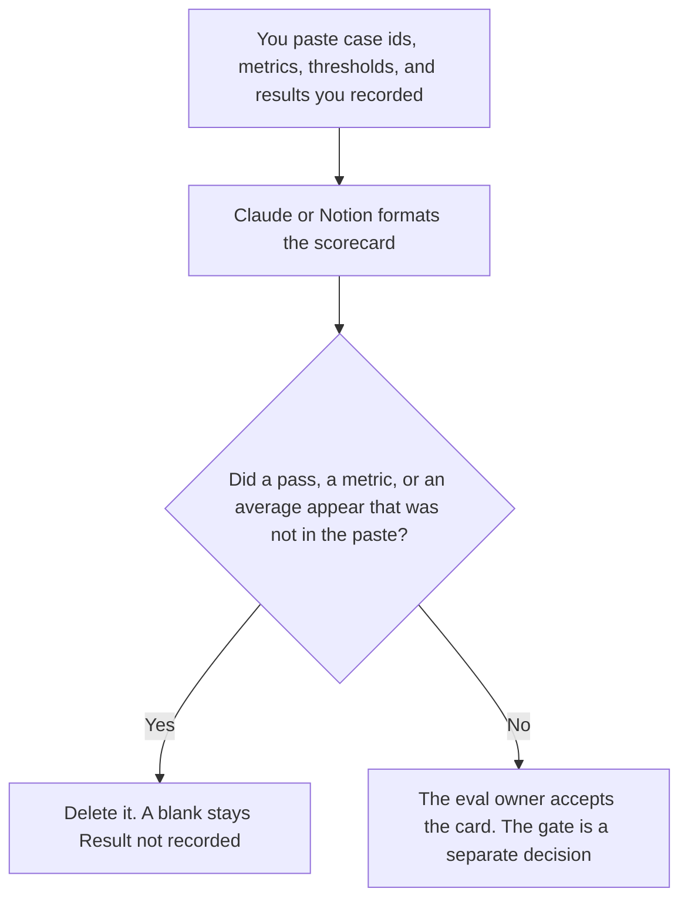

**An AI eval scorecard created with AI is a table of cases you already ran, with metrics you already named, filled only from results a person recorded.** The model may align the columns. It may not mark a case passed, average a blank, or add a metric. The retrieval-specific card is [how to create a RAG eval scorecard with AI](/blog/how-to-create-a-rag-eval-scorecard-with-ai-2026/). This page is any eval you are willing to show, including one that is not a search system.

The line a metric must meet is [what an AI eval pass threshold is](/blog/what-is-ai-eval-pass-threshold-2026/). The small set you run before the rest is [what an AI eval canary slice is](/blog/what-is-ai-eval-canary-slice-2026/). The rows you keep are [what an AI eval dataset is](/blog/what-is-ai-eval-dataset-2026/).

Claude's prices are the October 24, 2026 read of claude.com/pricing recorded in [Claude pricing explained](/blog/claude-pricing-explained-2026/). Notion is the October 16 directory card. ChatGPT's Plus price is the October 24 plan-page figure recorded in [ChatGPT pricing explained](/blog/chatgpt-pricing-explained-2026/). Cursor's Plus price is the October 24 help-center figure recorded in [Cursor pricing explained](/blog/cursor-pricing-explained-2026/). Published October 24, 2026. We did not run an eval for this article. We did not publish a pass rate.

## What the card is allowed to show

| Column | Who owns it | The model may |
|---|---|---|
| The case id | You | Copy it. It may not add a case |
| The metric | You, or Metric not set | Copy the name. It may not invent "quality" |
| The threshold | You, or Threshold not set | Copy the line. It may not choose 0.8 |
| The result | You, from a run you did, or Result not recorded | Copy it. It may not grade the output |
| The owner | You | Copy the name |

A RAG scorecard cares whether the passage and the citation were the ones you allowed. This card can include that metric if you already recorded it, and it can include a formatting check, a tool-call count, or a safety label you already wrote down. The model does not decide that "helpfulness" is a column. If you want that column, you name it and you record the result.

A canary slice is which cases run first. The scorecard is the table after a run. A green slice is not a full card. A card with Result not recorded on a row is an honest card. Averaging the filled rows and ignoring the blanks is a different number than the one you ran.

The gate that blocks a release is not this table. The table can show that a threshold was missed. A person still decides the gate. The short description of a model you might attach is [how to create a model card summary with AI](/blog/how-to-create-a-model-card-summary-with-ai-2026/). The summary does not replace the results.

## Where the card is filled

**The judgments, in words.** [Claude](/tools/claude/) Pro is $17 a month billed annually, $200 up front, or $20 monthly. Keep the threshold sentence in a Project so a later card does not soften a miss. The review is [Claude review](/blog/claude-review-2026/).

**The table the team opens.** [Notion AI](/tools/notion-ai/) Business is $20 a seat a month. One row per case. Plus at $10 is not the full AI tier. The invoice is [Notion AI pricing explained](/blog/notion-ai-pricing-explained-2026/).

**One table from a paste.** [ChatGPT](/tools/chatgpt/) Plus is $20 a month. Discard a version that writes Pass on an empty result. The ladder is [ChatGPT pricing explained](/blog/chatgpt-pricing-explained-2026/).

**The diff, if the cases live next to the code.** [Cursor](/tools/cursor/) Plus is $8 a month, or $80 a year. You review a change that deletes a failing row. The individual ladder is [Cursor pricing explained](/blog/cursor-pricing-explained-2026/).

A prompt that holds the line:

"Build the scorecard from the case ids, metrics, thresholds, and results I pasted. If a result is missing, write Result not recorded. Do not mark a pass. Do not average the blanks. Do not add a metric."

## What not to delegate

Do not ask the model to grade the outputs. Do not drop a row to raise the average. Do not call the card a release decision. The eval owner accepts the table. The gate owner, if you have one, reads it after that.

## FAQ

### How is this different from a RAG eval scorecard?

That page is for cases about retrieval: passages, citations, and judgments on those. This page is the general card. A RAG result can be one metric here if you recorded it. A formatting result does not belong on the RAG page unless you put it there on purpose.

### How is this different from a pass threshold?

The threshold is the line. The scorecard is the table that shows the result next to that line. A threshold with no results is a rule you have not applied. A card with no threshold can still show what you recorded. It cannot say the run passed.

### How is this different from a canary slice?

The slice is the small set you run first. The scorecard can have a column for those cases, or it can be the full run. Passing the slice does not fill the other rows. Result not recorded stays on the rows you did not run.

### Who may mark a pass?

A person, using the threshold they wrote, on a result they recorded. The model may copy a pass you already wrote down. It may not create one. A full table is not a pass.

## Last verified

October 24, 2026 for Claude, ChatGPT's plan page, and Cursor's help page, via the posts cited above. October 16, 2026 for Notion. Published October 24, 2026. We did not publish a pass rate.

**Sources:** [Claude pricing](https://claude.com/pricing), [Notion pricing](https://www.notion.com/pricing), [ChatGPT and Codex pricing](https://learn.chatgpt.com/docs/pricing), [Cursor pricing](https://cursor.com/help/account-and-billing/pricing).

*Published by Andrew for [AI Tools Optimizer](https://aitoolsoptimizer.com).*

[Claude](/tools/claude/) is in the [chatbots and assistants directory](/tools/category/chatbots-assistants/). Directory pages may use affiliate links. A purchase through them may earn us a commission at no extra cost to you.
