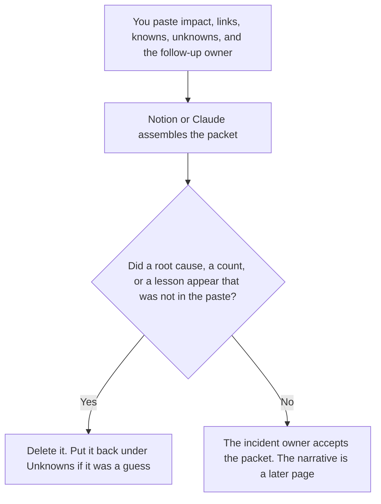

**An AI incident postmortem created with AI is a packet: the impact you already accepted, links to the timeline and the logs, the knowns, the unknowns, and the follow-up owner.** The model may list those fields. It may not turn an unknown into a root cause, a customer count, or a lesson. The prose document, written after this packet exists, is [how to write an AI incident postmortem with AI](/blog/how-to-write-an-ai-incident-postmortem-with-ai-2026/).

The chronological list is [how to write an incident timeline with AI](/blog/how-to-write-an-incident-timeline-with-ai-2026/). The hour of the event is [what AI incident response is](/blog/what-is-ai-incident-response-2026/). The conditions that should have stopped an agent are [what an AI agent escalation policy is](/blog/what-is-ai-agent-escalation-policy-2026/).

Notion is the October 16, 2026 directory card. Claude's prices are the October 24 read of claude.com/pricing recorded in [Claude pricing explained](/blog/claude-pricing-explained-2026/). Cursor's Plus price is the October 24 help-center figure recorded in [Cursor pricing explained](/blog/cursor-pricing-explained-2026/). ChatGPT's Plus price is the October 24 plan-page figure recorded in [ChatGPT pricing explained](/blog/chatgpt-pricing-explained-2026/). Published October 24, 2026. We did not score incidents.

## What the packet contains

| Field | Who owns it | The model may |
|---|---|---|
| Impact | You, or Impact not set | Copy it. It may not estimate a customer count |
| Timeline link | You, or Timeline not linked | Link it. It may not write a new chronology |
| Knowns | You | Copy them |
| Unknowns | You, and they stay unknown | List them. It may not resolve one |
| Follow-up owner | You, or Owner not set | Copy the name. It may not assign a team |

The write-up page is allowed to order a story once a person is willing to call a cause. This page stops earlier. If the cause is unknown, the field says Unknown. A sentence that begins "the root cause was likely" has left the packet and started a story nobody accepted. Put proposals in a note labeled Not in the packet.

A timeline that is not linked is not in the packet. The model does not reconstruct one from a Slack scroll you did not paste. The rollback steps, if you already wrote them, stay on [how to write an AI rollback runbook with AI](/blog/how-to-write-an-ai-rollback-runbook-with-ai-2026/). Link that page. Do not paste a new rollback into the packet.

## Where the packet is assembled

**The page.** [Notion AI](/tools/notion-ai/) Business is $20 a seat a month. Each field is a property a person can see is empty. Plus at $10 is not the full AI tier. The invoice is [Notion AI pricing explained](/blog/notion-ai-pricing-explained-2026/).

**A pass that only checks the fields.** [Claude](/tools/claude/) Pro is $17 a month billed annually, $200 up front, or $20 monthly. It may say which field is blank. It may not fill the blank. The review is [Claude review](/blog/claude-review-2026/).

**The diff, if a log link lives in the repo.** [Cursor](/tools/cursor/) Plus is $8 a month, or $80 a year. You review a change that deletes an unknown. The individual ladder is [Cursor pricing explained](/blog/cursor-pricing-explained-2026/).

**One list from a paste.** [ChatGPT](/tools/chatgpt/) Plus is $20 a month. Discard a version that adds a lesson so the packet looks finished. The ladder is [ChatGPT pricing explained](/blog/chatgpt-pricing-explained-2026/).

A prompt that holds the line:

"Assemble the postmortem packet from the impact, links, knowns, unknowns, and owner I pasted. If a field is missing, write the blank. Do not invent a root cause. Do not convert an unknown into a lesson."

## What not to delegate

Do not ask what the root cause "probably" was. Do not close an unknown because the list looks untidy. Do not send the packet to customers. The incident owner accepts the packet. The narrative page comes after, and only from fields this packet already holds.

## FAQ

### How is this different from writing the postmortem?

The write-up is the narrative: impact, timeline, what you will call a cause, and follow-ups, in prose. This page is the packet those sentences have to point at. Create the packet first. Write the story from the packet. A story with no link is a guess.

### How is this different from the timeline?

The timeline is the ordered list of what happened. The packet links to it and also holds impact, unknowns, and the follow-up owner. The model does not merge them by inventing a minute that was not on the timeline.

### How is this different from the escalation policy?

The policy is the list of conditions that should stop a run, written before the incident. The packet can link the policy if a condition matched, or say the policy was silent. It does not rewrite the policy during the review.

### Who may close an unknown?

The incident owner, by replacing the unknown with a known they accept. A fluent paragraph is not a close. Owner not set means the packet is not ready for the narrative page.

## Last verified

October 16, 2026 for Notion. October 24, 2026 for Claude, Cursor's help page, and ChatGPT's plan page, via the posts cited above. Published October 24, 2026.

**Sources:** [Notion pricing](https://www.notion.com/pricing), [Claude pricing](https://claude.com/pricing), [Cursor pricing](https://cursor.com/help/account-and-billing/pricing), [ChatGPT and Codex pricing](https://learn.chatgpt.com/docs/pricing).

*Published by Andrew for [AI Tools Optimizer](https://aitoolsoptimizer.com).*

[Notion AI](/tools/notion-ai/) is in the [productivity directory](/tools/category/productivity-notes/). Directory pages may use affiliate links. A purchase through them may earn us a commission at no extra cost to you.
