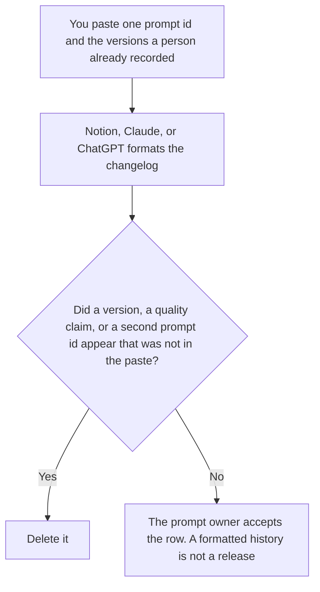

**An AI prompt changelog written with AI is the history of one prompt id: the version, the date, the owner, the line that changed, and the version pin it replaced, all recorded by a person.** The model may format that history. It may not decide the prompt got better, invent a version, or hide a change. The catalog across many prompts is [how to create a prompt library changelog with AI](/blog/how-to-create-a-prompt-library-changelog-with-ai-2026/). The front page of the library is [how to write an AI prompt library README with AI](/blog/how-to-write-an-ai-prompt-library-readme-with-ai-2026/). The pin this changelog points at is [what an AI prompt version pin is](/blog/what-is-ai-prompt-version-pin-2026/).

The line-level change is [what an AI prompt diff is](/blog/what-is-ai-prompt-diff-2026/). A product changelog, which is what shipped to customers, is [how to write an AI changelog entry with AI](/blog/how-to-write-an-ai-changelog-entry-with-ai-2026/).

Notion and Cursor prices are from directory pages checked October 16, 2026. Cursor's Plus price was reconfirmed on the October 24 help page in [Cursor pricing explained](/blog/cursor-pricing-explained-2026/). Claude's prices are the October 24, 2026 read of claude.com/pricing recorded in [Claude pricing explained](/blog/claude-pricing-explained-2026/). ChatGPT's Plus price is the October 24 plan-page figure recorded in [ChatGPT pricing explained](/blog/chatgpt-pricing-explained-2026/). Published October 24, 2026. We did not score prompts.

## What one row is allowed to say

| Field | Who owns it | The model may |
|---|---|---|
| The prompt id | You | Copy it. It may not merge two prompts into one history |
| The version and the date | You, or Version not set | Copy them. It may not invent v2 because the text looks newer |
| The owner | You, or Owner not set | Copy the name |
| The line that changed | You, from the diff | Copy it. It may not call the change an improvement |
| The pin it replaced, and whether the eval was re-run | You: a pin, and yes or no | Copy the mark. It may not mark yes |

The library changelog is the list across the catalog: many ids, one page. This page is one id, in order. A reader who needs every prompt opens the library page. A reader who needs to know what changed in the prompt production calls opens this one. Do not paste the whole library into this changelog to make it look complete.

Version not set stays in the row. The model does not number the drafts you forgot to number. Eval not re-run stays as those words if you did not re-run it. A changelog that says the new version passed, when you did not paste a result, is a claim this workflow deletes.

The version pin is the id production calls. This changelog records which pin the new version replaced. It does not move the pin. The person who owns the prompt moves it, after they accept the row.

## Where it is drafted

**The page that holds this prompt's history.** [Notion AI](/tools/notion-ai/) Business is $20 a seat a month on the October 16 card. One database row per version. Plus at $10 is not the full AI tier. The invoice is [Notion AI pricing explained](/blog/notion-ai-pricing-explained-2026/).

**The draft of a single row.** [Claude](/tools/claude/) Pro is $17 a month billed annually, $200 up front, or $20 monthly. Keep the accepted wording of the change in a Project so a later edit cannot soften a tighter rule into "clarified." The review is [Claude review](/blog/claude-review-2026/).

**One version from a paste.** [ChatGPT](/tools/chatgpt/) Plus is $20 a month. Discard a version that adds a moral, such as "safer" or "clearer," unless you pasted that word as the change. The ladder is [ChatGPT pricing explained](/blog/chatgpt-pricing-explained-2026/).

**The diff, if the prompt lives in the repo.** [Cursor](/tools/cursor/) Plus is $8 a month, or $80 a year, on the October 24 help page. You read the diff before the changelog row is written. The changelog describes the diff. It does not replace it. The review is [Cursor review](/blog/cursor-review-2026/).

A prompt that holds the line:

"Write the changelog row for the one prompt id I pasted. Include the version, the date, the owner, the line that changed, and the pin it replaced. If the eval was not marked, write Eval not recorded. Do not add a second prompt. Do not say the prompt is better."

## What not to delegate

Do not ask the model which version should ship. Do not collapse two prompts because they share a name. Do not mark the eval as run because the row looks finished. The prompt owner accepts the row. The pin moves only when that owner says so.

## FAQ

### How is this different from the library changelog?

That page is the catalog: many prompt ids on one list. This page is the history of one id. A library line can point here. It cannot replace the version, the date, and the line for this prompt.

### How is this different from a product changelog?

A product changelog tells a customer what shipped. This changelog tells the team what changed in a prompt. A prompt change is a product change only after someone who owns the product says so. Do not paste this row into the customer notes.

### How is this different from a version pin?

The pin is what production calls right now. The changelog is the history of pins and the lines that changed. Writing the history does not move the pin.

### Who may add a row?

The prompt owner. Version not set stays unset. A generated "vNext" is not a version, and a sentence that says the prompt improved is not a change log.

## Last verified

October 24, 2026 for Claude, for ChatGPT's plan page, and for Cursor's help page, via the posts cited above. October 16, 2026 for Notion. Published October 24, 2026.

**Sources:** [Notion pricing](https://www.notion.com/pricing), [Claude pricing](https://claude.com/pricing), [ChatGPT and Codex pricing](https://learn.chatgpt.com/docs/pricing), [Cursor pricing](https://cursor.com/help/account-and-billing/pricing).

*Published by Andrew for [AI Tools Optimizer](https://aitoolsoptimizer.com).*

[Notion AI](/tools/notion-ai/) is in the [productivity and notes directory](/tools/category/productivity-notes/). Directory pages may use affiliate links. A purchase through them may earn us a commission at no extra cost to you.
