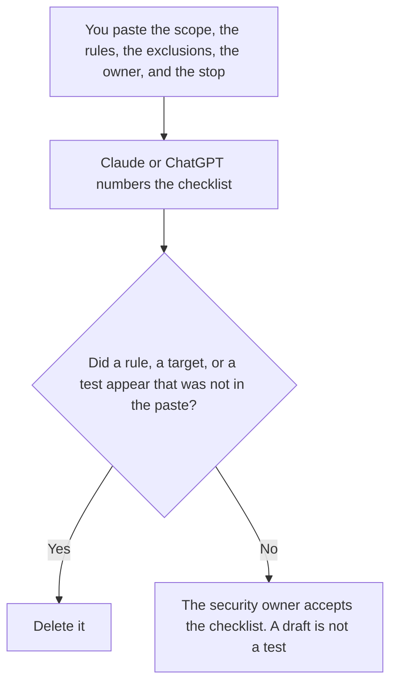

**An AI red-team checklist written with AI is a draft of the scope, the rules under test, the owner, and the stop condition a person already set.** The model may number the lines. It may not invent a rule, a target, or a test. The definition of the work is [what AI red teaming is](/blog/what-is-ai-red-teaming-2026/): a scheduled test of rules you already wrote. Output checks you already require, which are not this exercise, are [how to create a prompt QA checklist with AI](/blog/how-to-create-a-prompt-qa-checklist-with-ai-2026/). A marker that should stay hidden is [what an AI prompt injection canary is](/blog/what-is-ai-prompt-injection-canary-2026/).

This page is the checklist. It does not include attack text, payloads, or steps for breaking a system. The security owner keeps any private test plan off this site.

Claude's prices are the October 24, 2026 read of claude.com/pricing recorded in [Claude pricing explained](/blog/claude-pricing-explained-2026/). Notion and Cursor prices are from directory pages checked October 16, 2026. Cursor's Plus price was reconfirmed on the October 24 help page in [Cursor pricing explained](/blog/cursor-pricing-explained-2026/). ChatGPT's Plus price is the October 24 plan-page figure recorded in [ChatGPT pricing explained](/blog/chatgpt-pricing-explained-2026/). Published October 24, 2026. We did not run a test. A formatted checklist is not a finding.

## What a line is allowed to say

| Line | Who owns it | The model may |
|---|---|---|
| The scope: product, environment, and date | You | Copy it. It may not add a system |
| The rule under test | You, or Rule not set | Copy the rule. It may not invent a harm |
| What is out of scope | You | Copy it. It may not shrink the exclusion |
| The owner and the stop condition | You | Copy them. It may not delete the stop |
| Where the result is recorded | You, or Record not set | Copy the place. It may not write a result |

Red teaming, on the explainer, is people you trust checking whether the product breaks rules you already named: it reveals another customer's data, it takes an action the permissions forbid, it states a policy you do not have. This checklist is the cover sheet for that work. It names the rules. It does not supply the attempts. If you ask the model for an attack prompt, you have left this workflow. Rule not set stays on the page until the owner writes the rule.

The prompt QA checklist is the output checks on a normal run: shape, citations, refusals you already require. This checklist is the scheduled exercise against the rules. A QA pass is not a red-team result. A red-team checklist with no recorded result is not a pass either. Record not set means you have a plan and no outcome.

The stop condition is part of the paste. A model that drops it because the list looks cleaner has broken the checklist. The owner can stop the exercise for a reason they already wrote, including a result they did not expect. This page does not add reasons.

## Where it is drafted

**The draft.** [Claude](/tools/claude/) Pro is $17 a month billed annually, $200 up front, or $20 monthly. Keep the accepted rules in a Project the customer content never enters. The review is [Claude review](/blog/claude-review-2026/).

**The page that holds the accepted checklist.** [Notion AI](/tools/notion-ai/) Business is $20 a seat a month on the October 16 card. Link the owner, the date, and the record location. Plus at $10 is not the full AI tier. The invoice is [Notion AI pricing explained](/blog/notion-ai-pricing-explained-2026/).

**One section from a paste.** [ChatGPT](/tools/chatgpt/) Plus is $20 a month. Discard a version that adds a "sample attack." The ladder is [ChatGPT pricing explained](/blog/chatgpt-pricing-explained-2026/).

**The diff, if the checklist is a file.** [Cursor](/tools/cursor/) Plus is $8 a month, or $80 a year, on the October 24 help page. You read a diff that deletes the stop condition or adds a target. The review is [Cursor review](/blog/cursor-review-2026/).

A prompt that holds the line:

"Draft the red-team checklist from the scope, rules, exclusions, owner, and stop condition I pasted. If a rule is missing, write Rule not set. Do not invent a test. Do not write attack text."

## What not to delegate

Do not ask how to break the product. Do not ask for example prompts. Do not mark the checklist complete because every heading is filled. The security owner accepts the list, runs the exercise in private, and records the result in the place the checklist names. This page does not replace that record.

## FAQ

### How is this different from the red-teaming explainer?

That page defines the work: a scheduled test of rules you already wrote, with no attack steps. This page is the checklist you draft after the scope and the rules exist. A definition is not a line item. Rule not set means the decision is still open.

### How is this different from a prompt QA checklist?

QA checks the outputs you already require on ordinary runs. A red-team checklist names a scheduled exercise, an owner, and a stop. Passing QA does not close the exercise. The exercise does not belong in the public QA doc if it would publish a private test.

### How is this different from an injection canary?

The canary is a private marker that should stay hidden on ordinary runs. This checklist is the cover sheet for a planned test. The checklist may name that a canary exists. It does not contain the marker, and it does not contain attack text.

### Who may accept the checklist?

The security owner named on the page. A generated test is not a line. A filled template is not a finding, and a finding does not belong in the model's draft.

## Last verified

October 24, 2026 for Claude, for ChatGPT's plan page, and for Cursor's help page, via the posts cited above. October 16, 2026 for Notion. Published October 24, 2026. This page contains no attack text.

**Sources:** [Claude pricing](https://claude.com/pricing), [Notion pricing](https://www.notion.com/pricing), [ChatGPT and Codex pricing](https://learn.chatgpt.com/docs/pricing), [Cursor pricing](https://cursor.com/help/account-and-billing/pricing).

*Published by Andrew for [AI Tools Optimizer](https://aitoolsoptimizer.com).*

[Claude](/tools/claude/) is in the [chatbots and assistants directory](/tools/category/chatbots-assistants/). Directory pages may use affiliate links. A purchase through them may earn us a commission at no extra cost to you.
