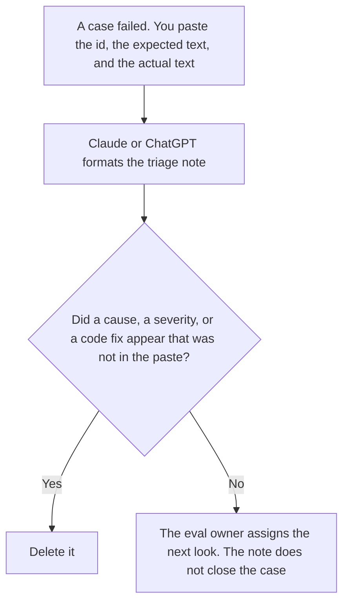

**An eval failure triage written with AI is a short record of which case failed, what you expected, what the run returned, and who owns the next look.** The model may order those fields. It may not invent a root cause, a severity, or a fix. The columns for a retrieval run, which are a different sheet, are [how to create a RAG eval scorecard with AI](/blog/how-to-create-a-rag-eval-scorecard-with-ai-2026/). The report a reader gets after a sample finishes is [how to create a model eval report with AI](/blog/how-to-create-a-model-eval-report-with-ai-2026/).

The suite you rerun so a fixed case stays fixed is [what an AI eval regression suite is](/blog/what-is-ai-eval-regression-suite-2026/). The triage is one failure. The suite is the set you refuse to shrink.

Claude's prices are from claude.com/pricing on October 24, 2026. Notion and Cursor prices are from directory pages checked October 16, 2026. ChatGPT's Plus price is from learn.chatgpt.com/docs/pricing on October 24. Published October 24, 2026. We did not score models.

## What the triage contains

| Field | Who owns it | The model may |
|---|---|---|
| Case id and the eval name | You, from the run | Copy them. It may not merge two cases |
| Expected output | The spec you wrote before the run | Copy it. It may not "improve" the expected text |
| Actual output | The log | Copy it, or quote the slice you pasted. It may not summarize a failure into a success |
| Owner and the next action you already chose | You | Copy them. If the owner is blank, write Owner not set |

A triage that explains "the model hallucinated" without a claim you marked has invented a cause. If you do not yet know why it failed, the note says Cause not determined. Two failed cases do not become one theme unless you write the theme and list both ids.

## Where it is written

**The note.** [Claude](/tools/claude/) Pro is $17 a month billed annually, $200 up front, or $20 monthly. Keep the expected text in a Project so a later edit does not change the spec to match the failure. The review is [Claude review](/blog/claude-review-2026/).

**The queue.** [Notion AI](/tools/notion-ai/) Business is $20 a seat a month. One row per case id. The invoice is [Notion AI pricing explained](/blog/notion-ai-pricing-explained-2026/).

**A diff, if the next action is a change you already described.** [Cursor](/tools/cursor/) Plus is $8 a month, or $80 a year. You review the diff. The triage does not merge it. The ladder is [Cursor pricing explained](/blog/cursor-pricing-explained-2026/).

**One note from a short paste.** [ChatGPT](/tools/chatgpt/) Plus is $20 a month. Discard a version that adds a severity. The ladder is [ChatGPT pricing explained](/blog/chatgpt-pricing-explained-2026/).

A prompt that holds the line:

"Write the failure triage from the case id, the expected output, and the actual output I pasted. If the cause is missing, write Cause not determined. Do not add a severity. Do not propose a code change."

## What not to delegate

Do not ask why it failed. Do not delete the case from the suite because the note sounds minor. Do not change the expected output so the actual output passes. The eval owner decides the next action. A fluent paragraph is not a diagnosis.

## FAQ

### How is this different from a RAG scorecard?

The scorecard is the set of columns for a retrieval run you defined, filled from a run you did. The triage is one failed case, with expected and actual side by side. A scorecard can show that a case failed. It does not replace the note. Do not average the triage into the score.

### How is this different from an eval report?

The report is what a reader sees after the sample: the size, the failures, the limits. The triage is the working note for one failure before you are ready to put a cause in the report. A report that lists causes the triage marked undetermined has skipped a step.

### Can the model group similar failures?

It can group ids you already said were the same theme. It may not discover a theme and assign cases to it. If you want a proposal, label it Proposed groups, and do not let those groups replace the case rows.

### Who may close the case?

The eval owner, after the next action is done and the case has been rerun, or after they explicitly accept the failure. The triage note does not close it. A rerun that still fails stays open.

## Last verified

October 24, 2026 for Claude and for ChatGPT's plan page. October 16, 2026 for Notion and Cursor. Published October 24, 2026.

**Sources:** [Claude pricing](https://claude.com/pricing), [Notion pricing](https://www.notion.com/pricing), [Cursor pricing](https://cursor.com/help/account-and-billing/pricing), [ChatGPT and Codex pricing](https://learn.chatgpt.com/docs/pricing).

*Published by Andrew for [AI Tools Optimizer](https://aitoolsoptimizer.com).*

[Claude](/tools/claude/) is in the [chatbots and assistants directory](/tools/category/chatbots-assistants/). Directory pages may use affiliate links. A purchase through them may earn us a commission at no extra cost to you.
