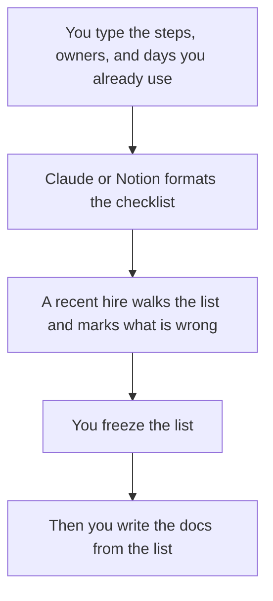

**An onboarding checklist written with AI is a list a new hire can finish: the step, the owner, the day it should happen, and what done means.** The model can order steps you already run. It cannot invent the laptop vendor, the benefits portal, or the person who approves access. Those names come from you. This page builds the list. Turning that list into a wiki, a deck, and a video is the next article: [how to create onboarding docs with AI](/blog/how-to-create-onboarding-docs-with-ai-2026/).

The people-team shelf is [best AI tools for people ops](/blog/best-ai-tools-for-people-ops-2026/). The HR shelf is [best AI tools for HR teams](/blog/best-ai-tools-for-hr-teams-2026/). A customer-facing kickoff, which is a different audience, lives in [how to write a customer success playbook with AI](/blog/how-to-write-a-customer-success-playbook-with-ai-2026/).

Prices are US list prices excluding tax from directory pages checked October 16, 2026. Published October 24, 2026. We did not score onboarding programs.

## A row that can be checked off

| Column | Who fills it | The model may |
|---|---|---|
| Step | The manager's real list | Split a vague step into two, only when you confirm both |
| Owner | A name you typed | Use the name. It may not write "people team" as a substitute |
| Day | Day 0, day 1, or the day you actually do it | Keep your numbers |
| Done | The evidence: an account exists, a form is signed, a meeting happened | State it. It may not accept "familiar with the culture" as done |
| Link | The URL you pasted | Place it. It may not guess the portal |
| Not included | Anything you are unsure about | Leave it off the list |

A checklist item with no owner will be everyone's job, which means it will slip. The person who publishes the list is [what human-in-the-loop AI is](/blog/what-is-human-in-the-loop-ai-2026/).

## Where the list is made

**The page that will be reused.** [Notion AI](/tools/notion-ai/) Business is $20 a seat a month if the checklist lives in Notion. A database with the columns above beats a prose essay. Plus at $10 is not the full AI tier. The card is [Notion AI pricing explained](/blog/notion-ai-pricing-explained-2026/). The record, once you agree the list is real, is [what a system of record for AI is](/blog/what-is-a-system-of-record-for-ai-2026/).

**The first formatting pass.** [Claude](/tools/claude/) Pro is $20 a month, or $17 billed annually. Paste the messy list from the last hire. Ask for a table. [ChatGPT](/tools/chatgpt/) Plus at $20 does the same job if that is the team's habit. Business is $20 a user a month billed annually, for two or more users, when the notes include personal data you should not put on a consumer seat. The container is [Claude Projects vs ChatGPT Projects](/blog/claude-projects-vs-chatgpt-projects-2026/).

**The line edit.** [Grammarly](/tools/grammarly/) Pro is $12 a member a month billed annually. It will not know the name of your IT owner.

**A short deck, only after the list is frozen.** [Gamma](/tools/gamma/) Plus is $9 a seat a month. The deck points at the checklist. It does not replace it. The format choice is [Gamma vs Beautiful.ai](/blog/gamma-vs-beautiful-ai-2026/).

A prompt that holds the line:

"Format my notes as an onboarding checklist with columns: step, owner, day, done-when, link. Use only the notes. If an owner, a day, or a link is missing, write Missing. Do not add benefits, tools, or welcome rituals I did not list. Do not write paragraphs."

The claim check, including job titles, is [how to fact-check AI writing](/blog/how-to-fact-check-ai-writing-2026/).

## What this page is not

It is not the employee handbook. It is not legal advice about employment, payroll, or benefits. If a step is a policy, the policy owner writes that sentence. The model formats the row. A customer onboarding checklist uses the same columns and a different owner. Do not merge the two lists because the word onboarding appeared in both.

## FAQ

### How many steps is too many?

More than a new hire can finish in the first week without a second document. Split later weeks into a second list with its own owner. A 60-row day-one list is a backlog, not a checklist.

### Can AI personalize it per role?

Yes, from the role differences you paste. A engineer and a seller do not get the same access list unless your notes say they do. The model should not "include the usual tools."

### Should the checklist email itself to the new hire?

A person sends it, or a workflow you already trust sends the link after access exists. An agent that emails a stale portal on day one is an incident. The automation, if you add one, comes after the list is true. The meter for that path is [Make pricing explained](/blog/make-pricing-explained-2026/).

### What does the recent hire review?

They mark steps that never happened, links that 404, and owners who have left. That pass is the evaluation. A fluent checklist that fails the walk is not done.

## Last verified

October 16, 2026 for Notion, Claude, ChatGPT, Grammarly, and Gamma prices named above. Published October 24, 2026.

**Sources:** [Notion AI](https://www.notion.com/product/ai), [Claude pricing](https://claude.com/pricing), [Gamma pricing](https://gamma.app/pricing).

*Published by Andrew for [AI Tools Optimizer](https://aitoolsoptimizer.com).*

[Notion AI](/tools/notion-ai/) is in the [productivity and notes directory](/tools/category/productivity-notes/). Directory pages may use affiliate links. A purchase through them may earn us a commission at no extra cost to you.
