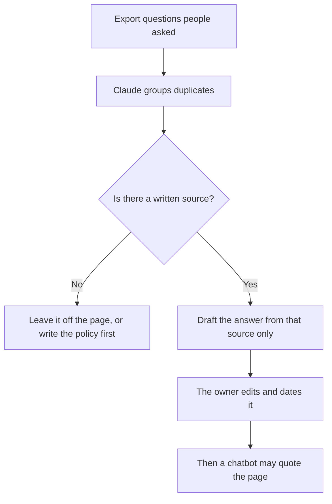

**An FAQ page made with AI is a list of questions customers already asked, each answered from a source you can open.** The model can cluster the questions and draft the answer. It cannot invent the policy. A page of plausible questions is a liability the moment someone treats it as the help center.

The bot that will quote this page later is [how to build a knowledge-base chatbot](/blog/how-to-build-a-knowledge-base-chatbot-2026/). The reason that bot must name a passage is [what retrieval-augmented chat is](/blog/what-is-retrieval-augmented-chat-2026/). The claim check is [how to fact-check AI writing](/blog/how-to-fact-check-ai-writing-2026/).

Prices are US list prices excluding tax from directory pages checked October 16, 2026. Published October 24, 2026. We did not score ticket deflection.

## The page, as a table you can audit

| Column | Who fills it | Done when |
|---|---|---|
| Question, in the customer's words | You, from tickets, chat, or sales calls | It is a question a stranger asked, not a heading you wished for |
| Source | You | A policy URL, a contract clause, or "we do not have this in writing" |
| Answer | The model, then you | Every sentence is in the source, or you cut it |
| What this answer refuses | You | The adjacent promise you will not make |
| Owner and date | You | A person who can change the source |

If the source does not exist, the FAQ is the wrong document. Write the policy, then the question. The model will happily draft a refund window. That draft is not the policy.

## Which tool does which pass

**Cluster the questions.** Paste a month of ticket subjects into [Claude](/tools/claude/) or [ChatGPT](/tools/chatgpt/). Ask for groups, a count, and the original wording of one example per group. Claude Pro is $20 a month, or $17 billed annually. ChatGPT Plus is $20. Do not ask for answers in this pass. Answers without sources are how the page drifts.

**Draft from the source.** Paste one policy and one question. Ask for an answer a support agent could send, with a sentence you will delete if it is not in the policy. The editing pass can be [Grammarly vs ChatGPT for editing](/blog/grammarly-vs-chatgpt-for-editing-2026/) if the tone is the remaining problem. Grammarly will not verify the refund window.

**Store the page where the team edits.** [Notion AI](/tools/notion-ai/) Business is $20 per seat per month when the help center draft lives in Notion. The seat math is [Notion AI pricing explained](/blog/notion-ai-pricing-explained-2026/). The published URL still needs an owner. A wiki page nobody updates is a stale graph of promises. The structured version of that problem is [what a knowledge graph is](/blog/what-is-a-knowledge-graph-in-ai-2026/).

**Only then attach a bot.** [Chatbase](/tools/chatbase/) Hobby is $32 a month billed yearly for 700 message credits. Train it on the FAQ you just approved, set the boundaries, and test questions whose answers you know. [Intercom Fin](/tools/intercom-fin/) is $49 a month including 50 outcomes, then $0.99 per outcome, when the bot runs on the help desk. A handoff can count as an outcome. Price a real month. The queue that owns the leftovers is [best AI tools for support teams](/blog/best-ai-tools-for-support-teams-2026/).

Customer-success teams who need the account plan rather than the public FAQ should use [best AI tools for customer success](/blog/best-ai-tools-for-customer-success-2026/). This page is the public answers.

## A prompt for one question

"Question, in the customer's words: [paste]. Source: [paste the policy and the URL]. Write a four-sentence answer using only the source. End with the URL. If the source does not answer the question, reply 'not in the source' and stop. Do not add a timeline, a price, or an exception that the source does not state."

That instruction is [what a system prompt is](/blog/what-is-a-system-prompt-2026/) for a single task. It still fails if the source itself was poisoned or outdated. Date the policy. Re-read the FAQ when the policy changes. The repeatable check is [what AI eval testing is](/blog/what-is-ai-eval-testing-2026/).

## FAQ

### How many questions should the page have?

The ones people ask. Ten sourced answers beat forty invented ones. Add a question when a ticket repeats and you have a source. Remove a question when the policy changes and you have not rewritten it.

### Can the FAQ mention competitors?

Only with a source you would show a customer. A model will compare you favorably if you ask it to. That comparison is a claim. The research habit, if you need it, is [how to use AI for competitive analysis](/blog/how-to-use-ai-for-competitive-analysis-2026/).

### Should sales and support share one FAQ?

They should share the sourced answers. Sales may want a shorter cut. Generate the short cut from the same source, and do not let it add a discount the policy does not contain.

### Who signs the page?

The person who owns the policy. A writer can tighten sentences. A model can cluster. The owner is the name in the last column.

## Last verified

October 16, 2026 for Claude, ChatGPT, Notion, Chatbase, and Intercom Fin prices. Published October 24, 2026.

**Sources:** [Chatbase pricing](https://www.chatbase.co/pricing), [Intercom Fin](https://fin.ai), [Notion AI](https://www.notion.com/product/ai).

*Published by Andrew for [AI Tools Optimizer](https://aitoolsoptimizer.com).*

[Chatbase](/tools/chatbase/) is in the [customer support directory](/tools/category/customer-support/). Directory pages may use affiliate links. A purchase through them may earn us a commission at no extra cost to you.
