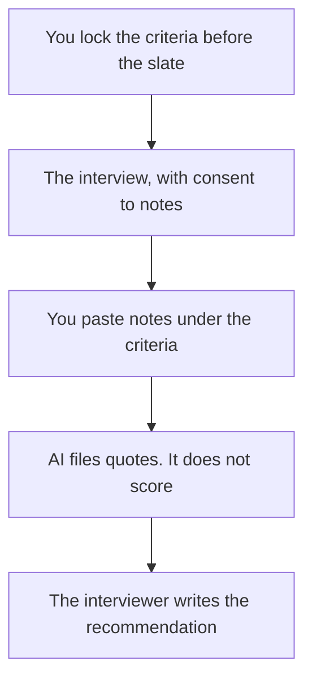

**An interview scorecard made with AI is a form you designed before the interview: the criteria, the evidence column, and a recommendation a person will sign.** The model can lay out the form and file quotes from notes you paste. It does not assign a hire or no-hire number. A score the model invented is not a process. It is a liability with clean formatting.

This is a hiring artifact. It is not user research. Research notes are [how to use AI for user interview notes](/blog/how-to-use-ai-for-user-interview-notes-2026/). The role the scorecard serves is [how to write a job description with AI](/blog/how-to-write-a-job-description-with-ai-2026/). The team that runs the loop is [best AI tools for people ops](/blog/best-ai-tools-for-people-ops-2026/). The sourcing stack is [best AI tools for recruiters](/blog/best-ai-tools-for-recruiters-2026/).

Prices are US list prices excluding tax from directory pages checked October 16, 2026. Published October 24, 2026. We did not score candidates, and this page is not employment or legal advice.

## What the model may touch

| Column | Who owns it | The model may |
|---|---|---|
| Criteria | You, written before any interview that week | Format the list. It may not add a trait after the conversation |
| Evidence | Notes or a transcript the candidate was told about | Place a quote under the criterion it matches. It may not infer a trait |
| Gap | You, if the interview did not cover something | Leave the cell empty. It may not fill it with a guess |
| Recommendation | The interviewer, in their own words | Leave it blank for the human |
| Level or number | Your rubric, applied by a person | Do nothing, unless you are formatting a number a person already wrote |

Tell the candidate the interview is being noted or recorded, the same way you would without AI. A hidden recorder is not a scorecard feature.

## Where the form lives

**The template the hiring team reuses.** [Notion AI](/tools/notion-ai/) Business is $20 a seat. Duplicate the database row per candidate. Plus at $10 is not the full AI tier. The card is [Notion AI pricing explained](/blog/notion-ai-pricing-explained-2026/). The page is the record. The chat is not. That distinction is [what a system of record for AI is](/blog/what-is-a-system-of-record-for-ai-2026/).

**A long transcript plus the rubric.** [Claude](/tools/claude/) Pro is $20 a month, or $17 billed annually. Put the blank scorecard in a Project. Ask for quotes only. The container is [Claude Projects vs ChatGPT Projects](/blog/claude-projects-vs-chatgpt-projects-2026/).

**The chat, for a short debrief you will paste back.** [ChatGPT](/tools/chatgpt/) Plus is $20. If the notes include candidate data, use a plan your review allows. Business is $20 a user a month billed annually, for two or more users, and does not train on business data by default. A personal Plus seat is a different promise. The ladder is [ChatGPT Go vs Plus vs Pro](/blog/chatgpt-go-vs-plus-vs-pro-2026/).

**The capture.** [Granola](/tools/granola/) Business is $14 a user a month, with no bot on the call. [Fathom](/tools/fathom/) Free includes unlimited recordings if a bot is allowed. Team is $15 a user a month billed annually, with a two-user minimum. The summary is not the evidence column. You still pull quotes. The meeting write-up habit is [how to summarize meetings with AI](/blog/how-to-summarize-meetings-with-ai-2026/).

**The sentences, after the recommendation is human.** [Grammarly](/tools/grammarly/) Pro is $12 a member a month billed annually. It will not make a weak criterion stronger.

A prompt that holds the line:

"Here is the scorecard and the notes. File quotes under the matching criterion. If the notes do not cover a criterion, write Not covered. Do not score, rank, or recommend. Do not infer personality, health, age, or any trait we did not ask about. Do not compare this candidate to another person."

The person who signs is [what human-in-the-loop AI is](/blog/what-is-human-in-the-loop-ai-2026/). The handbook and training video, which are HR's docs rather than this form, are [best AI tools for HR teams](/blog/best-ai-tools-for-hr-teams-2026/).

## After the loop

Keep the same criteria for every candidate in the slate. Changing the rubric after a favorite interview is how a scorecard becomes a story. If you must change it, change it for the next slate and write down why.

Do not paste a stack of resumes into a chat and ask who to hire. That is a different and worse workflow. The scorecard starts from the conversation you designed.

## FAQ

### Can AI give each candidate a number so we can sort?

No. A person applies your rubric. A generated number will be repeated in a debrief as if it were a measurement. Leave the score cell for the interviewer.

### What if we have no rubric yet?

Write the criteria from the job description before you meet candidates. A scorecard built during the debrief measures the story you preferred. The model can format a draft rubric. The hiring manager still locks it.

### Are user-research interviews the same template?

No. Research notes look for needs and quotes. A hiring scorecard looks for evidence against a role. Mixing the templates will either reject a user insight or "score" a customer.

### Where should the recording live?

In the system your privacy review named, for the period you named. A consumer chat is a poor archive for candidate data. Put the approved quotes on the scorecard and keep the media where HR already keeps it.

## Last verified

October 16, 2026 for Notion, Claude, ChatGPT, Granola, Fathom, and Grammarly prices named above. Published October 24, 2026.

**Sources:** [Notion AI](https://www.notion.com/product/ai), [Claude pricing](https://claude.com/pricing), [Fathom pricing](https://www.fathom.ai/pricing).

*Published by Andrew for [AI Tools Optimizer](https://aitoolsoptimizer.com).*

[Notion AI](/tools/notion-ai/) is in the [productivity and notes directory](/tools/category/productivity-notes/). Directory pages may use affiliate links. A purchase through them may earn us a commission at no extra cost to you.
