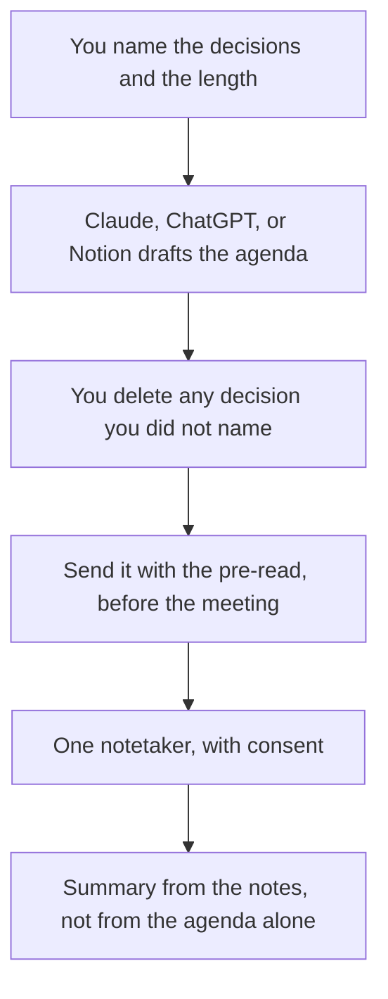

**A meeting agenda written with AI is a clock wrapped around decisions a person already named.** The model can turn "ship the pricing page" into a timed block with an owner and a pre-read. It cannot know which meeting should exist. An agenda for a meeting that should have been a message is a polished waste. Name the decision. Then allow the draft.

The notes after the meeting are [how to summarize meetings with AI](/blog/how-to-summarize-meetings-with-ai-2026/). A retro is a specific agenda, not a generic one: [how to run a retro with AI](/blog/how-to-run-a-retro-with-ai-2026/). The failure mode of a smooth recap is [what an AI hallucination is](/blog/what-is-ai-hallucination-2026/).

Prices are US list prices excluding tax from directory pages checked October 16, 2026, except where a pricing explainer gives the figure. Published October 24, 2026. We did not score meetings.

## What the model may touch

| Line | Who owns it | The model may |
|---|---|---|
| The decision | You. One sentence, or the meeting is optional | Turn it into an agenda item |
| The clock | You. The meeting length you actually have | Timebox. It may not add a second meeting |
| The owner | You | Name the person you named |
| The pre-read | You, a link you paste | Say what to read. It may not invent a document |
| Who must be there | You | Cut a guest list only from names you provided |
| The notes | Later, from the meeting | Not part of the agenda draft |

If you ask for "a productive weekly agenda" with no decisions, you will get status updates and a brainstorm. That meeting will feel full and decide nothing. Put the decision in the title of the block.

## Where the draft happens

**The writing pass.** [Claude](/tools/claude/) Pro is $20 a month, or $17 billed annually. [ChatGPT](/tools/chatgpt/) Plus is $20. Go is $8. Free tiers are enough for one agenda. Use a Project if this meeting recurs, and store the shape you liked. The container is [Claude Projects vs ChatGPT Projects](/blog/claude-projects-vs-chatgpt-projects-2026/). Summaries of the last meeting, if you have them, are input. They are not a reason to skip the decision line. The summary comparison is [Claude vs ChatGPT for summaries](/blog/claude-vs-chatgpt-for-summaries-2026/).

**The page people will open.** [Notion AI](/tools/notion-ai/) Business is $20 a seat. The agenda should live next to the notes from last time. A chat transcript will not be the pre-read. The card is [Notion AI pricing explained](/blog/notion-ai-pricing-explained-2026/).

**The meeting itself, afterward.** Pick one notetaker and say so. [Granola](/tools/granola/) Business is $14 per user a month and keeps history past Basic's 30 days. [Fireflies](/tools/fireflies-ai/) Pro is $10 per user billed annually, or $18 monthly. [Fathom](/tools/fathom/) Free includes unlimited recordings and transcripts on the pricing explainer. Premium is $20 a month, or $16 billed annually. [Otter](/tools/otter-ai/) Basic includes 300 minutes. Pro is $16.99 a month or $8.33 billed annually. The field guide is [Fireflies alternatives](/blog/fireflies-alternatives-2026/). Otter's card is [Otter.ai pricing explained](/blog/otter-ai-pricing-explained-2026/). Fathom's is [Fathom pricing explained](/blog/fathom-pricing-explained-2026/).

A prompt that holds the line:

"Meeting length is 25 minutes. Decisions I need: the two lines below. Draft an agenda with a timebox, an owner, and a pre-read link only if I pasted one. If a block has no decision, label it 'cut unless I confirm.' Do not add guests."

## After you send it

An agenda is a proposal until the meeting starts. If a block slips, the model does not get to invent a new decision in the notes to fill the time. The summary should say "not decided." That honesty is the difference between minutes and fan fiction.

Scrum ceremonies are a repeated version of this page. The role's stack is [best AI tools for scrum masters](/blog/best-ai-tools-for-scrum-masters-2026/). A weekly update that should fall out of the decisions, not out of the transcript, belongs with the engineering manager's writing habit in [best AI tools for engineering managers](/blog/best-ai-tools-for-engineering-managers-2026/).

Customer calls are the same shape with a higher cost for a made-up promise. The email after the call is [how to write customer emails with AI](/blog/how-to-write-customer-emails-with-ai-2026/). Do not let the agenda's "desired outcome" become a commitment you did not make.

## FAQ

### How long should the agenda be?

Shorter than the meeting. A 25-minute meeting with a one-page agenda will be read. A 25-minute meeting with a six-point brainstorm will not decide the thing you named. Ask for timeboxes that sum to the length you gave, with a few minutes left.

### Can AI decide who to invite?

It can remove people who are not on the list you pasted. It should not add a department. You know who can make the decision. Extra guests are how the meeting becomes a status broadcast.

### Should I attach the last transcript?

Attach the decisions, not the whole transcript, unless the meeting is explicitly a review of that transcript. A transcript in the prompt will resurface side comments as agenda items.

### What if we never follow the agenda?

Stop generating a better one. Cancel the meeting or change the decision. A model cannot create a reason to gather. It can only format the reason you brought.

## Last verified

October 16, 2026 for Claude, ChatGPT, Notion, Granola, and Fireflies prices. Fathom and Otter figures match their pricing explainers. Published October 24, 2026.

**Sources:** [Claude pricing](https://claude.com/pricing), [Notion pricing](https://www.notion.com/pricing), [Fireflies pricing](https://fireflies.ai/pricing).

*Published by Andrew for [AI Tools Optimizer](https://aitoolsoptimizer.com).*

[Granola](/tools/granola/) and [Fireflies](/tools/fireflies-ai/) are in the [meetings and transcription directory](/tools/category/meetings-transcription/). Directory pages may use affiliate links. A purchase through them may earn us a commission at no extra cost to you.
