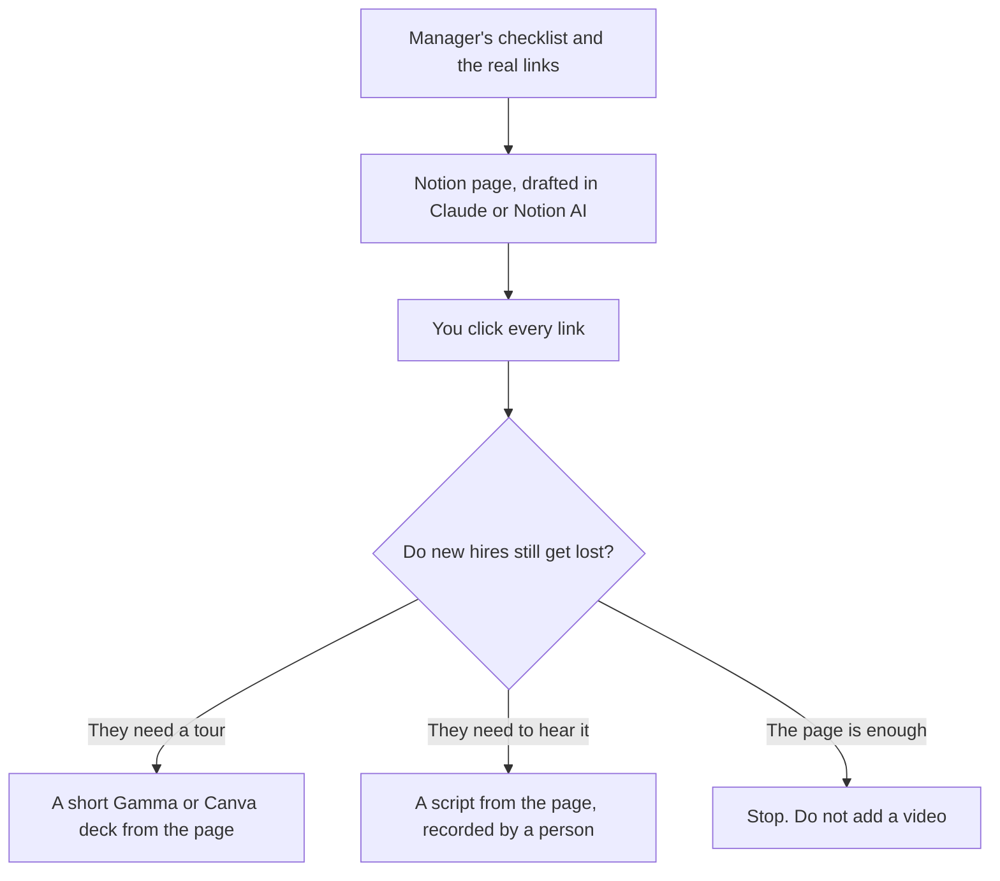

**Onboarding docs written with AI are the checklist your team already runs, turned into a page a new hire can follow without asking where the link went.** The model can expand a step into a paragraph. It cannot invent the benefits vendor, the laptop process, or the person who approves access. Those names come from you. A confident page with the wrong portal is a first-week incident.

Write the source of truth in the wiki, then make a short deck or a video from that page. Do not start in a video tool and hope the script is the policy. The support version of the same habit is [how to create FAQ pages with AI](/blog/how-to-create-faq-pages-with-ai-2026/). The claim check is [how to fact-check AI writing](/blog/how-to-fact-check-ai-writing-2026/).

Prices are US list prices excluding tax from directory pages checked October 16, 2026. Published October 24, 2026. We did not score onboarding programs.

## What belongs on the page

| Section | Source | The model may |
|---|---|---|
| Day-one checklist | The manager's real list | Order it and name the owner you named |
| Access and tools | IT's list | Not add a tool the company does not use |
| Who to ask | You | Use the names you pasted. No invented "people team" |
| How we write and ship | A sample doc you like | Match the format. It may not invent a ritual |
| Benefits and policy | The vendor page or the handbook excerpt | Quote it. It may not paraphrase a number |
| What this page is not | You | A line that says where the legal or HR policy actually lives |

Click every link before anyone is hired. The model will write a plausible settings path. The plausible path is the bug.

## The stack

**The page.** [Notion AI](/tools/notion-ai/) Business is $20 per seat per month, which is where the handbook should live if Notion is already the wiki. Free includes a trial of Notion AI. The card is [Notion AI pricing explained](/blog/notion-ai-pricing-explained-2026/). If the company wiki is somewhere else, write it there. A chatbot thread is not onboarding.

**The long draft.** [Claude](/tools/claude/) Pro is $20, or $17 billed annually. Put the checklist, the handbook excerpts, and one onboarding page you already like into a Project. Ask for the page in your headings, and for "steps I could not verify from the source." Delete that list or go get the source. Projects versus a running chat are [Claude Projects vs ChatGPT Projects](/blog/claude-projects-vs-chatgpt-projects-2026/).

**The sentence edit.** [Grammarly](/tools/grammarly/) Pro is $12 per member per month billed annually, or $30 monthly. It catches the awkward line. It does not know which VPN you use. The editing split is [Grammarly vs ChatGPT for editing](/blog/grammarly-vs-chatgpt-for-editing-2026/).

**A visual, after the page exists.** [Gamma](/tools/gamma/) Plus is $9 a seat a month, or $108 a year, for 1,000 credits. Paste the checklist. Do not paste "onboarding best practices" and accept a generic deck. The credits are [Gamma pricing explained](/blog/gamma-pricing-explained-2026/). [Canva](/tools/canva/) Pro at $18 a month, or $180 a year, is the right seat if the deck has to match a brand kit you already built.

**A video, only with consent.** [HeyGen](/tools/heygen/) Creator is $29 a month if you truly need an avatar and the person agreed. A manager on a laptop in [Descript](/tools/descript/) is the more honest version of a welcome. Hobbyist is $16 per person billed annually. The avatar steps, including consent, are [how to create AI avatars with HeyGen](/blog/how-to-create-ai-avatars-with-heygen-2026/). Do not generate a coworker's face to save a recording.

A prompt that stays inside the checklist:

"Checklist and links are below. Write an onboarding page with those steps only. If a step needs a link I did not paste, write 'link missing.' Do not add culture language I did not supply."

## After the first hire reads it

Ask what they had to Slack someone about. Add that step, with the real answer, in the wiki. Then point a help bot at the page only after the page is true. The build is [how to build a knowledge-base chatbot](/blog/how-to-build-a-knowledge-base-chatbot-2026/). A bot on a stale checklist answers confidently and creates a second queue. The fence is [what AI guardrails are](/blog/what-is-ai-guardrails-2026/).

Benefits numbers, equity, and anything a lawyer or a broker owns should be linked, not rewritten. An AI summary of a policy is not the policy. If the page starts to look like legal advice, stop and use the organizing workflow in [best AI tools for startup legal ops](/blog/best-ai-tools-for-startup-legal-ops-2026/), and have counsel own the sentence.

## FAQ

### Can AI write the whole handbook?

It can write a handbook-shaped document. Publish only the sections a person checked against the current vendor, the current tool, and the current owner. The rest is a draft with a date on it.

### What should a new hire read on day one?

The checklist with links that work, the names of three people, and where to ask a question. A manifesto can wait. The model will offer the manifesto first if you let it.

### Do I need a video?

Only if people still get lost after the page is short and the links work. Record the path once. An avatar is optional, and only with consent. HeyGen Free is three one-minute videos, which is a test, not a curriculum.

### How often should this be regenerated?

When a tool or an owner changes, edit that step. Do not regenerate the whole page on a schedule. Regeneration is how a corrected paragraph gets replaced by a fluent wrong one.

## Last verified

October 16, 2026 for Notion, Claude, Grammarly, Gamma, Canva, HeyGen, and Descript prices. Published October 24, 2026.

**Sources:** [Notion AI](https://www.notion.com/product/ai), [Gamma pricing](https://gamma.app/pricing), [HeyGen pricing](https://www.heygen.com/pricing).

*Published by Andrew for [AI Tools Optimizer](https://aitoolsoptimizer.com).*

[Notion AI](/tools/notion-ai/) is in the [productivity directory](/tools/category/productivity-notes/). Directory pages may use affiliate links. A purchase through them may earn us a commission at no extra cost to you.
