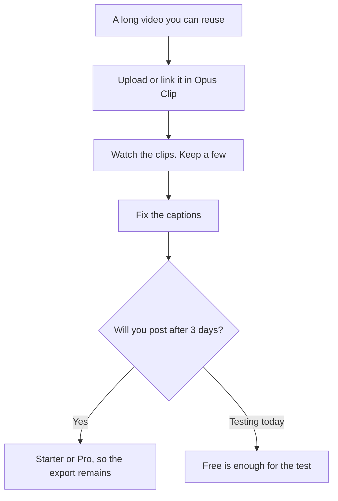

**Create shorts by clipping a long video you already have, then keep only the clips whose words you would say on camera.** Opus Clip finds moments, reframes them, and adds captions. The Virality Score is a label the product shows you. It is not a measurement this site has verified, and it is not a promise about views.

Prices are US list prices excluding tax, from Opus Clip's pricing page as recorded October 16, 2026. The product review is [Opus Clip review](/blog/opusclip-review-2026/). A channel stack that includes this step is [best AI tools for YouTubers](/blog/best-ai-tools-for-youtubers-2026/).

## The plan, before you upload an hour

| Plan | Price | Credits | What you are buying |
|---|---|---|---|
| Free | $0 | 60 a month | A test. Clips stop being exportable after 3 days |
| Starter | $15/month, monthly only | 150 a month | Virality Score, captions, no watermark. A free trial without a card |
| Pro | $29/month, or $14.50/month billed annually ($174/year) | 300 a month | Credits roll over for 2 months, 2 seats, 2 brand templates, 6 social connections |
| Business | Custom | Custom | API, storage, and custom assets |

Credits process video into clips. The directory page does not print a minutes-per-credit rate. Watch the credit counter on the upload. Do not assume 60 credits equal 60 minutes.

## Step 1: Start from a finished long cut

Clip a video that already has a point: a podcast episode, a webinar, a lesson, your own YouTube upload. [Descript](/tools/descript/) is the usual place that long cut was edited. Hobbyist is $16 a person a month billed annually. The edit order is [how to edit podcasts with Descript](/blog/how-to-edit-podcasts-with-descript-2026/). Export the master, then bring it to Opus Clip. Clipping a raw two-hour tape full of false starts produces shorts of false starts.

You need the right to repost the footage and the words. A guest should know the clip will exist. A song in the background can be a separate rights problem. Opus Clip will process the file you give it.

## Step 2: Let it find moments, then watch them

Upload the file, or link a source the product accepts for an account you control. ClipAnything is the clipping model the directory describes, aimed at interviews, explainers, and other genres, not only podcasts. It will return more clips than you should post.

Watch each one with the sound on. Delete any clip that starts mid-sentence in a way that changes the meaning, any clip that makes a guest say something they did not mean, and any clip that is only a face waiting for the point. The score can order your watching. It should not order your publishing.

## Step 3: Captions are the edit

Animated captions in 20+ languages are a Starter feature on the pricing page. Read them. Names, product terms, and numbers are where auto captions fail. A wrong number in a caption is the clip. Fix it before you schedule.

If you want a timeline, templates, and a phone preview after the clip exists, finish in [CapCut](/tools/capcut/). Pro there is $19.99 a month or $179.99 a year, and the in-app price can differ by platform. The comparison of the two editors' jobs is [Descript vs CapCut](/blog/descript-vs-capcut-2026/). Opus Clip's job is finding the moment. CapCut's job is the last frame.

## Step 4: Export on a plan that keeps the file

Free clips expire for export after 3 days. That is fine for a test you will post today. It is a bad plan for a batch you will schedule next week. Starter at $15 removes the watermark and keeps the workflow on a monthly bill. Starter does not offer annual billing. Pro at $14.50 a month on the annual plan is the lower monthly number if you will clip every week, and it adds rollover for 2 months, a second seat, and 6 social connections.

Schedule only the clips you watched. Six connections on Pro are not a reason to post the same weak clip everywhere. One good short on the channel that matches the long video is the result this workflow is for.

A faceless channel that needs a generated voice before the long video exists is a different stack. [ElevenLabs](/tools/elevenlabs/) Starter at $6 a month is the first commercial voice plan. The overview is [start a faceless YouTube channel with AI](/blog/start-faceless-youtube-channel-with-ai/). [invideo AI](/tools/invideo-ai/) is the prompt-to-video path, from $10 a seat a month billed annually. Use it when there is no long video to clip.

## FAQ

### How much does Opus Clip cost?

Free is 60 credits a month, with exports that expire after 3 days. Starter is $15 a month. Pro is $29 a month, or $14.50 a month billed annually.

### What is a credit?

A unit Opus Clip uses to process video into clips. The public pricing page we used does not state minutes per credit. Read the counter on the project.

### Is the Virality Score a view forecast?

It is the product's ranking of clips. This site has not audited it against later views. Watch the clip.

### Can I start from a YouTube link I do not own?

No. Clip footage you have the right to reuse. Your own upload or a file a client sent you is the start. The transcript side of your own video is [how to transcribe YouTube videos with AI](/blog/how-to-transcribe-youtube-videos-with-ai-2026/).

## Last verified

October 16, 2026. Published October 24, 2026.

**Sources:** [Opus Clip pricing](https://www.opus.pro/pricing), [Descript pricing](https://www.descript.com/pricing).

*Published by Andrew for [AI Tools Optimizer](https://aitoolsoptimizer.com).*

[Opus Clip](/tools/opusclip/) and [Descript](/tools/descript/) are in the [video directory](/tools/category/video/). Directory pages may use affiliate links. A purchase through them may earn us a commission at no extra cost to you.
