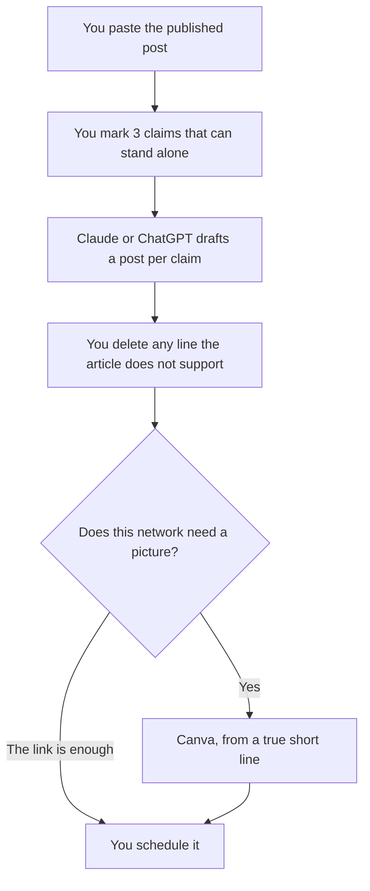

**A social post made from a blog with AI is one claim the article already states, cut to the length of the network, with a link back.** The model can write five openings. It cannot add a statistic, a customer, or a promise that the post did not make. Paste the published article, not your hope for what it should have said.

The article itself is [how to write a blog post with Claude](/blog/how-to-write-a-blog-post-with-claude-2026/). The calendar those posts should sit on is [how to build an AI content calendar](/blog/how-to-build-an-ai-content-calendar-2026/). The fact pass is [how to fact-check AI writing](/blog/how-to-fact-check-ai-writing-2026/).

Prices are US list prices excluding tax from directory pages checked October 16, 2026. Published October 24, 2026. We did not score engagement.

## What the model may touch

| Piece | Who owns it | The model may |
|---|---|---|
| The claim | The published post | Restate it. It may not upgrade it |
| The hook | You, from that claim | Draft several. You pick one |
| The link | You | Not drop it so the post "stands alone" with a new fact |
| The image text | You, if words are on the image | Shorten a phrase that is already true |
| The network | You | Match length. It may not invent a trend |

If the blog is still a draft, do not cut social posts from it. The claims will move. Publish, or at least freeze the paragraph you are quoting. A social line that outruns the article is [a hallucination](/blog/what-is-ai-hallucination-2026/) with a logo on it.

## Where the cut happens

**Several openings from one section.** [Claude](/tools/claude/) Pro is $20 a month, or $17 billed annually. Paste the section, not the whole site. Ask for three posts and a fourth bucket titled "not in the article." Free includes Projects if you want the brand notes kept. The container is [Claude Projects vs ChatGPT Projects](/blog/claude-projects-vs-chatgpt-projects-2026/). The voice card is [how to create a brand voice with AI](/blog/how-to-create-a-brand-voice-with-ai-2026/).

**The team's default chat.** [ChatGPT](/tools/chatgpt/) Plus is $20. Go at $8 is enough for a week's cuts. The ladder is [ChatGPT Go vs Plus vs Pro](/blog/chatgpt-go-vs-plus-vs-pro-2026/). The marketing split, if you were about to buy a writing suite for this, is [Jasper vs ChatGPT for marketing](/blog/jasper-vs-chatgpt-for-marketing-2026/).

**The picture.** [Canva](/tools/canva/) Free is enough to test a layout. Pro is $18 a month, or $180 a year, for one person. Put a short true line on the image. If the words are fiddly, [Ideogram](/tools/ideogram/) is the text-in-image tool. Plus is $20 a month, or $15 billed yearly. Do not generate a chart the article does not contain. The card is [Ideogram pricing explained](/blog/ideogram-pricing-explained-2026/).

**A designed carousel from the approved lines.** [Gamma](/tools/gamma/) Plus is $9 a seat a month. Generate from the claims you marked, not from "make this post viral." The review is [Gamma review](/blog/gamma-review-2026/).

**The sentence.** [Grammarly](/tools/grammarly/) Free is enough for a short post. Pro at $12 a member a month billed annually is optional. The card is [Grammarly pricing explained](/blog/grammarly-pricing-explained-2026/).

If the source is a webinar or a recording, you are on a different workflow. The video path is [how to repurpose a webinar with AI](/blog/how-to-repurpose-a-webinar-with-ai-2026/). [Opus Clip](/tools/opusclip/) Starter is $15 a month for clipping video. It is the wrong tool for a blog that has no footage.

A prompt that holds the line:

"Here is a published section. Write 3 social posts. Each post may use only one claim from the section. Include a place for the link. Do not add statistics, urgency, or customers that are not in the section. Put rejected ideas under Not in the article."

## One claim per post

A blog can support a week of posts if each post is a different true sentence. It cannot support a week of posts if each one adds a result. Three claims, three posts, one link. The reader who clicks should find the sentence you teased.

The team that does this every week is [best AI tools for content teams](/blog/best-ai-tools-for-content-teams-2026/) and [best AI tools for marketers](/blog/best-ai-tools-for-marketers-2026/). A community reply, which is not a broadcast, is [best AI tools for community managers](/blog/best-ai-tools-for-community-managers-2026/).

Keep a copy of what you posted next to the article, in the doc or in [Notion](/tools/notion-ai/). Business is $20 a seat if Notion is where that log lives. Plus at $10 is not the full AI tier. A chat thread will not tell you, in three months, which claim you already used.

## FAQ

### Can AI turn one blog into a month of posts?

It can repeat the same claim with new adjectives. That is not a month of posts. Mark the distinct claims. If there are four, you have four posts. Write another article when you need more.

### Should every post include the link?

Yes, unless the network is a format where the link cannot appear and you have accepted that. A post that states a result and does not point at the source is asking the reader to trust the caption. Point at the paragraph.

### What about hashtags and trends?

Add them only if they are true of the post. A model will attach a trending tag the article does not earn. Delete it. This page did not study reach.

### Can I quote a customer in the social cut?

Only if the case study they approved already contains that quote, and the approval covers this use. The workflow is [how to write a case study with AI](/blog/how-to-write-a-case-study-with-ai-2026/). Do not pull a quote from a sales call into a public post because the blog felt thin.

## Last verified

October 16, 2026 for Claude, ChatGPT, Canva, Ideogram, Gamma, Grammarly, Opus Clip, and Notion prices named above. Published October 24, 2026.

**Sources:** [Claude pricing](https://claude.com/pricing), [Canva pricing](https://www.canva.com/pricing/), [ChatGPT pricing](https://chatgpt.com/pricing).

*Published by Andrew for [AI Tools Optimizer](https://aitoolsoptimizer.com).*

[Canva](/tools/canva/) is in the [design directory](/tools/category/design/). Directory pages may use affiliate links. A purchase through them may earn us a commission at no extra cost to you.
