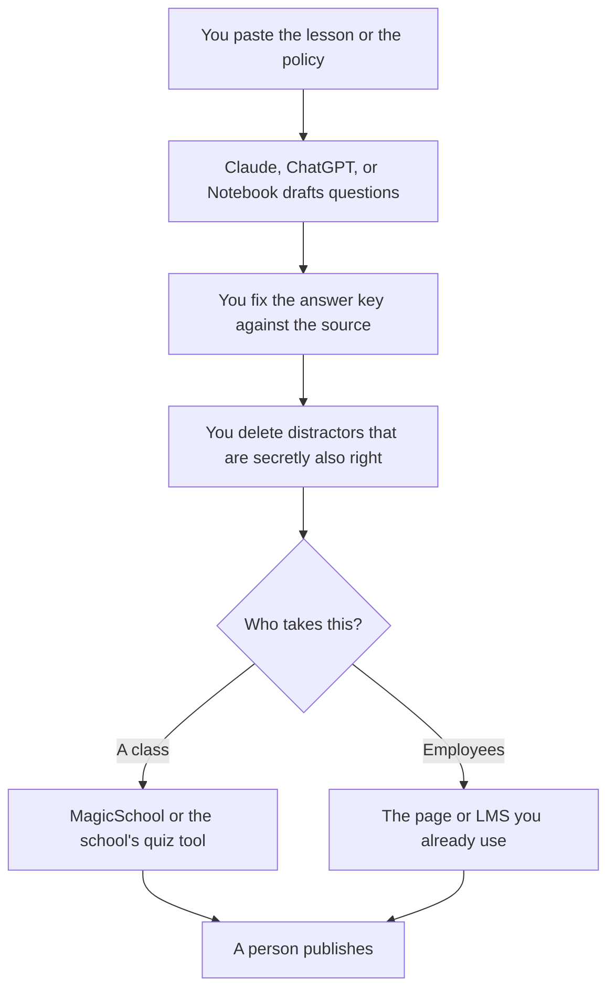

**A training quiz written with AI is a set of questions from material you already trust, with an answer key you checked.** The model can draft the stems and the distractors. It cannot know which policy is current, which answer your course marked correct, or which question would embarrass a learner who did the reading. Paste the source. Write or fix the key. Then publish.

A quiz that teaches the wrong step is worse than no quiz. The fact pass is [how to fact-check AI writing](/blog/how-to-fact-check-ai-writing-2026/). The person who publishes is [what human-in-the-loop AI is](/blog/what-is-human-in-the-loop-ai-2026/). A student using a quiz to study, which is a different job from writing one, should read [Gemini Notebook study workflows](/blog/gemini-notebook-study-workflows/).

Prices are US list prices excluding tax from directory pages checked October 16, 2026. Quizlet's paid price did not load in that check. Published October 24, 2026. We did not measure learning.

## What the model may touch

| Piece | Who owns it | The model may |
|---|---|---|
| The source | You. A lesson, a policy, a doc | Not replace it with a general explanation |
| The correct answer | You | Draft it only from the source, then you check it |
| The wrong answers | You | Draft plausible distractors. You delete tricks |
| The audience | You. New hires, customers, a class | Match the level. It may not add a topic you did not teach |
| The score | You, in the tool that delivers the quiz | Not declare that someone is certified |

Ask for the source line under each question. If the model cannot point at a sentence you pasted, drop the question. That attachment is [what AI grounding is](/blog/what-is-ai-grounding-2026/). A question with no source is how a quiz invents a rule.

## Where the draft happens

**A long lesson.** [Claude](/tools/claude/) Pro is $20 a month, or $17 billed annually. Put the lesson in a Project. Ask for ten questions, each with one correct answer, three distractors, and the sentence it came from. Free includes Projects, with limits. The container is [Claude Projects vs ChatGPT Projects](/blog/claude-projects-vs-chatgpt-projects-2026/).

**A short quiz beside other work.** [ChatGPT](/tools/chatgpt/) Plus is $20. Go is $8. Keep the source in the thread. The ladder is [ChatGPT Go vs Plus vs Pro](/blog/chatgpt-go-vs-plus-vs-pro-2026/).

**The readings, if they are files.** [Gemini Notebook](/tools/gemini-notebook/) can quiz from sources you upload. It is free with a Google account. Google AI Plus is $4.99 a month. The notebook's quiz is tied to that source set. Export the questions you will reuse, and check them. Do not leave the only copy inside a notebook you might delete.

**A K-12 teacher.** [MagicSchool](/tools/magicschool/) is free for individual teachers. Plus is $8.33 a user a month billed annually, or $12.99 monthly. The directory says it is SOC 2 certified and FERPA/COPPA compliant, and that student and teacher data is not used to train AI. District tools are Enterprise, priced by the district. The teacher shelf is [best AI tools for teachers](/blog/best-ai-tools-for-teachers-2026/). If your district has a tool list, the list wins.

**Flashcards, after the quiz exists.** [Quizlet](/tools/quizlet/) Free includes flashcards and practice questions. Plus adds more of the study tools. The October 16 check could not load a Plus price, so this page does not print one. Confirm it at quizlet.com/upgrade. Move only the items you checked.

**The page the quiz will live on, if it is a doc and not an LMS.** [Notion AI](/tools/notion-ai/) Business is $20 a seat. A Notion page is not an exam proctor. It is a fine place to draft. The card is [Notion AI pricing explained](/blog/notion-ai-pricing-explained-2026/).

A prompt that holds the line:

"Using only the lesson below, write 8 multiple-choice questions. One correct answer each. Three distractors that are wrong for a reason the lesson supports. Under each question, quote the sentence you used. If the lesson does not support a question, do not write it. Do not add facts from outside the lesson."

## Company training versus a class

Employees need the current policy, not a polished approximation. If the source is a handbook that legal has not approved, do not generate the quiz yet. A wrong distractor that is actually the new policy will teach the old one.

Customers and new hires need a short quiz on what you documented. The FAQ that should exist beside it is [how to create FAQ pages with AI](/blog/how-to-create-faq-pages-with-ai-2026/). A bot that answers the same docs is a different build: [how to build an FAQ chatbot from docs](/blog/how-to-build-an-faq-chatbot-from-docs-2026/). Do not replace the quiz with a bot, and do not replace the docs with a quiz.

A training video with a quiz inside the player is a third budget. [HeyGen](/tools/heygen/) Business at $149 a month is where the directory puts interactive pieces such as quizzes, plus SCORM. Most teams do not need that to publish ten questions under a doc. Read [Synthesia vs HeyGen for training](/blog/synthesia-vs-heygen-for-training-2026/) before you buy a video seat to deliver a form.

## FAQ

### Can AI write the quiz from the slide deck alone?

It can draft from the slides you paste. Slides omit the caveat that was said out loud. Add that caveat to the source, or accept that the quiz will not teach it.

### How do I stop trick questions?

Ask for distractors that are wrong for a reason in the lesson, and read them. A distractor that is also defensible will start an argument you did not want. Delete it.

### Is this the same as a student using AI to take the quiz?

No. This page is for the person writing the quiz. A learner pasting the quiz into a chat is a different problem, and your academic or HR rules cover it. A student study stack is [best AI tools for students](/blog/best-ai-tools-for-students-2026/).

### Where should the answer key live?

Next to the questions, in the tool that delivers them, with access limited to the people who grade. A chat thread is not a key. Date the source you used so the next editor knows when the policy moved.

## Last verified

October 16, 2026 for Claude, ChatGPT, Gemini, MagicSchool, Notion, and HeyGen prices. Quizlet Plus was not priced in that check. Published October 24, 2026.

**Sources:** [MagicSchool](https://www.magicschool.ai/), [Gemini Notebook](https://workspace.google.com/products/gemini-notebook/), [Claude pricing](https://claude.com/pricing).

*Published by Andrew for [AI Tools Optimizer](https://aitoolsoptimizer.com).*

[MagicSchool](/tools/magicschool/) is in the [education directory](/tools/category/education/). Directory pages may use affiliate links. A purchase through them may earn us a commission at no extra cost to you.
