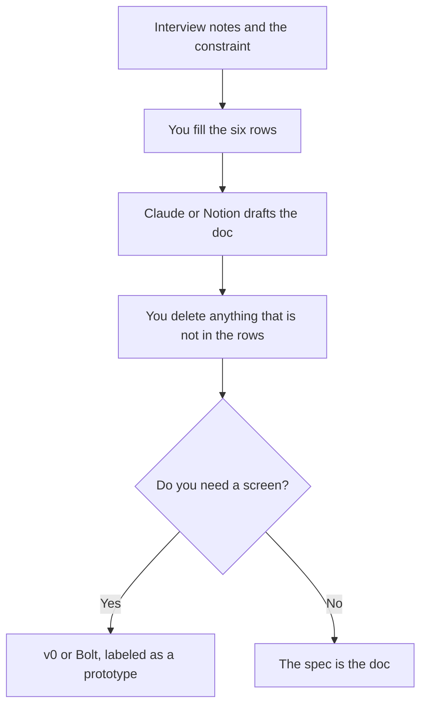

**A product spec drafted with AI is a document of decisions you already made: who it is for, what it will not do, and how you will know it worked.** The model can turn those decisions into headings. It cannot attend the meeting where the scope was cut. A spec that is only a prompt will describe a product nobody agreed to build.

The stack around a product manager is [best AI tools for product managers](/blog/best-ai-tools-for-product-managers-2026/). Interview notes that should feed the spec are [how to use AI for user interview notes](/blog/how-to-use-ai-for-user-interview-notes-2026/). The claim check is [how to fact-check AI writing](/blog/how-to-fact-check-ai-writing-2026/).

Prices below mix directory pages checked October 16, 2026 with v0's pricing page read October 24, 2026. Published October 24, 2026. We did not score specs.

## The decisions, before the prose

| Section | Who writes the substance | The model may |
|---|---|---|
| Problem and user | You, from interviews or tickets | Tighten the sentence |
| Non-goals | You | Refuse to smuggle a non-goal back into the solution |
| Solution in one paragraph | You | Expand it only with details you pasted |
| Open questions | You | List them. It may not close them |
| Success measure | You | Format the measure. It may not invent a target |
| Prototype | A builder, after the paragraph exists | Generate a screen in v0 or Bolt. The screen is not the spec |

## Where the draft lives

**A long document.** [Claude](/tools/claude/) Pro is $20 a month, or $17 billed annually, on the October 16 card. Put the interview excerpts and the decision table in a Project. Free includes up to five Projects on that card. Ask for the spec in your headings, and for a final section titled "claims not in the source." Delete that section or go get the source. The project comparison is [Claude Projects vs ChatGPT Projects](/blog/claude-projects-vs-chatgpt-projects-2026/).

**The wiki the team already uses.** [Notion AI](/tools/notion-ai/) Business is $20 per seat per month. The spec should live where engineering will comment. A chat transcript is a poor system of record. The notes comparison is [Notion AI vs ChatGPT for notes](/blog/notion-ai-vs-chatgpt-for-notes-2026/).

**ChatGPT, if that is the team's default.** Plus is $20 and lists projects. Use a Project for the running spec. Use a custom GPT only for the format, not for the facts. That split is [ChatGPT Projects vs custom GPTs](/blog/chatgpt-projects-vs-custom-gpts-2026/).

**A screen, after the paragraph.** [v0](/tools/v0/) Plus is $30 per user per month with $30 of credits, on the page read October 24, 2026. Free is a 7-message day. Label the output "prototype." Link the spec. Do not let the generated UI add a button the non-goals forbade. The invoice is [v0 pricing explained](/blog/v0-pricing-explained-2026/). [Bolt.new](/tools/bolt-new/) is the other builder if you want the larger free token pool. The comparison is [Bolt vs Lovable vs v0](/blog/bolt-vs-lovable-vs-v0-2026/).

**The meeting where the spec was argued.** [Granola](/tools/granola/) Business is $14 per user per month for unlimited history. Basic is free with 30 days, on the pricing page the Granola article used for October 24, 2026. Paste the decision lines into the spec. Do not paste the whole transcript and ask the model to "pull the requirements." It will promote a side comment into scope.

A prompt that keeps the boundary:

"Decision table is below. Write the spec in these headings: problem, non-goals, solution, open questions, measure. If a heading needs a fact the table does not have, write 'open question' and stop. Do not add features."

One spec you already liked, pasted above the table, is [what few-shot prompting is](/blog/what-is-few-shot-prompting-2026/).

## FAQ

### Can AI write the spec from a one-line idea?

It can write a plausible document. That document is a brainstorm. Call it a brainstorm until a person fills the non-goals and the measure. Shipping the brainstorm as the spec is how teams build the wrong thing on time.

### Should the spec include the technical design?

Only the constraints engineering has already stated. The model can format them. The design itself is a different doc, written by the people who will own the system.

### How do interview quotes get in?

As quotes, with the date, and only when the person agreed the note can be shared inside the company. The capture step is the interview-notes article linked above. A summary is not a quote.

### Who approves it?

The person who can say no to the next feature. The model drafts. The reviewer deletes. Engineering and design comment on the non-goals before anyone opens v0.

## Last verified

October 16, 2026 for Claude, Notion, and ChatGPT prices. October 24, 2026 for v0's Plus price, from v0.app/pricing, and for Granola's $14 Business price as used in the Granola pricing article. Published October 24, 2026.

**Sources:** [Claude pricing](https://claude.com/pricing), [Notion AI](https://www.notion.com/product/ai), [v0 pricing](https://v0.app/pricing).

*Published by Andrew for [AI Tools Optimizer](https://aitoolsoptimizer.com).*

[Notion AI](/tools/notion-ai/) is in the [productivity directory](/tools/category/productivity-notes/). Directory pages may use affiliate links. A purchase through them may earn us a commission at no extra cost to you.
