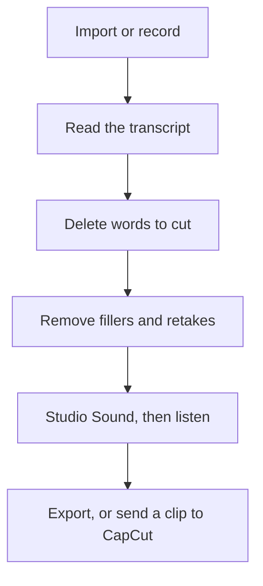

**Edit the words, then listen once for the sound.** Descript's advantage is that a delete in the transcript deletes the media. The workflow below is the order that uses that advantage, plus the plan that matches how many minutes you import. It is not a tour of every button.

Prices are US list prices excluding tax, from Descript's pricing page as checked October 16, 2026, published here on October 24, 2026. A live refetch that day did not return the page. The buying comparison with a timeline editor is [Descript vs CapCut](/blog/descript-vs-capcut-2026/). The product review is [Descript review](/blog/descript-review-2026/).

## Pick the plan from the minutes, not the logo

| Plan | Price | Media | AI credits | Choose it when |
|---|---|---|---|---|
| Free | $0 | 60 minutes a month | The free allowance | You are learning on a short episode. No card |
| Hobbyist | $16/person/month annually, or $24 monthly | 10 hours | 400 | You will publish 1080p without a watermark |
| Creator | $24 annually, or $35 monthly | 30 hours | 800 | You need 4K or full Underlord, and you edit often |
| Business | $50 annually, or $65 monthly | 40 hours | 1,500 | You need Brand Studio or translation and dubbing in 30+ languages |

Prices are per person. Underlord, the co-editor, is available on Hobbyist and fully available on Creator and above. Transcription in 25 languages is on every plan. Do not buy Business for a solo English-language show.

## Step 1: Record into a file you can afford

Descript can record, including a screen recorder and Rooms for a remote guest. You can also import a file from another recorder. Media hours count the media Descript processes for you. A two-hour raw tape is two hours against the monthly pool, even if the finished episode is 30 minutes. Hobbyist's 10 hours is about five of those raw tapes, not ten finished episodes, if you import the whole board.

Record cleanly so you are not paying hours for a second take of the same story. Filler removal is not a reason to ignore the microphone.

If the episode is a read narration rather than a conversation, generate the voice on a plan that allows commercial use, then import the audio. [ElevenLabs](/tools/elevenlabs/) Starter at $6/month is the first plan with that license. The credit rules are [ElevenLabs pricing explained](/blog/elevenlabs-pricing-explained-2026/). Do not use Descript's AI speech to imitate a guest who did not say the line.

## Step 2: Cut by deleting sentences

Wait for the transcript. Read it as a script. Delete false starts, the paragraph that repeated the intro, and the aside that will not survive a listener who is driving. Each deletion is an edit. This is faster than blade-cutting a waveform, and it is the reason you are in this app instead of [CapCut](/tools/capcut/).

Leave a breath. A transcript cut that removes every pause sounds like a different, worse show. Play the join. If the room tone jumps, that is an edit to undo, not a failure of the idea.

## Step 3: Fillers and retakes, as a pass of their own

Descript can remove filler words and retakes. Run that after the structural cut, not before. If you strip every "um" first, you will not know which sentences you meant to delete, and you will spend AI credits polishing audio you are about to throw away.

Listen to a minute after the filler pass. Over-cleaned speech is a tell. Put a few fillers back if the host sounds unlike themselves.

## Step 4: Studio Sound, then a human listen

Studio Sound is the one-click cleanup for a noisy room. Use it when the room is the problem. Skip it when the recording was already clean, because processing is not free of artifacts. Then listen to the episode once in order, without looking at the transcript. The transcript will forgive a repeated word that the ear will not.

Underlord can build a tighter cut from instructions. Use it on Creator, where full access is listed, and only after you have a note of what "tighter" means: the cold open, the tangent at 40 minutes, the repeated ask. An instruction of "make it good" spends credits and returns a cut you cannot explain. Hobbyist can try the feature. It is not a reason to skip the listen.

## Step 5: Export the master, then the clips

Export the show master from Descript. Make the vertical teaser in CapCut, where the templates and the phone preview live, or find candidate clips with [Opus Clip](/tools/opusclip/). Opus Clip's free plan is 60 credits and the clips expire for export after three days. Starter at $15/month removes the watermark. A channel stack that includes this handoff is [best AI tools for YouTubers](/blog/best-ai-tools-for-youtubers-2026/).

Captions for a short belong in CapCut or in Descript's own captioning, using the transcript you already trust. Do not retype them from memory.

## What this workflow will not do

- It will not mix a music-heavy, sound-designed episode the way a traditional DAW will. Speech is the fit.
- It will not replace a producer who decides the story. The transcript makes the cut faster. It does not decide which story you are telling.
- It will not ethically add a sentence the guest did not say. Cut. Do not invent.

If the "podcast" is a meeting you need notes from, you wanted a notetaker. [Fathom](/tools/fathom/) records and transcribes on a free plan. That is a different file and a different job.

## FAQ

### Is Descript's free plan enough for a podcast?

Enough to learn, on 60 media minutes a month. A weekly hour-long raw recording does not fit. Hobbyist is the first publishing plan: watermark-free 1080p and 10 media hours.

### Do I need Creator?

You need it for 4K export, 30 media hours, 800 AI credits, and full Underlord. A 1080p interview show can stay on Hobbyist until the hours or the credits say otherwise.

### Can I edit a video podcast the same way?

Yes. The transcript cuts the picture with the sound. That is the feature. Color and effects are still a weak fit. Finish the social version in CapCut.

### Should I remove every filler word?

No. Remove the ones that stall the sentence. Leave the ones that are the person's voice. Listen after the pass.

## Last verified

October 16, 2026 for Descript's prices. Published October 24, 2026. The pricing page did not return a fresh fetch that day.

**Sources:** [Descript pricing](https://www.descript.com/pricing), [Descript](https://www.descript.com).

[Descript](/tools/descript/) is in the [video directory](/tools/category/video/). Directory pages may use affiliate links. A purchase through them may earn us a commission at no extra cost to you.
