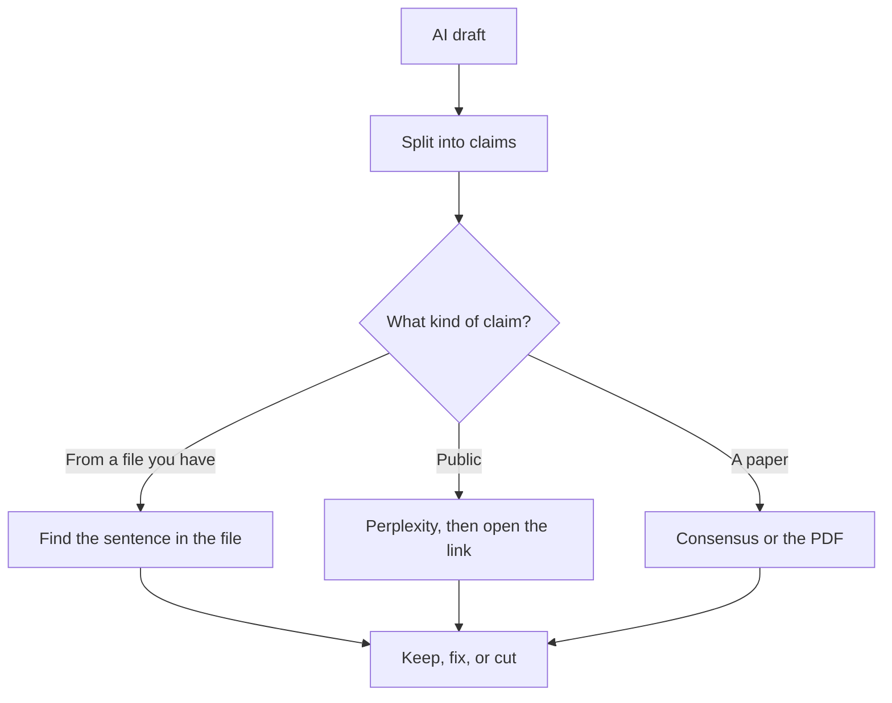

**Fact-check an AI draft by listing the claims, opening a source for each one, and deleting any claim that has no source.** Grammar, tone, and "sounds right" are a later pass. The model that wrote the paragraph is a weak witness for the paragraph. A second model can help you find the page. You still open the page.

The failure you are looking for is [what an AI hallucination is](/blog/what-is-ai-hallucination-2026/). A chat that is supposed to bring the page with the answer is [what retrieval-augmented chat is](/blog/what-is-retrieval-augmented-chat-2026/). Prices are US list prices excluding tax. Perplexity's figures are the ones in the October 24, 2026 pricing article. Other prices are from directory pages checked October 16, 2026. Published October 24, 2026.

## Sort the claim before you pick a tool

| Kind of claim | Where the source has to be | Tool that fits the lookup |
|---|---|---|
| A number, date, or quote from a page you were given | That page | Your eyes. A chatbot only helps if it quotes the line and you find the line |
| A public fact about a company or a product | The company's page, or a named report | [Perplexity](/tools/perplexity/). Pro is $17/month billed annually |
| A sentence you already drafted, and you need a cleaner line | Nowhere new. Editing is not verification | [Grammarly](/tools/grammarly/) Pro is $12/member/month annually. The split is [Grammarly vs ChatGPT for editing](/blog/grammarly-vs-chatgpt-for-editing-2026/) |
| A scientific claim | The paper | [Consensus](/tools/consensus/). Pro is $12/month billed annually |
| A claim about your own product | Your help center or your spec | The file. [ChatGPT](/tools/chatgpt/) Plus at $20 can reformat the check. It cannot be the source |

Asking the same model "are you sure?" often returns a more confident version of the same sentence. Use a retrieval step, or the original file. The research pairing is [ChatGPT vs Perplexity for research](/blog/chatgpt-vs-perplexity-for-research-2026/).

## A pass you can repeat

**1. Highlight only the sentences a stranger could prove false.** Opinions, transitions, and "we believe" lines can wait. Prices, dates, proper names, causal claims, and quotes cannot.

**2. Put each claim on its own row.** A paragraph with three facts is three checks. The table below is the whole method.

**3. Attach a source or write "cut."** For a public claim, search in Perplexity and open the link. For a claim that came from notes, the notes are the source. For a paper, use Consensus or the PDF. The paper workflow is [how to research with Elicit and Consensus](/blog/how-to-research-with-elicit-and-consensus-2026/).

**4. Repair from the source's wording.** If the page says "up to 10," the draft cannot say "10." If the page is silent, the draft is silent. A smoother sentence that adds a qualifier is a new claim.

**5. Run the edit pass after the facts.** Grammarly, or a rewrite in [Claude](/tools/claude/) Pro at $20 a month or $17 billed annually, comes after the table is clean. A rewrite can reintroduce a fact. Spot-check the numbers again after the polish.

**6. Save the table with the draft.** The next editor should see the source, not only the prose. A link in a footnote that 404s is an empty cell.

| Claim in the draft | Source opened | Verdict |
|---|---|---|
| "Pro is $20 a month" | The pricing page, with the date you opened it | Keep, and name the date if the page moves |
| "Customers love the annual plan" | None | Cut, unless a real quote is attached |
| "The study found a 30% gain" | The PDF, or cut | Keep only the figure the PDF prints, with the population it names |

## What not to outsource

**Do not ask a chatbot to fact-check itself in the same thread and then ship.** A fresh thread with the claim and an instruction to find a primary page is a better lookup. The instruction still ends with you opening the page. Chain-of-thought steps inside one model are [what chain-of-thought prompting is](/blog/what-is-chain-of-thought-prompting-2026/). They make a calculation easier to audit. They do not create a missing source.

**Do not treat a search summary as the citation.** Paste the URL you opened. A summary of a summary is how a statistic drifts. Perplexity Max at $167 a month billed annually is a usage tier. It is not a higher grade of truth than Pro.

**Do not fact-check a voice pass as if it were a research pass.** "Make it warmer" can change a commitment. Freeze the facts in the table first. The voice work is [how to create a brand voice with AI](/blog/how-to-create-a-brand-voice-with-ai-2026/).

## FAQ

### Can Grammarly fact-check a draft?

It can flag a sentence and suggest a clearer one. Correctness against a source is your table. A fluent suggestion can still be wrong. Use Grammarly after the claims are tied to pages.

### Is the free tier of Perplexity enough?

For a few public claims a week, try it. Pro at $17 a month billed annually is the plan when the weekly cap stops the work. Either way, open the link. The plan does not open it for you.

### How many claims should I check?

Every claim you would be ashamed to retract. A product roundup might have a price in every row. A personal essay might have none. The table scales to the draft. It does not require a tool subscription to exist.

### What if two sources disagree?

Quote both, or pick the primary page (the vendor, the paper, the filing) and say which one you used. An AI blend of the two is a third number nobody published.

## Last verified

October 24, 2026 for the Perplexity prices as recorded in the pricing article. October 16, 2026 for ChatGPT, Claude, Grammarly, and Consensus. Published October 24, 2026.

**Sources:** [Perplexity Pro](https://www.perplexity.ai/pro), [OpenAI ChatGPT pricing](https://openai.com/chatgpt/pricing/), [Consensus pricing](https://consensus.app/pricing/).

*Published by Andrew for [AI Tools Optimizer](https://aitoolsoptimizer.com).*

[Perplexity](/tools/perplexity/) is in the [research directory](/tools/category/research-search/). Directory pages may use affiliate links. A purchase through them may earn us a commission at no extra cost to you.
