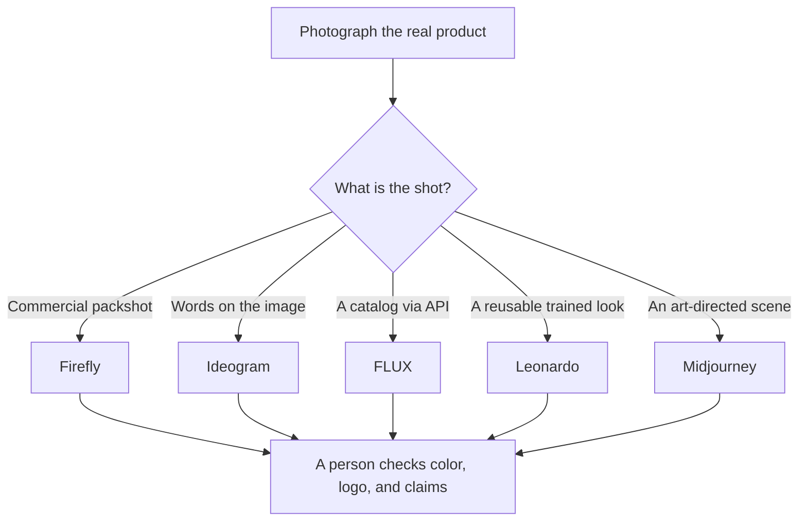

**Start from a real photo of the product, then pick the model for the shot type: a clean commercial still, words on a label, a batch through an API, or an art-directed scene.** Generating a product from a text prompt alone is how the logo, the color, and the claim drift. The workflow below is the order that keeps the object honest.

Prices are US list prices excluding tax, from vendor pages checked October 16, 2026, published here on October 24, 2026. A live refetch of those pages that day did not return numbers. We did not score which model looks more photographic. The assignments follow the controls each company sells.

The model comparison is [Midjourney vs Leonardo vs Flux](/blog/midjourney-vs-leonardo-vs-flux-2026/). The wider set is [best AI image generators](/blog/best-ai-image-generators-2026/).

## Which tool for which shot

| Shot | Tool | Why this one | First paid step |
|---|---|---|---|
| A commercial still you may need to describe as generated on Adobe's licensed-training models | [Adobe Firefly](/tools/adobe-firefly/) | Paid plans include unlimited standard image generations. Credits spend on premium and partner models | Standard, $9.99/month, with 2,000 monthly credits |
| Packaging or an ad where the words must be spelled correctly | [Ideogram](/tools/ideogram/) | The product is text in the image | Plus, $20/month or $15 on yearly billing, with 2,400 monthly credits. Free is 30 credits a week |
| Hundreds of catalog stills from your own app | [FLUX](/tools/flux/) | Pay per image. No seat | FLUX 3 Klein from $0.008 at 768×768 to $0.036 at 4K |
| One product look you will train and reuse | [Leonardo.Ai](/tools/leonardo-ai/) | Personal model training | Essential $12/month to start. Ultimate $60/month lists 50 personal models |
| A stylized lifestyle scene, not a spec sheet | [Midjourney](/tools/midjourney/) | Style references and moodboards | Standard $30/month. Pro $60 if the images must be private or the company is over $1,000,000 gross revenue |
| A resize into an ad layout after the still exists | [Canva](/tools/canva/) or [AdCreative.ai](/tools/adcreative-ai/) | Layout and ad sizes, not the product truth | Canva Pro $18/month. AdCreative Starter $39/month, or $20 billed yearly |

## Step 1: Lock the reference

Shoot the product, or export the manufacturer's image you have rights to use. Note the hex colors if the brand is strict, the exact product name, and every word that is a legal claim: materials, dimensions, "organic," a price. The generator does not know which of those words are regulated. You do.

If you cannot photograph it, say so in the file name. A concept render is not a listing photo. Marketplaces and ad policies differ on whether a generated image must be labeled. Read the policy of the place you will upload. This article is not that policy.

## Step 2: Generate the background and the scene, not a new product

Use the reference image as the input wherever the tool allows an image prompt. Ask for the scene: a table, a color field, a hand, a room. Ask it to keep the product unchanged. Then look at the output at 100% zoom. The failures that matter are a warped logo, a changed port, an extra button, and a label that says something you did not write.

Firefly Standard is the default for a design team already in Adobe, because standard image generations are unlimited on the paid plans and the training-data claim is Adobe's. Credits still apply to video, audio, and partner models. Do not burn the 2,000 Standard credits on a job the unlimited standard generator already does. Pro is $19.99, Pro Plus $49.99, and Premium $199.99 if the credit pool is the constraint. The review is [Adobe Firefly review](/blog/adobe-firefly-review-2026/).

## Step 3: Put words in a tool that is built for words

If the shot needs a headline, a price badge, or packaging text, do that in Ideogram or typeset it in Canva on top of a clean render. Midjourney's own limits include less precise text. FLUX is better at text than a purely stylistic model, and Ideogram is still the tool whose plan is organized around legible type. Ideogram's free tier is public. Plus is where private generation starts. Do not put an unreleased product on a public free tier.

[Canva](/tools/canva/) Free is enough to place a real logo and a real price on a background. Pro at $18/month or $180/year adds brand kit and resize. That is often the whole "product photo" job: a real photo, a clean background, type you typed yourself.

## Step 4: Only then batch it

FLUX is the batch path. One credit is $0.01. A 768×768 FLUX 3 Klein image lists at $0.008, and 4K at $0.036. Two thousand 4K images are $72 before you count the bad ones you throw away. Budget for the throwaways. The API and the playground use the same prices in the docs we used. See [FLUX review](/blog/flux-review-2026/).

Leonardo is the batch path when the batch must share a trained model of this product. Measure tokens on Essential before you buy Ultimate for the model slots. Premium at $30/month is the unlimited-relaxed-image tier for select models. See [Leonardo review](/blog/leonardo-ai-review-2026/).

Midjourney is the batch path only for a look, and only on a plan that matches your privacy and revenue rules. Stealth is Pro or Mega. The clock and the revenue rule are [Midjourney pricing explained](/blog/midjourney-pricing-explained-2026/).

AdCreative is the path when the deliverable is a set of ad sizes, not a master still. Credits are spent on download, and previews are unlimited on the plan we reviewed. Starter is $39 monthly or $20 on a yearly bill. It is a media-buying tool. It should receive a correct product image, not invent one. See [AdCreative.ai review](/blog/adcreative-ai-review-2026/).

## What you still check before upload

- The product matches the reference: color, shape, logo, count of items in the box.
- No claim appears that is not on the real packaging.
- No person's face or a competitor's product sneaked into the scene.
- The file you upload is the one a person approved, not the contact sheet.

## FAQ

### What is the best AI for product photos?

For a commercially conservative still, start with Firefly. For words in the image, Ideogram. For an API catalog, FLUX. For a trained product model, Leonardo. For an art-directed campaign frame, Midjourney. There is no single winner across those shots.

### Can I use AI product photos on a store?

Only if the marketplace, the brand, and the rights to the reference image allow it, and a person has checked the object. A generated label that changes a claim is a listing problem, not a style choice.

### How much does a product image cost?

From under a cent on FLUX at a small resolution, up to a monthly seat if you are exploring in Midjourney or Firefly. The seat is cheaper per image only after you generate enough to justify the month. A handful of packshots does not need Mega.

### Do I need a photoshoot at all?

You need a reference you have rights to. A phone photo on a white background is enough for many of these tools to relight and extend. It is not enough to skip the check at the end.

## Last verified

October 16, 2026 for prices. Published October 24, 2026. Pricing pages did not return a fresh fetch that day.

**Sources:** [Adobe Firefly plans](https://www.adobe.com/products/firefly/plans.html), [Ideogram plans](https://docs.ideogram.ai/plans-and-billing/available-plans), [Black Forest Labs pricing](https://bfl.ai/pricing), [Leonardo pricing](https://leonardo.ai/pricing/), [Comparing Midjourney plans](https://docs.midjourney.com/hc/en-us/articles/27870484040333-Comparing-Midjourney-Plans).

These tools are in the [image generation directory](/tools/category/image-generation/). Directory pages may use affiliate links. A purchase through them may earn us a commission at no extra cost to you.
