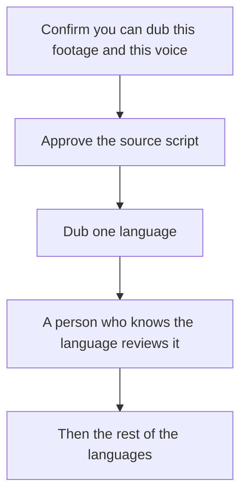

**Localize a video you have the rights to, from a script a person has approved, and review the first language in full before you order the rest.** AI dubbing and avatar translation multiply whatever is in the source, including a wrong price or a joke that does not travel. The tool choice follows the artifact: an avatar course, a voice on footage you shot, or a screen recording.

Prices are US list prices excluding tax from directory pages checked October 16, 2026. Published October 24, 2026. We did not score lip-sync or translation quality. A native speaker in the target language is the review step this workflow keeps.

## Where the second language lives

| Artifact | Tool | The plan that lists the language feature |
|---|---|---|
| An avatar presenter, and you need many languages on a self-serve plan | [HeyGen](/tools/heygen/) | Creator $29/month lists 175+ languages and dialects, 1080p, no watermark. Free lists 30+ languages, capped at 3 videos of 1 minute |
| An L&D stack with one-click translation, Brand Kits, and SCORM | [Synthesia](/tools/synthesia/) | One-click translation into 140+ languages is Enterprise. Starter at $29/month billed monthly is the MP4 plan, shown as $19 on yearly billing |
| Footage you shot, dubbed as voice | [ElevenLabs](/tools/elevenlabs/) | Starter $6/month includes Dubbing Studio and a commercial license. Free has 10,000 credits and no commercial license |
| A screen recording, with dubbing inside the editor | [Descript](/tools/descript/) | Business $50/person/month annually lists translation and dubbing in 30+ languages. Hobbyist at $16 annual is the edit, not that dub |
| Captions and a resize after the master exists | [CapCut](/tools/capcut/) | Pro is $19.99/month or $179.99/year. Confirm subtitle features in the current app |

The training comparison, including which plan lists SCORM, is [Synthesia vs HeyGen for training](/blog/synthesia-vs-heygen-for-training-2026/). The wider product split is [HeyGen vs Synthesia](/blog/heygen-vs-synthesia-2026/).

## The production order

**1. Rights.** You need the right to use the picture, the music, and the voice. A cloned voice is a separate permission from a stock avatar. HeyGen lists voice cloning on Creator. ElevenLabs lists Professional Voice Cloning on Creator at $22 a month, and a commercial license starting on Starter at $6. Read the license for the channel you will publish on. A social clip and a paid course can sit under different terms.

**2. The source script.** Write it in the language you can edit. Short sentences survive dubbing better than a paragraph with three asides. Remove the filler and the false start in the source edit first if the master is a recording. That pass is [how to remove filler words with Descript](/blog/how-to-remove-filler-words-with-descript-2026/).

**3. Pick one path.** Avatar: HeyGen or Synthesia. Voice on your footage: ElevenLabs Dubbing Studio, or Descript Business if the edit and the dub should stay in one file. Do not pay for three dubbing stacks for one video. The ElevenLabs ladder is [ElevenLabs pricing explained](/blog/elevenlabs-pricing-explained-2026/). HeyGen's credit and minute caps are [HeyGen pricing explained](/blog/heygen-pricing-explained-2026/).

**4. Spend a small test.** HeyGen Free is three one-minute videos, which is enough to hear one language and not enough to ship a course. Synthesia Basic includes 10 minutes and 500 credits, with a watermark, and prices dubbing at about 76 credits a minute after the included minutes. ElevenLabs Free is 10,000 credits with no commercial license, so a test you might publish belongs on Starter. Watch the credit debit on that one language and multiply.

**5. Human review of language one.** A bilingual colleague or a contractor reads the subtitles and listens to the dub. Proper nouns, prices, and anything regulatory get checked against the source. Then you multiply. Synthesia's 140+ language button on Enterprise is a volume feature. It is also a volume of review if you treat every language as publishable on the day it renders.

**6. Captions even when you dub.** Many viewers watch muted. CapCut or the editor you already use can burn in captions from the approved script. Translated captions are a document. They deserve the same review as the voice.

**7. Store the script beside the file.** The next product change should edit the script, then re-render the languages that mention the change. Re-rendering every language because a thumbnail changed is how credit bills grow. Avatar courses that will be updated quarterly are the case for [how to make training videos with Synthesia](/blog/how-to-make-training-videos-with-synthesia-2026/) or HeyGen's equivalent, with the LMS format decided first.

## What this workflow does not promise

Lip-sync that survives a close-up, a joke that lands, or a legal equivalence between languages. On-screen text inside the picture often stays in the source language unless you rebuild the frame. [Ideogram](/tools/ideogram/) and other image tools are a still-frame problem, not a dubbing problem. Budget a designer for text in the picture.

A marketing page and a course can share a master and still need different plans. HeyGen Business at $149 a month is the self-serve SCORM tier. Synthesia puts SCORM and one-click translation on Enterprise. An MP4 on a landing page can stay on HeyGen Creator at $29.

## FAQ

### What is the cheapest way to dub one video?

ElevenLabs Starter at $6 a month, if you have the footage and a commercial license matters. HeyGen Free, if a one-minute avatar test is enough to decide. Descript Hobbyist does not include the 30+ language dub. That line is Business at $50 a month billed annually.

### Should I translate with ChatGPT and then record a voice?

You can draft a translation in [ChatGPT](/tools/chatgpt/) or [Claude](/tools/claude/) and have a person edit it, then record or dub from the edited script. Plus and Pro are $20 a month. The chat draft is not the review. The person who knows the language is the review.

### Do I need an avatar to localize?

No. Footage you already shot is an ElevenLabs or Descript job. An avatar helps when you will not put a person on camera and the script will change. Localizing a bad script in twelve languages produces twelve bad videos.

### How do credits work on a dub?

Synthesia's recorded rate is about 76 credits per minute of dubbing after the first 10 minutes included on every plan. HeyGen does not publish one universal minutes-per-credit rate on the summary we used, so measure one video. ElevenLabs meters credits on the plan. Write down the debit before you approve a language list.

## Last verified

October 16, 2026. Published October 24, 2026. Language counts are plan claims from those pricing pages. Confirm the language you need is on the tier you will buy.

**Sources:** [HeyGen pricing](https://www.heygen.com/pricing), [Synthesia pricing](https://www.synthesia.io/pricing), [ElevenLabs pricing](https://elevenlabs.io/pricing), [Descript pricing](https://www.descript.com/pricing).

*Published by Andrew for [AI Tools Optimizer](https://aitoolsoptimizer.com).*

[HeyGen](/tools/heygen/), [Synthesia](/tools/synthesia/), and [Descript](/tools/descript/) are in the [video directory](/tools/category/video/). Directory pages may use affiliate links. A purchase through them may earn us a commission at no extra cost to you.
