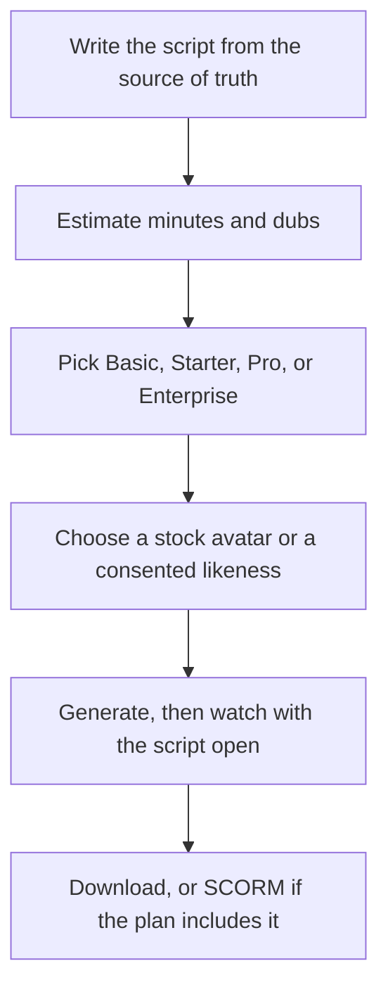

**Make the training video in Synthesia only after the script is true and you know which plan can export it.** Basic will show you a watermarked draft. Starter will let you download without the logo. SCORM, one-click translation into 140+ languages, and Brand Kits sit on Enterprise. A $29 seat does not become an LMS package because the video is about onboarding.

Prices are US list prices excluding tax, recorded October 16, 2026. The bill is [Synthesia pricing explained](/blog/synthesia-pricing-explained-2026/). The review is [Synthesia review](/blog/synthesia-review-2026/). We did not score how human the avatars look.

## Pick the plan for the file you must hand over

| The file | Plan | Why |
|---|---|---|
| A watermarked draft for an internal review | Basic, $0 | 10 minutes of video or dubbing, 3 survey responses, 500 credits |
| A downloadable module, one language, no LMS | Starter, $29/month billed monthly, or $19 shown on yearly billing | 1,250 credits, downloads, logo removal |
| Several modules or dubs a month | Pro, $89/month billed monthly | 6,000 credits |
| SCORM, SSO, Brand Kits, or 1-click translation into 140+ languages | Enterprise, custom | Those controls are listed together on Enterprise |
| SCORM this quarter without a sales call | Look at [HeyGen](/tools/heygen/) Business, $149/month | HeyGen publishes SCORM on Business. The comparison is [HeyGen vs Synthesia](/blog/heygen-vs-synthesia-2026/) |

Video is about 100 credits a minute and dubbing about 76 a minute, beyond the first 10 minutes included on every plan. A 6-minute module is on the order of 600 credits. Starter can hold that. Starter cannot hold that plus a full dub plus a second module in the same month without getting tight. Do the arithmetic before you subscribe. The credit explainer has the sketch.

## Step 1: Write the script outside the avatar

One learning objective per video. Short sentences. The number, the policy, and the product name come from a page you have open, not from the model's memory. If the course is a process, say the clicks. An avatar that sounds smooth while naming the wrong menu is worse than a slide.

[Claude](/tools/claude/) or [ChatGPT](/tools/chatgpt/) can turn your outline into a spoken script. Claude Pro is $20 a month, or $17 billed annually. ChatGPT Plus is $20. The method is [how to write a blog post with Claude](/blog/how-to-write-a-blog-post-with-claude-2026/), applied to a script: you supply the facts. Paste the finished script into Synthesia. Do not let a regenerate button change a policy sentence.

## Step 2: Choose the avatar you have the right to use

Stock avatars are the default. Synthesia lists 125+ on paid plans and 240+ on Enterprise. A personal avatar is a person's face. Get consent in writing, and decide what happens to that avatar if the person leaves. Enterprise is the plan that includes unlimited personal avatars. Lower plans are not that sentence.

Say on screen or in the description that the presenter is synthetic when your audience, your employer, or the platform expects that disclosure. Realism is the product. It is also how a viewer gets misled.

## Step 3: Generate the shortest module that teaches the objective

Start on Basic if you have not seen the avatar. Ten watermarked minutes is enough to reject a voice. Move to Starter when someone outside the account must watch a clean file.

Watch the export with the script beside you. Fix pronunciation in the script with phonetic spelling or a rewritten sentence. A one-word fix is cheaper than a new creative direction. Surveys spend 350 credits after the first 3. Skip the survey if a quiz in your LMS already exists. Interactive features are not free because they are "training."

## Step 4: Hand off the file the plan allows

Share links exist on Basic. Downloads start on paid plans. SCORM export is Enterprise. If the requirement from the learning team arrived after you bought Starter, you have a plan gap, not a rendering gap. HeyGen Business at $149 is the published SCORM alternative. The avatar steps on that product are [how to create AI avatars with HeyGen](/blog/how-to-create-ai-avatars-with-heygen-2026/).

Learner seats on Synthesia are $29 per learner per month. That line is separate from the creator who made the video. Count it before you promise a company rollout.

Dubbing is how a second language spends credits on plans below Enterprise. One-click translation into 140+ languages is the Enterprise feature. Pick one path and price it. Doing both by accident is how a 6-minute module becomes a credit incident.

## Step 5: When Synthesia is the wrong camera

| Situation | Use instead |
|---|---|
| You already filmed the trainer | [Descript](/tools/descript/). Hobbyist is $16/person/month billed annually |
| You only need a voice on slides | [ElevenLabs](/tools/elevenlabs/) Starter at $6/month, then slides in [Canva](/tools/canva/) |
| You need footage that is not a talking head | A video generator. See [best AI video generators](/blog/best-ai-video-generators-2026/) |
| The "training" is a one-page job aid | [Canva](/tools/canva/) or [Gamma](/tools/gamma/). Gamma Plus is $9/seat/month |

Slides with a real screen recording often teach software better than an avatar describing the software. Use the avatar for policy, onboarding context, and updates where a consistent presenter saves a shoot. Use the screen recording for the clicks.

## FAQ

### Can I make a Synthesia training video on the free plan?

Yes, inside 10 minutes, with a watermark and 500 credits. You can share a link. Download without the logo is a paid plan.

### How long a module should I make?

Short enough that a learner finishes it, and short enough that the credit sketch fits the plan. A 6-minute video is a useful planning unit because it is about 600 credits after the included minutes. It is not a rule about learning science.

### Does Starter include SCORM?

No. SCORM export is an Enterprise feature on the page we checked. HeyGen Business lists SCORM at $149 a month if you need a published price.

### Who owns the personal avatar?

Treat a personal avatar as the person's likeness. Have consent, and a plan for when they leave. The Enterprise card is where unlimited personal avatars are listed. Consent is still yours to obtain.

## Last verified

October 16, 2026 for prices, credit rates, and which features sit on Enterprise. Published October 24, 2026.

**Sources:** [Synthesia pricing](https://www.synthesia.io/pricing), [HeyGen pricing](https://www.heygen.com/pricing).

[Synthesia](/tools/synthesia/) is in the [video directory](/tools/category/video/). Directory pages may use affiliate links. A purchase through them may earn us a commission at no extra cost to you.
