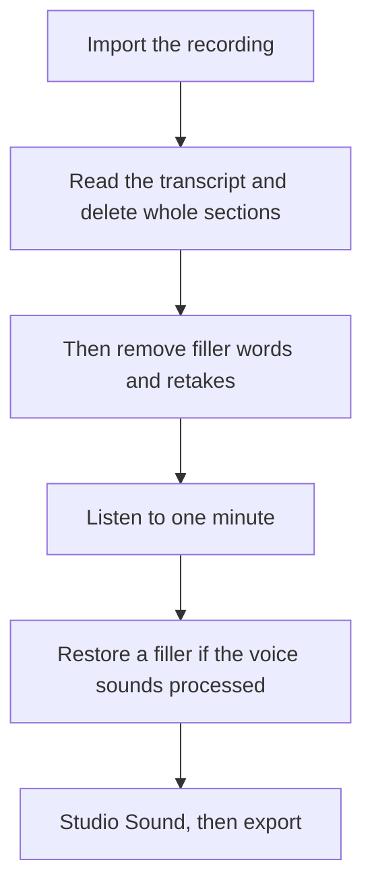

**Run filler-word removal after you delete the sentences you would not publish, then listen to a minute and put a few fillers back if the speaker sounds unlike themselves.** Descript can strip "um," "uh," and retakes from the transcript. Doing that first spends effort on audio you are about to throw away, and over-cleaned speech is obvious.

The full episode order, of which this is one step, is [how to edit podcasts with Descript](/blog/how-to-edit-podcasts-with-descript-2026/). The invoice is [Descript pricing explained](/blog/descript-pricing-explained-2026/). The product page is [Descript review](/blog/descript-review-2026/).

Prices are US list prices excluding tax from Descript's pricing page as checked October 16, 2026. Published October 24, 2026. We did not measure a word-error rate.

## The plan that includes the button

| Plan | Annual, per person | Monthly | Media | AI credits | Filler removal |
|---|---|---|---|---|---|
| Free | $0 | $0 | 60 minutes | A trial of the AI tools | Trial access, not a production allowance |
| Hobbyist | $16 | $24 | 10 hours | 400 | Included, with Studio Sound, Underlord access, and 1080p without a watermark |
| Creator | $24 | $35 | 30 hours | 800 | Included, with full Underlord and 4K |
| Business | $50 | $65 | 40 hours | 1,500 | Included, plus translation and dubbing in 30+ languages |

Media hours count the file Descript processes, not the finished length. A two-hour raw tape is two hours against Hobbyist's 10, even if filler removal leaves a 40-minute episode. Transcription in 25 languages is on every plan, including Free. Buy Business for dubbing and Brand Studio, not for the filler button. Hobbyist already lists Remove Filler Words.

## The order that saves the take

**1. Import or record once.** Descript can record, including Rooms for a remote guest, or you can import a file. A second import of the same board spends another slice of the media pool. [Otter](/tools/otter-ai/) can transcribe a meeting, and it is the wrong tool for this step: Otter's output is notes. Descript's output is an edit on the media. If the only goal is a meeting summary, use the notetaker path in [how to summarize meetings with AI](/blog/how-to-summarize-meetings-with-ai-2026/).

**2. Cut structure in the transcript.** Delete the false start, the aside, and the repeated answer. Each deletion removes the matching audio. This is the edit. Filler removal is a pass on what remains.

**3. Run filler-word removal and retake removal on the keep.** The directory page lists both on Hobbyist and above, and a trial of the AI tools on Free. Use Free to learn the gesture on a short file. Publish the episode from Hobbyist or above so the export is 1080p without a watermark.

**4. Listen.** Play one minute of the host and one minute of the guest. If the rhythm is gone, undo the pass on that speaker or restore a handful of words by hand. Listeners notice a voice that never hesitates. They also notice a three-second "um" in an ad read. The standard is the person, not a zero count.

**5. Then Studio Sound.** Noise cleanup on audio you will delete is wasted credit. Credits on Hobbyist are 400. The pricing page does not publish a single credit cost for one filler pass, so watch the balance on the first episode and write it down. Creator's 800 credits and full Underlord are the step when that balance, or 4K, is the blocker.

**6. Export, or hand a clip to a timeline.** [CapCut](/tools/capcut/) Pro is $19.99 a month, or $179.99 a year, when the next job is captions and a vertical cut. The split is [Descript vs CapCut](/blog/descript-vs-capcut-2026/). A voice you generate to patch a sentence is [ElevenLabs](/tools/elevenlabs/), and a patched sentence should be labeled as such if a listener would assume it was said in the room. Starter there is $6 a month.

## What filler removal will not fix

A bad microphone, two people talking at once, and a script the host did not know. Studio Sound can reduce a room. It will not invent a clean take. Re-record the ad read if the read is wrong. Removing "um" from a wrong claim leaves a wrong claim.

Underlord, the co-editor, can propose a tighter cut. On Hobbyist you have access. Full Underlord is the Creator line on the directory page. Accept a suggestion only after you hear it. An AI cut that drops a caveat is a content error, not a style choice.

If you are translating the episode, that is Business: dubbing in 30+ languages with proofread. Filler removal in the source language still comes first. Dubbing a transcript you have not cut multiplies the minutes. The localization order is [how to localize video with AI](/blog/how-to-localize-video-with-ai-2026/).

## FAQ

### Does Descript Free remove filler words?

Free includes a trial of the AI tools and 60 media minutes. The directory page puts Remove Filler Words on the Hobbyist feature list. Use Free to see the transcript edit. Use Hobbyist at $16 a month billed annually when you are publishing without a watermark.

### Should I remove every um?

Remove the ones that sit in silence or break an ad read. Keep enough of the speaker's rhythm that they still sound like themselves. Listen before you export.

### Do filler words count against media hours?

Media hours are the recording you import or process. The words you delete do not refund the hours. A shorter finished episode can still have come from a long raw file.

### Can I do this in CapCut instead?

CapCut is the timeline and the social export. Descript is the transcript-first cut, which is why filler removal lives there. Many shows cut in Descript and finish a clip in CapCut. Paying for both makes sense when both steps are weekly. It does not make sense for a single internal recording.

## Last verified

October 16, 2026. Published October 24, 2026. Descript does not publish one credit price per filler pass on the page we used. Read the credit balance on your first episode.

**Sources:** [Descript pricing](https://www.descript.com/pricing), [Descript](https://www.descript.com).

*Published by Andrew for [AI Tools Optimizer](https://aitoolsoptimizer.com).*

[Descript](/tools/descript/) is in the [video directory](/tools/category/video/). Directory pages may use affiliate links. A purchase through them may earn us a commission at no extra cost to you.
