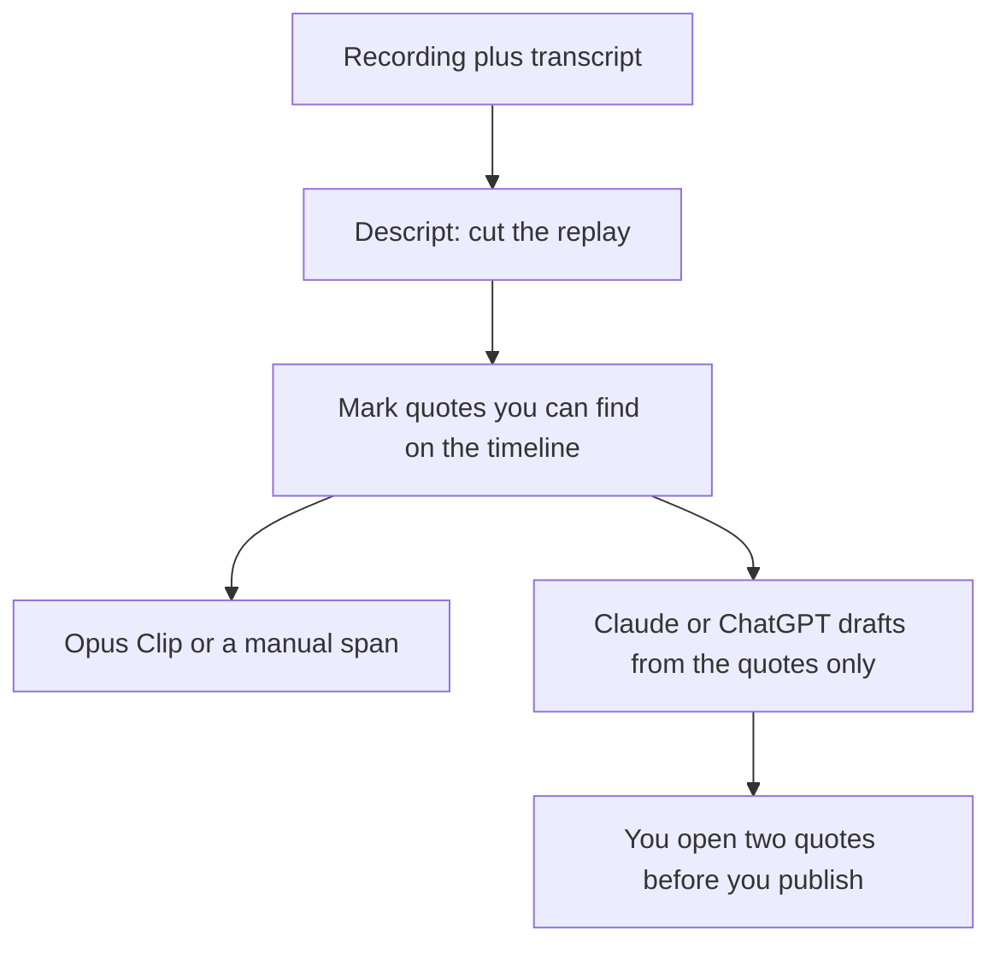

**Repurpose a webinar from the recording and the transcript you already have. Cut the episode, pull quotes you can find in the transcript, and draft the derivative pieces from those quotes.** A generated avatar recap is a different video. It can be useful. It is not the webinar. Label it if you publish it.

The editor for a recording is [Descript](/tools/descript/). The short-clip path is [how to create shorts with Opus Clip](/blog/how-to-create-shorts-with-opus-clip-2026/). Prices are US list prices excluding tax from directory pages checked October 16, 2026. Published October 24, 2026. We did not score clip performance.

## What each derivative is allowed to be

| Output | Source it must use | Tool | Price to know |
|---|---|---|---|
| A tightened replay | The recording | Descript | Hobbyist is $16/person/month billed annually, or $24 monthly. Free includes 60 media minutes |
| A social clip | A span you can hear in the recording | [Opus Clip](/tools/opusclip/) | Starter is $15/month, monthly billing only, 150 credits. Pro is $29, or $14.50 billed annually |
| Show notes, an email, a blog outline | The transcript, after you delete the bad lines | [Claude](/tools/claude/) or [ChatGPT](/tools/chatgpt/) | Claude Pro is $20/month or $17 annually. ChatGPT Plus is $20 |
| A captioned cut for someone who prefers a timeline | The same recording | [CapCut](/tools/capcut/) | Pro lists at $19.99/month or $179.99/year in the US |
| A presenter recap with no new claims | A script you wrote from the quotes | [HeyGen](/tools/heygen/) | Creator is $29/month. This is optional, and it is not the replay |

Filler-word removal on the replay is [how to remove filler words with Descript](/blog/how-to-remove-filler-words-with-descript-2026/). The plan math is [Descript pricing explained](/blog/descript-pricing-explained-2026/). If the file started as a YouTube upload, the transcript step is [how to transcribe YouTube videos with AI](/blog/how-to-transcribe-youtube-videos-with-ai-2026/).

## The order that keeps the quotes honest

**1. Decide the one replay you would actually rewatch.** A 45-minute webinar usually contains one 12-minute explanation and a stretch of logistics. Cut logistics. Descript's text-based edit is the tool when you want to delete a sentence by deleting the words. Free's 60 media minutes cover a single short session. A monthly webinar plus the raw file will pass that. Hobbyist at $16 annual is the first plan with 10 media hours and watermark-free 1080p.

**2. Mark quotes on the timeline before you write.** A quote in the blog post needs a minute mark. If you cannot find it, it is not a quote. This is the same discipline as [how to fact-check AI writing](/blog/how-to-fact-check-ai-writing-2026/), applied to your own event.

**3. Make clips from marked spans.** Opus Clip Starter at $15 is a monthly plan with 150 credits. Pro at $14.50 a month billed annually ($174 a year) adds a two-seat workspace on the card we recorded. Use it when you want a first set of candidates. Reject any clip that starts mid-claim. A generated "highlight" that stitches two answers into one sentence is a new statement. Publish the span you checked.

**4. Draft the written pieces from the quotes and the minute marks only.** Paste the transcript sections, not a vibe. Ask for show notes with a title, three points, and the minute mark for each. Ask for an email that points at the replay. Ask for a blog outline that uses only those points. [Claude](/tools/claude/) is the long-draft seat. The method is [how to write a blog post with Claude](/blog/how-to-write-a-blog-post-with-claude-2026/).

**5. Add an avatar only for a script you wrote.** HeyGen Creator at $29 can read a 60-second recap in a voice clone if your plan includes it. The script comes from step 4. The avatar does not attend the webinar retroactively. Training-style presenters are a different job: [Synthesia vs HeyGen for training](/blog/synthesia-vs-heygen-for-training-2026/).

**6. Skip the generator studio.** Runway and its alternatives invent frames. They are the wrong tool for a recording you must not invent. The switch list is [Runway alternatives](/blog/runway-alternatives-2026/).

## A small kit for one webinar a month

Descript Hobbyist, Opus Clip if the shorts are worth a $15 test, and a chat seat you already pay for. That is the kit. CapCut replaces Opus Clip if you would rather cut the span yourself. HeyGen waits until a recap video is actually on the calendar. A stack that also buys a generative video plan "to repurpose faster" usually produces a clip that never happened.

## FAQ

### Can I repurpose a webinar without Descript?

Yes. Any editor that can cut the file works, including CapCut. Descript is the recommendation when you want to edit by deleting text. The transcript can also come from the webinar platform. The rule is the same: the words you publish have to be in the recording.

### How many clips should I make?

As many as you can check. Three checked clips beat ten auto-posts. Opus Clip's credit pool is a reason to export a short list and stop, and a reason to review before you connect a social account.

### Should the blog post be a transcript?

No. The blog post is the argument, with minute marks for the claims. A raw transcript is the source. Paste it into the chat as source. Publish the edited piece.

### What if a guest said something we cannot use?

Cut it in Descript before the transcript goes into the chat. A model will cheerfully turn a retracted aside into a pull quote. The cut list is a human step.

## Last verified

October 16, 2026 for Descript, Opus Clip, Claude, ChatGPT, CapCut, and HeyGen prices. Published October 24, 2026.

**Sources:** [Descript pricing](https://www.descript.com/pricing), [Opus Clip pricing](https://www.opus.pro/pricing), [HeyGen pricing](https://www.heygen.com/pricing).

*Published by Andrew for [AI Tools Optimizer](https://aitoolsoptimizer.com).*

[Descript](/tools/descript/) is in the [video directory](/tools/category/video/). [Opus Clip](/tools/opusclip/) is in the [video directory](/tools/category/video/). Directory pages may use affiliate links. A purchase through them may earn us a commission at no extra cost to you.
