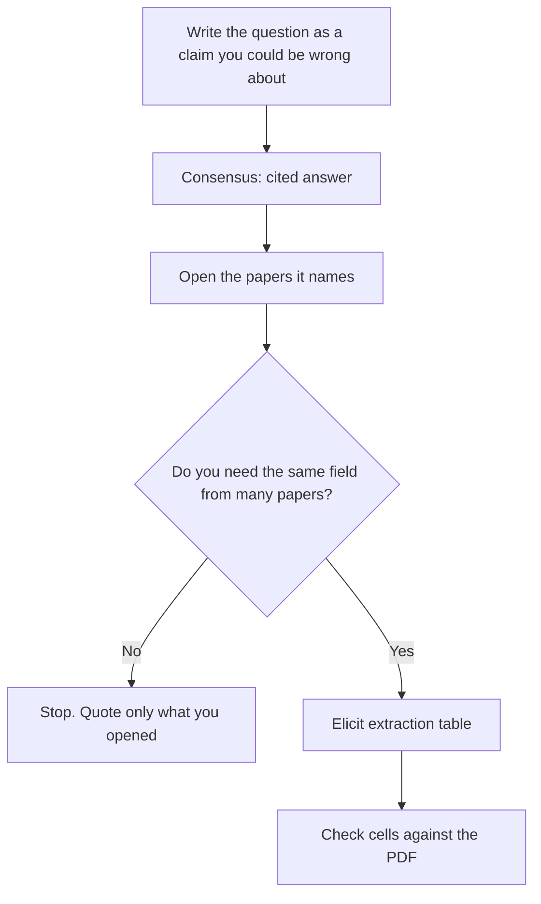

**Use Consensus to see whether peer-reviewed papers speak to the question. Use Elicit when you need a table that pulls the same field out of many papers.** Consensus is a cited answer. Elicit is a screening and extraction desk. Running both on every question wastes the meter that is actually scarce: Pro messages on Consensus, and agent or column limits on Elicit.

This is a method. We did not score how often either summary matches the paper. Open the PDF before you quote a number. Prices are US list prices from each vendor's pages as re-read for the reviews published October 24, 2026. The product pages are [Consensus review](/blog/consensus-review-2026/) and [Elicit review](/blog/elicit-review-2026/).

## Which plan this workflow needs

| Stage | Tool and plan | When you pay |
|---|---|---|
| Search papers and read a short cited answer | [Consensus](/tools/consensus/) Free | Unlimited paper searches, 10 Pro messages a month, 3 Deep reviews, 10 Study Snapshots |
| You do the cited-answer step every week | Consensus Pro | $20/month, or $144/year ($12/month). Unlimited Pro messages, 15 Deep reviews |
| Search, summaries, and chat with papers | [Elicit](/tools/elicit/) Basic | Free. Unlimited search across 138 million papers. Agent and reports are limited |
| Exports, a short extraction table, clinical trials | Elicit Plus | $11/user/month billed annually ($132/year) on the non-Industry card. 5 columns |
| A systematic review | Elicit Pro | $39/user/month billed annually on the non-Industry card, or $49 on the Industry card. Screens about 5,000 papers, 20 columns |
| The open web around the papers | [Perplexity](/tools/perplexity/) | Free, or Pro at $17/month billed annually. It is not a paper database |

The web-versus-papers split is [Perplexity alternatives](/blog/perplexity-alternatives-2026/). A PDF you already have, with no literature search, belongs in [Gemini Notebook](/tools/gemini-notebook/). That workflow is [how to study with Gemini Notebook](/blog/gemini-notebook-study-workflows/).

## Step 1: Write the question before you open either tool

One sentence, in the form "What is the effect of X on Y?" or a yes/no you are willing to abandon. Add the population and the years if they matter. Add what you will not accept: a blog, a preprint if your field requires peer review, a paper you cannot open.

If you cannot write the sentence, you are still scoping. A Deep review in Consensus, or a wandering Elicit query, will produce a confident paragraph about a topic you have not bounded.

## Step 2: Run Consensus and open the papers

Ask the question. Read the synthesis. Then open the studies it cites, starting with the ones the answer leans on. Use the filters the product offers, such as study type or year, when the first page is the wrong kind of evidence.

Free includes 10 Pro messages a month. Spend them on the questions you will publish or grade, not on curiosity clicks. A Deep review is a longer synthesis. Free includes 3 a month. Pro includes 15. Deep, the plan, is $65 a month or $540 a year ($45 a month) and includes 200 Deep reviews. Buy that plan when the Deep review count is the constraint. Do not buy it to "be more scientific."

Study Snapshots are a skim. The help center, re-read October 24, 2026, lists 10 on Free and unlimited on Pro. A snapshot is not a substitute for the result table in the paper.

## Step 3: Move to Elicit only when the unit of work is a table

Create the project from the same question. The distinctive feature is the extraction table: one row per paper, one column per field you name, with a link back to the source text. Name columns you can check, such as sample size, population, outcome measure, and direction of effect. Avoid a column called "quality" unless you have defined it.

Basic is enough to find papers and chat with full text. Plus, at $11 a user a month on the non-Industry annual card, adds exports (RIS, CSV, BIB, PDF, DOCX), clinical-trials search, and 5 columns. Pro adds the systematic-review workflow, about 5,000 papers screened, 20 columns, and API access. Scale is $89 a user a month on that same non-Industry annual card, or $229 on the Industry card we read October 24, 2026. Set the Industry toggle before a company card is charged. A team that quotes the $11 price and checks out on Industry Pro has not been quoted $11.

Elicit says its team evaluates accuracy. That is their claim. Your check is the PDF.

## Step 4: The fact pass

For every number you will repeat, open the paper and find the sentence. Cut cells that point at the wrong passage. Cut claims that appear in the synthesis and not in the papers you opened. Consensus and Elicit can both smooth a disagreement into a single confident line. The disagreement is often the finding.

Keep a short log: question, date, plan you used, papers you opened, claims you rejected. That log is what a reviewer can audit. The chat transcript is not.

## Step 5: Where the other tools fit

[Perplexity](/tools/perplexity/) is for the public web around the finding: a regulator's page, a methods explainer, a news report. It is the wrong corpus for "what does the literature say?" Pro at $17 a month billed annually adds Computer and premium data. The bill is [Perplexity pricing explained](/blog/perplexity-pricing-explained-2026/).

[Claude](/tools/claude/) can draft a paragraph from notes you paste after the fact pass. Pro is $20 a month, or $17 billed annually. The rule is the same as [how to write a blog post with Claude](/blog/how-to-write-a-blog-post-with-claude-2026/): the model does not supply the citations.

Zotero import on Elicit Basic is the bridge if your library already exists. Export on Plus is the bridge back.

## FAQ

### Can I do this on the free plans?

Yes, for a small question. Consensus Free gives you 10 Pro messages and 3 Deep reviews. Elicit Basic gives you unlimited search, summaries, and chat with papers. Pay when the meter you hit is messages, columns, or a systematic-review screen.

### Which tool is better for a systematic review?

Elicit Pro is the plan that lists a systematic-review workflow and a 5,000-paper screen. Consensus Deep reviews are a synthesis, not that screening workflow. Read the Industry price if a company is paying.

### Will the AI write my literature review?

It will draft from papers you still have to read. Publish the claims you opened. A citation you did not open is a rumor with a link.

### What about preprints and the web?

Consensus and Elicit are aimed at academic literature. Perplexity covers the web. A preprint policy is yours. The tool will not enforce the standard your advisor or editor set.

## Last verified

October 24, 2026, from the Consensus help center and Elicit's pricing page, as recorded in the linked reviews. Published October 24, 2026.

**Sources:** [Consensus subscription plans](https://help.consensus.app/en/articles/10087865-subscription-plans), [Elicit pricing](https://elicit.com/pricing).

[Elicit](/tools/elicit/) and [Consensus](/tools/consensus/) are in the [research directory](/tools/category/research-search/). Directory pages may use affiliate links. A purchase through them may earn us a commission at no extra cost to you.
