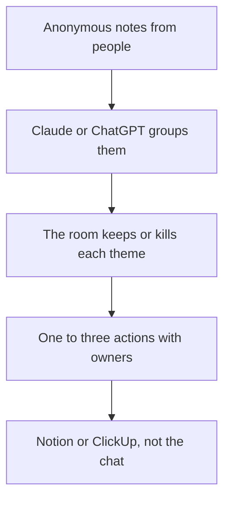

**A retro run with AI still belongs to the people in the room. The model clusters notes they already wrote and formats actions they already accepted.** It should not open the meeting, rank who struggled, or invent a process change nobody argued for. Facilitation is the part you keep. Clustering is the part worth automating once the notes exist.

Capture is a different article: [how to summarize meetings with AI](/blog/how-to-summarize-meetings-with-ai-2026/). The notetaker choice is [best AI meeting notetakers](/blog/best-ai-meeting-notetakers/). A retro that becomes a spec is [how to draft a product spec with AI](/blog/how-to-draft-a-product-spec-with-ai-2026/).

Prices are US list prices excluding tax from directory pages checked October 16, 2026, with Granola's $14 figure as used on October 24, 2026. Published October 24, 2026. We did not score facilitation.

## The hour, with the model in one slot

| Minute | Who | The model |
|---|---|---|
| Before | Everyone writes notes, privately | Off. A generated note is not a person's note |
| Gather | The facilitator pastes the anonymous notes | Off |
| Cluster | One person asks for themes | Groups only. No blame, no new complaints |
| Decide | The room picks one to three actions | Formats the owner and the date you named |
| After | The action lives in the tracker | Drafts the recap from the actions, not from the venting |

Anonymous means anonymous. Do not paste a transcript with names and ask for "who blocked the sprint." That request is a performance review disguised as a retro. If the meeting was recorded, say so, and prefer the written notes over the transcript for this exercise. A transcript is a record. It is a poor voting system.

## What to capture with, and where the actions go

**Notes a person is already writing.** [Granola](/tools/granola/) Business is $14 per user per month for unlimited history. Basic keeps 30 days. It fits a facilitator who types during the retro and wants the page cleaned up. It is the wrong tool if the policy is "a bot in every call." That split is [Granola vs Fathom](/blog/granola-vs-fathom-2026/).

**A bot, if the team already consents to one.** [Fireflies](/tools/fireflies-ai/) Pro is $10 per user per month billed annually, or $18 monthly. Use the transcript as backup. Do not let AskFred write the retro. The invoice is [Fireflies pricing explained](/blog/fireflies-pricing-explained-2026/). Alternatives, if the bot is the problem, are [Fireflies alternatives](/blog/fireflies-alternatives-2026/).

**The cluster.** [Claude](/tools/claude/) Pro is $20, or $17 billed annually. [ChatGPT](/tools/chatgpt/) Plus is $20. Paste the notes. Ask for five themes, a count of notes under each, and zero suggested owners. Then delete themes the room does not recognize. A theme with one spicy note is not a theme. The writing comparison is [ChatGPT vs Claude for writing](/blog/chatgpt-vs-claude-for-writing-2026/).

**The system of record.** [Notion AI](/tools/notion-ai/) Business is $20 per seat. [ClickUp Brain](/tools/clickup-brain/) starts at $9 per user on top of ClickUp. Put the action where the work already lives. A beautiful recap in chat that nobody opens is how the same retro repeats. The notes split is [Notion AI vs ClickUp Brain](/blog/notion-ai-vs-clickup-brain-2026/).

A prompt for the cluster step:

"Notes are below. Group them into themes. Quote a short phrase from the notes under each theme. Do not name people. Do not propose actions. If a note does not fit, leave it in 'unclustered.'"

The action prompt comes later, after the room has spoken:

"Actions we agreed are below. Format each as action, owner, date. Do not add an action."

## What not to automate

**The vote.** Dots, a show of hands, or a stack rank in the room. A model that "picks the top issue" is averaging wording, not priority.

**The blame.** Even a well-meant "communication broke down" sentence can point at a person who is not there. Read the recap out loud before you post it.

**The OKR.** A retro action is smaller than a quarterly target. If the room changed a target, that is a different document: [how to write OKRs with AI](/blog/how-to-write-okrs-with-ai-2026/).

**The recording policy.** Tell people the call is recorded before a bot joins. If someone opts out, take notes. The tool does not outrank the room.

## FAQ

### Can AI facilitate the retro?

It can cluster and format. A facilitator still has to notice who has not spoken and stop a pile-on. Leave that to a person. A screen full of themes is a worksheet, not a host.

### Should we record it?

Only with consent, and not as the input to the cluster if names in a transcript will leak into the recap. Written anonymous notes make the better prompt. The recording can sit in Fireflies for people who missed the meeting, with the recap linked at the top.

### How many actions should the model suggest?

None, until the room has picked them. Then format one to three. A list of twelve generated improvements is how nothing ships. The release that follows a real action is [how to write release notes with AI](/blog/how-to-write-release-notes-with-ai-2026/).

### What if the notes are mean?

Do not feed them to a bot and post the output. A person edits, or the note does not leave the room. The model will smooth the wording and keep the target. Smoothing is not mediation.

## Last verified

October 16, 2026 for Fireflies, Claude, ChatGPT, Notion, and ClickUp prices. October 24, 2026 for Granola Business at $14 as used in the Granola articles. Published October 24, 2026.

**Sources:** [Fireflies pricing](https://guide.fireflies.ai/articles/3734844560-learn-about-the-fireflies-pricing-plans), [Claude pricing](https://claude.com/pricing), [Notion AI](https://www.notion.com/product/ai).

*Published by Andrew for [AI Tools Optimizer](https://aitoolsoptimizer.com).*

[Granola](/tools/granola/) and [Fireflies](/tools/fireflies-ai/) are in the [meetings directory](/tools/category/meetings-transcription/). Directory pages may use affiliate links. A purchase through them may earn us a commission at no extra cost to you.
