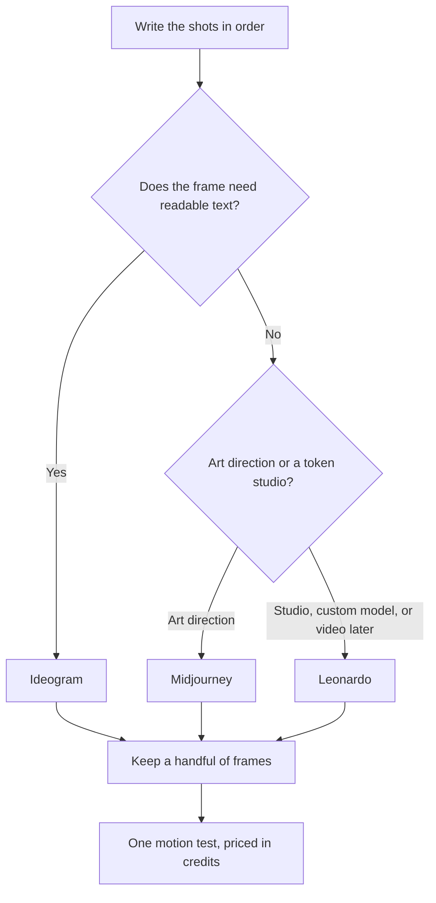

**A storyboard is a sequence of shots you can point at, not a pile of pretty frames.** Write the shots in words first. Generate a frame only for a shot you are willing to film or animate. Spend motion credits on the frames you kept. This page does not score which generator looks more cinematic.

Prices are US list prices excluding tax from directory pages checked October 16, 2026. The still-image choice between two of the generators is [Leonardo vs Ideogram](/blog/leonardo-vs-ideogram-2026/).

## One shot, one tool

| Storyboard job | Start here | Price to know |
|---|---|---|
| The beat list, as a diagram | [Napkin AI](/tools/napkin-ai/) | Free is 500 credits a week. Plus is $9/person/month |
| A frame that contains a sign, a title, or a lower-third | [Ideogram](/tools/ideogram/) | Free is 30 credits a week. Plus is $20/month, or $15 yearly |
| A frame, a custom style, or a later video test | [Leonardo.Ai](/tools/leonardo-ai/) | Essential is $12/month for 8,500 fast tokens. Premium is $30 |
| An art-directed frame, and you will typeset words later | [Midjourney](/tools/midjourney/) | No free plan. Basic is $10/month, or $8 annual. Standard is $30 |
| A client-facing board, as slides | [Gamma](/tools/gamma/) | Plus is $9/seat/month for 1,000 credits |
| A motion test of a kept frame | [Google Flow](/tools/google-flow/) | 50 free credits a day. Veo 3.1 Quality is 100 credits a clip |

The image shelf is [best AI image generators](/blog/best-ai-image-generators-2026/). Motion, once you are past a single test, is [Runway vs Kling vs Veo](/blog/runway-vs-kling-vs-veo-2026/).

## Step 1: Write the board before you generate

Number the shots. For each one, write who is in frame, what changes, and what the viewer should understand. Six shots are a board. Forty adjectives are a mood, and a mood is how you burn a credit balance on frames you cannot sequence.

[Napkin AI](/tools/napkin-ai/) can turn that list into a diagram you can drop in a deck. Free covers light use at 500 credits a week. Plus at $9 a person a month adds PPT and SVG export. The review is [Napkin AI review](/blog/napkin-ai-review-2026/). A diagram is not a frame. It is the order of the frames.

Paste the same list into [Gamma](/tools/gamma/) if the client needs to see the board as slides. Plus is $9 a seat. The credit rules are [Gamma pricing explained](/blog/gamma-pricing-explained-2026/).

## Step 2: Generate the frame that matches the shot

If the shot has words in the picture, a poster, a phone UI, a title card, start with [Ideogram](/tools/ideogram/). Plus at $15 a month on yearly billing includes private generation. Free images are not private. The review is [Ideogram review](/blog/ideogram-review-2026/).

If the shot is a look, and the words will be typeset later in [Canva](/tools/canva/) or a design tool, [Midjourney](/tools/midjourney/) Standard at $30 a month adds unlimited Relax image generation. Basic at $10 does not. There is no free plan. The GPU bill is [Midjourney pricing explained](/blog/midjourney-pricing-explained-2026/). Companies over $1 million in gross revenue need Pro or Mega, at $60 or $120 a month, for the commercial rule on that page.

If you may train a style or you want video inside the same account, [Leonardo](/tools/leonardo-ai/) Premium at $30 a month adds unlimited relaxed images for select models. Fast tokens still spend on full-speed work. The review is [Leonardo.Ai review](/blog/leonardo-ai-review-2026/). The three-way with FLUX is [Midjourney vs Leonardo vs FLUX](/blog/midjourney-vs-leonardo-vs-flux-2026/).

Generate two frames per shot, not twenty. Pick one. A storyboard that keeps every variation is a folder, not a plan.

## Step 3: Move one frame, and price it

[Google Flow](/tools/google-flow/) is the motion test that has a published credit cost in this directory. Everyone gets 50 credits a day, and unused daily credits do not roll over. Veo 3.1 Lite is 10 credits a clip, Fast is 20, and Quality is 100. A Quality clip is two days of the free daily grant. Google AI Plus at $4.99 a month adds 200 monthly Flow credits. Pro at $19.99 adds 1,000. The review is [Google Flow review](/blog/google-flow-review-2026/).

Test the one shot where motion changes the idea: a door opening, a product turn, a face turning. A static frame does not need a clip. [Runway](/tools/runway/) Standard is $12 a month billed annually for 625 credits if the motion work moves out of Flow. Do not run the same shot in three video products "to compare" until you have a frame you would actually use. That habit is how storyboards become invoices.

[Kling](/tools/kling-ai/) is the other video quote. Its renewal prices are easy to misread because the directory records first-month discounts and later rates. Read [Runway vs Kling vs Veo](/blog/runway-vs-kling-vs-veo-2026/) and the live card before you subscribe for a board.

## FAQ

### What AI tool makes a storyboard?

None of them makes the sequence for you. You write the shots. Ideogram, Leonardo, or Midjourney makes a frame. Napkin or Gamma shows the order. Flow or Runway moves a frame you kept.

### Is Midjourney free for storyboards?

No. Basic is $10 a month, or $8 billed annually. Ideogram and Leonardo have free tiers you can use to test a single frame.

### How do I keep text readable in a frame?

Use Ideogram for the frame that contains words. Put other type in Canva or your design tool afterward. Midjourney is the weaker choice when the letters are the point.

### Can I storyboard a whole ad in Google Flow?

You can, and Quality clips at 100 credits each will spend a free daily grant quickly. Board the ad as stills first. Move the shots that need motion.

## Last verified

October 16, 2026. Published October 24, 2026.

**Sources:** [Ideogram](https://ideogram.ai/), [Leonardo pricing](https://leonardo.ai/pricing), [Midjourney](https://www.midjourney.com/), [Google Flow](https://labs.google/flow).

*Published by Andrew for [AI Tools Optimizer](https://aitoolsoptimizer.com).*

[Ideogram](/tools/ideogram/), [Leonardo.Ai](/tools/leonardo-ai/), and [Midjourney](/tools/midjourney/) are in the [image generation directory](/tools/category/image-generation/). Directory pages may use affiliate links. A purchase through them may earn us a commission at no extra cost to you.
