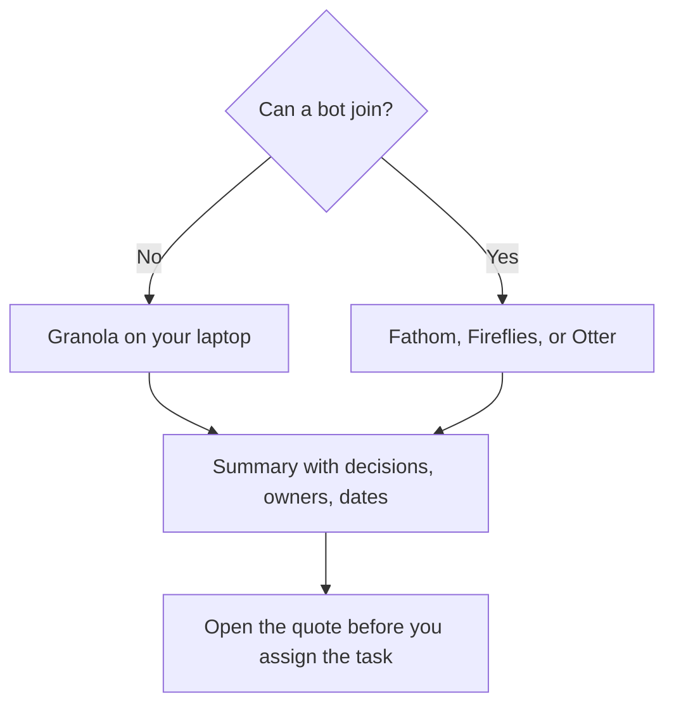

**A meeting summary is useful when it lists decisions, owners, and dates, and each line can be checked against what was said.** The AI notetaker is the capture step. You still confirm the decision before it becomes a task. Pick the tool from the constraint in the room: a bot, no bot, a minute cap, or a CRM field.

The category comparison is [best AI meeting notetakers](/blog/best-ai-meeting-notetakers/). The bot trio is [Otter vs Fireflies vs Fathom](/blog/otter-vs-fireflies-vs-fathom-2026/). Prices are US list prices. Fathom was read October 24, 2026. Otter, Fireflies, Granola, and Read AI are from directory pages checked October 16, 2026. Published October 24, 2026. We did not score summary quality.

## Choose the capture before the meeting

| Constraint | Use | What you pay to get a summary |
|---|---|---|
| A normal video call, and you want to try unlimited recordings | [Fathom](/tools/fathom/) | Free lists unlimited recordings and instant summaries. Premium is $16/month annually for advanced summaries and action items |
| Search across months of calls, or a dialer | [Fireflies](/tools/fireflies-ai/) | Pro is $10/user/month annually, or $18 monthly |
| A published per-conversation minute cap | [Otter](/tools/otter-ai/) | Basic is free: 300 minutes and 30 minutes per conversation. Pro annual is $8.33, with 90 minutes per conversation |
| No bot in the participant list | [Granola](/tools/granola/) | Basic is free with 30 days of history. Business is $14/user/month |
| A small test, five transcripts | [Read AI](/tools/read-ai/) | Free is 5 a month. Pro is $15/user/month annually |

Consent is part of the setup. Tell attendees a notetaker is present when a bot joins. Laws and company rules differ. Granola's design avoids the bot and still captures from the computer. Fathom's bot-free option is marked beta for Mac. Do not promise "no bot" on a beta label without checking it that week. The split is [Granola vs Fathom](/blog/granola-vs-fathom-2026/).

## During and after the call

**1. Decide what the summary is for.** A staff meeting needs decisions and owners. A sales call may also need a CRM field. Fathom Business, at $25 per user per month billed annually with a two-user minimum, lists CRM field sync. Fireflies Business, at $19 annually, is the analytics tier. Buying a CRM tier for an internal standup is the expensive version of a notes doc. The invoices are [Fathom pricing explained](/blog/fathom-pricing-explained-2026/) and [Fireflies pricing explained](/blog/fireflies-pricing-explained-2026/).

**2. Record the meeting you mean to summarize.** Otter Basic cuts a conversation at 30 minutes. A 45-minute staff meeting needs Pro, a different tool, or a shorter agenda. Know the cap before you depend on the last fifteen minutes.

**3. Ask for a shape.** "Decisions, owners, dates, and open questions. Quote the line for each decision. If the owner was not named, write 'owner not named.'" That instruction is [what prompt engineering is](/blog/what-is-prompt-engineering-2026/). A narrative recap is harder to assign.

**4. Open two quotes.** If the timestamp does not say what the summary claims, fix the summary. AskFred on Fireflies and the assistants on the other tools can point at a sentence and still point at the wrong one. The failure has a name: [what an AI hallucination is](/blog/what-is-ai-hallucination-2026/).

**5. Write the tasks yourself, or accept them one by one.** Premium Fathom lists AI action items. They are a draft. An action item with no owner is a sentence, not a task. Paste the kept lines into the tracker your team already uses.

**6. Skip the notetaker when you will edit the recording.** A podcast or a webinar that must be cut belongs in [Descript](/tools/descript/). The meeting summary and the episode edit are different jobs. Filler-word removal is [how to remove filler words with Descript](/blog/how-to-remove-filler-words-with-descript-2026/).

## A summary template you can reuse

| Field | What "done" looks like |
|---|---|
| Decision | One sentence, plus the quote or timestamp |
| Owner | A name that was said, or "not named" |
| Date | A date that was said, or "not named" |
| Open question | The question, and who will answer it |
| Not a decision | A topic that was discussed and left unchanged |

Send that table. A three-paragraph recap hides the missing owner. People reply to paragraphs with more paragraphs. They reply to a blank owner cell by filling it in.

Read AI's free plan, at five transcripts a month, is enough to see whether you like its layout. It is not enough for a weekly staff meeting plus sales calls. Pro at $15 annual lists unlimited transcripts. The review is [Read AI review](/blog/read-ai-review-2026/).

## FAQ

### What is the cheapest way to summarize a meeting with AI?

Fathom's free plan, if a bot can join and unlimited recordings match the page you see at checkout. Otter Basic, if the meeting is under 30 minutes and you are inside 300 minutes for the month. Granola Basic, if the room refuses a bot and 30 days of history is enough.

### Should I paste the transcript into ChatGPT instead?

Yes, when you already have a transcript you trust and you want a different shape. [ChatGPT](/tools/chatgpt/) Plus is $20 a month. Paste the transcript, ask for the table above, and check the quotes. A notetaker is the capture. The chat is the rewrite. You do not need both paid on day one.

### How do I stop the summary from inventing an owner?

Require the name to appear in the transcript, and require "owner not named" otherwise. Then read the two quotes. The instruction reduces the failure. It does not retire your review.

### Are AI meeting notes a record?

They are a draft of a record. If your company, your regulator, or your customer needs minutes, a person still approves them. Retention settings on Enterprise plans exist for that conversation. Free plans are a weak place to store the only copy.

## Last verified

October 24, 2026 for Fathom. October 16, 2026 for Otter, Fireflies, Granola, and Read AI. Published October 24, 2026.

**Sources:** [Fathom pricing](https://www.fathom.ai/pricing), [Otter pricing](https://otter.ai/pricing), [Fireflies pricing plans](https://guide.fireflies.ai/articles/3734844560-learn-about-the-fireflies-pricing-plans).

*Published by Andrew for [AI Tools Optimizer](https://aitoolsoptimizer.com).*

[Fathom](/tools/fathom/), [Fireflies](/tools/fireflies-ai/), and [Otter](/tools/otter-ai/) are in the [meetings directory](/tools/category/meetings-transcription/). Directory pages may use affiliate links. A purchase through them may earn us a commission at no extra cost to you.
