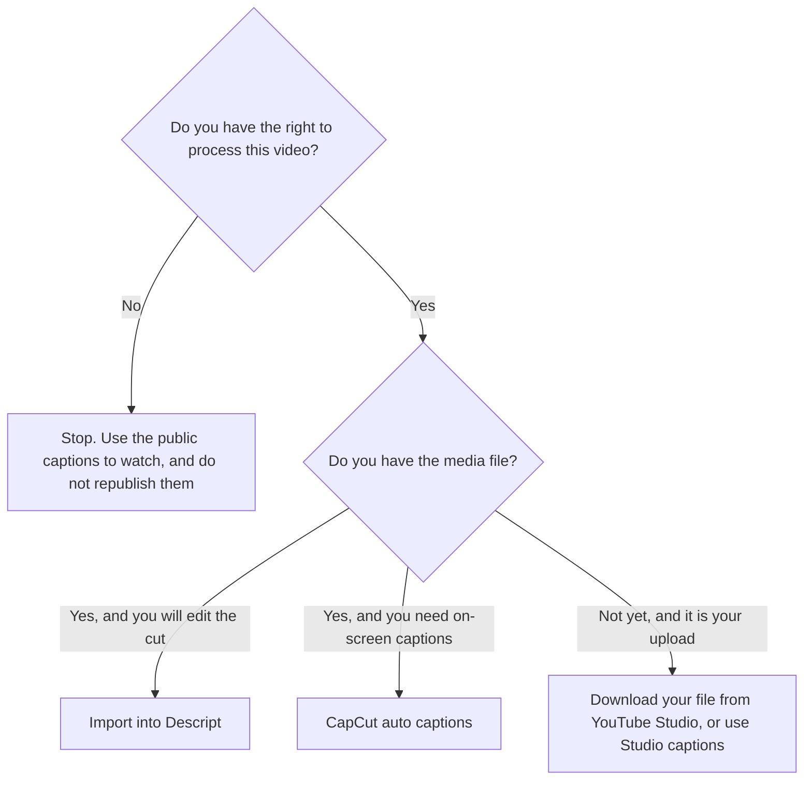

**Transcribe a video you own, or one you have permission to process, by starting from the media file or from YouTube's own captions.** Then put that text in an editor that can clean it. This is a workflow for your uploads, a client's file, or a recording you are allowed to reuse. It is not a method for pulling someone else's video off YouTube and republishing the words.

Prices are US list prices excluding tax from directory pages checked October 16, 2026. The editor most people land in is [Descript](/tools/descript/). The plan math is [Descript pricing explained](/blog/descript-pricing-explained-2026/).

## Pick the tool from the file you already have

| What you have | Use | First price that matters |
|---|---|---|
| The video in your own YouTube account, and you only need a caption file | YouTube Studio's captions on that video | $0, inside the account that owns the upload |
| A media file you can import, and you will edit by text | [Descript](/tools/descript/) | Free is 60 media minutes. Hobbyist is $16/person/month billed annually for watermark-free 1080p |
| A short you will caption in a timeline | [CapCut](/tools/capcut/) | Free covers basic editing and auto captions. Pro is $19.99/month or $179.99/year |
| An audio or video file to drop on a meeting tool | [Fireflies](/tools/fireflies-ai/) | Uploaded files are supported. Pro is $10/user/month billed annually |
| A meeting that happened to be recorded, not a YouTube edit | [Otter](/tools/otter-ai/) | Basic is 300 minutes, with a 30-minute cap and only 3 lifetime imports |

YouTube Studio is YouTube's own product, not a directory listing. Use it for videos on a channel you control. This guide does not include a downloader for other people's URLs.

## Step 1: Get a file you are allowed to open

If the video is yours, open YouTube Studio and use the caption track YouTube already made, or download your own source file from the account that uploaded it. If a client sent a file, use that file. The rest of this workflow starts there.

Public captions on someone else's video are for watching. Copying them into a post, a book, or a dataset is a separate rights question. When you do not have permission, do not import the media into a tool.

## Step 2: Descript, when the transcript is the edit

Import the file. Descript transcribes it, including the 25 languages listed on every plan. From then on, deleting a sentence deletes that moment. Read the transcript and fix names before you trust search or captions. A wrong name in the transcript becomes a wrong caption.

Free covers 60 media minutes a month, which is enough to learn on a short video. A long upload counts the whole file against media hours. Hobbyist at $16 a person a month billed annually is the first plan with watermark-free 1080p export, 10 media hours, and 400 AI credits. Creator at $24 annually is the 4K and 30-hour plan.

The cutting order for a spoken edit is [how to edit podcasts with Descript](/blog/how-to-edit-podcasts-with-descript-2026/). The same order works on a YouTube talking-head video: structure, then fillers, then a listen.

## Step 3: CapCut, when the deliverable is captions on a short

Import the same file into [CapCut](/tools/capcut/) and run auto captions. Many caption tools work without the paid AI credits. Generative video features spend credits. Pro at $19.99 a month, or $179.99 a year, is the premium-template plan. The directory page says final prices can differ by platform after sign-in, and desktop prices can be higher than mobile. Read the price you are shown.

CapCut is the timeline. Descript is the transcript edit. The comparison is [Descript vs CapCut](/blog/descript-vs-capcut-2026/). Review every caption line. Auto captions miss names and product terms. The transcript is a draft of the captions, not the publish button.

## Step 4: A meeting tool, only if you already have the file

[Fireflies](/tools/fireflies-ai/) can process uploaded MP3, MP4, WAV, and M4A files, and it transcribes meetings. Pro is $10 a user a month billed annually. Use it when the file is a call you want in a searchable meeting library. Use Descript when you are cutting a video.

[Otter](/tools/otter-ai/) is a meeting notetaker. Basic allows 3 lifetime imports. Do not plan a YouTube backlog on Basic. The caps are [Otter pricing explained](/blog/otter-ai-pricing-explained-2026/). The notetaker shelf is [best AI meeting notetakers](/blog/best-ai-meeting-notetakers/).

## What to do with the transcript

Keep the words that match the audio. Cut the rest. For a description, chapters, or a blog post, paste the corrected transcript into [Claude](/tools/claude/) or [ChatGPT](/tools/chatgpt/) and ask for a draft that uses only that text. Claude Pro is $20 a month, or $17 billed annually. ChatGPT Plus is $20. The writing rule is [how to write a blog post with Claude](/blog/how-to-write-a-blog-post-with-claude-2026/).

Clips, if you want shorts from the long file, are a second product. [Opus Clip](/tools/opusclip/) Starter is $15 a month. The steps are [how to create shorts with Opus Clip](/blog/how-to-create-shorts-with-opus-clip-2026/).

## FAQ

### Can I paste a YouTube link into Descript?

The directory page describes importing footage, a script, or a Zoom call, and transcribing it. It does not promise a YouTube URL import. Start from a file you have the right to use.

### Is CapCut's free plan enough for captions?

Enough to try auto captions on a short. Pro is $19.99 a month or $179.99 a year if you need the paid template and credit bundle. Confirm the in-app price. It can differ by device.

### What is the cheapest way to transcribe my own upload?

YouTube Studio's caption tools on a video you own, at no extra AI subscription. Move to Descript Free when you want to edit the video by editing the text, within 60 media minutes.

### Can Otter do this for free?

Only inside Basic's limits: 300 minutes a month, 30 minutes per conversation, and 3 lifetime imports. A long YouTube file is a poor fit for that plan.

## Last verified

October 16, 2026 for plan prices and the import behavior named above. Published October 24, 2026.

**Sources:** [Descript pricing](https://www.descript.com/pricing), [CapCut](https://www.capcut.com/), [Fireflies](https://fireflies.ai/), [Otter pricing](https://otter.ai/pricing).

*Published by Andrew for [AI Tools Optimizer](https://aitoolsoptimizer.com).*

[Descript](/tools/descript/) and [CapCut](/tools/capcut/) are in the [video directory](/tools/category/video/). Directory pages may use affiliate links. A purchase through them may earn us a commission at no extra cost to you.
