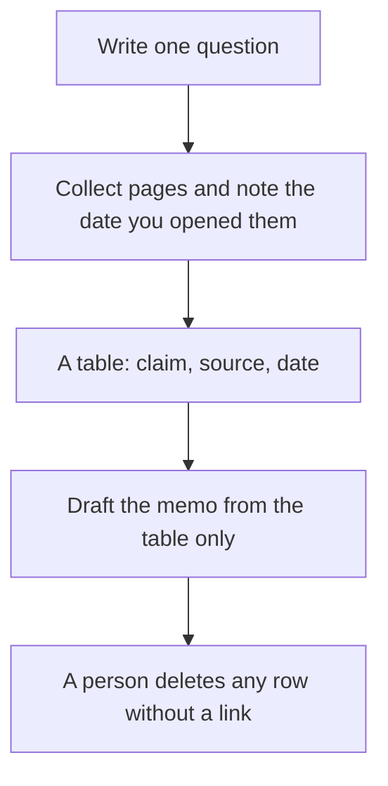

**Competitive analysis with AI starts from a question you could put in a header, and it ends in a table of sources a colleague can open.** The model can gather candidates and draft the memo. It cannot bless a claim you did not trace. "Analyze the market" is not a question. "What do these four pricing pages charge for the entry paid plan, and what is excluded?" is a question.

The research habit with citations is [how to use Perplexity for market research](/blog/how-to-use-perplexity-for-market-research-2026/). The split with a general chatbot is [ChatGPT vs Perplexity for research](/blog/chatgpt-vs-perplexity-for-research-2026/). Prices are US list prices. Perplexity's annual Pro price is on the directory page checked October 16, 2026 and in the October 24, 2026 pricing article. Other prices are from directory pages checked October 16, 2026, except Writesonic's annual card, read October 24, 2026. Published October 24, 2026. We did not rank competitors.

## The question decides the tool

| Question | Tool | First paid step |
|---|---|---|
| What does this page say, and what is the link? | [Perplexity](/tools/perplexity/) | Pro is $17/month billed annually. Free is enough to test one question |
| Which queries do we and a rival both show up for? | [Semrush](/tools/semrush/) | SEO plan $117.33/month billed annually, or $139 monthly. Free is 10 reports a day |
| Who works at these accounts, from providers we already pay? | [Clay](/tools/clay/) | Launch $167/month billed annually. Free is 500 actions and 100 data credits |
| Draft the memo from a table I already built | [Claude](/tools/claude/) or [ChatGPT](/tools/chatgpt/) | Claude Pro $20/month or $17 annual. ChatGPT Plus $20 |
| Do AI answers mention us or them? | [Writesonic](/tools/writesonic/) | Starter $79/month on the annual view read October 24, 2026 |

A leaderboard of "best AI" inside the memo is the failure mode. You are recording what a company published, or what a keyword tool returned, on a date. You are not awarding a score.

## A week that stays small

**Day 1: the question and the set.** Name the rivals. Four is enough. Name the field: price, a feature that must be on a public page, positioning on the homepage, or search overlap. Leave "innovation" out. It does not have a column.

**Day 1, second hour: Perplexity for the pages.** Ask for the pricing URL and the homepage URL. Open them. If the citation is a roundup blog, find the vendor page yourself. Pro at $17 a month billed annually is the plan when you are doing this weekly. The ladder is [Perplexity pricing explained](/blog/perplexity-pricing-explained-2026/). A wrong citation is [what an AI hallucination is](/blog/what-is-ai-hallucination-2026/).

**Day 2: the table.** One row per claim. Columns: company, claim, URL, the date you opened it, and a note if the page required a login you do not have. Missing data stays missing. Asking Claude to fill a price it cannot see is how a client memo picks up a fiction.

**Day 3: the keyword question, if it is in scope.** Semrush's free account will show you the product and will not run an agency project. The SEO plan is the freelancer entry. Buy it when search overlap is the question you wrote on day 1. Skip it when the question was the pricing page. The category piece is [best AI SEO tools](/blog/best-ai-seo-tools-2026/).

**Day 4: the memo.** Paste the table into Claude or ChatGPT. Ask for a one-page brief that quotes only the table, flags gaps, and recommends one next question. The instruction pattern is [what prompt engineering is](/blog/what-is-prompt-engineering-2026/). Edit the brief. The model does not sign it.

**Day 5: the account question, if sales asked.** Clay is the spreadsheet of providers. It is the wrong tool for "what does their homepage say." Launch at $167 a month billed annually is a list-building price. The review is [Clay review](/blog/clay-review-2026/). Writesonic is the tool when the question is whether answer engines mention the brand. Starter tracks 50 prompts on the annual card. It is a measurement product, and the review is [Writesonic review](/blog/writesonic-review-2026/).

## What to hand someone else

| Section | Contents |
|---|---|
| The question | One sentence |
| The set | The companies, and why these four |
| The table | Claim, URL, date |
| Gaps | What you could not see without a login |
| One implication | A decision this supports, written by you |
| The next question | The thing this pass did not answer |

Update the date when you re-open a pricing page. A figure from October is a different fact in January. This site's own pricing articles exist because those pages move. Treat a rival's price the same way.

[Gamma](/tools/gamma/) Plus at $9 a seat a month can turn the one-pager into a leave-behind after the table is solid. A deck of unsourced charts is the step to skip. The presentation category is [best AI presentation makers](/blog/best-ai-presentation-makers/).

## FAQ

### Can ChatGPT do competitive analysis by itself?

It can draft from pages you paste and from the browsing tools on your plan. Perplexity is the better default when the link is the point, because the product is built to show sources. You still open the source. The comparison is [ChatGPT vs Perplexity for research](/blog/chatgpt-vs-perplexity-for-research-2026/).

### How often should I refresh the table?

When you are about to use a number, and on a schedule you can keep, such as once a quarter for pricing pages. A dashboard that nobody opens is a subscription. Semrush and Writesonic are justified when someone reports from them.

### Is this the same as market research?

It is the public-page slice of market research. Interviews, win-loss calls, and your own pipeline are still primary. The Perplexity workflow covers the wider desk. This page is the competitive table.

### What if the rival's best feature is behind a login?

Record "not on the public page" and stop. A guessed feature list is worse than a gap. A trial you are allowed to start is a source. A scraped private console is not a method this guide covers.

## Last verified

October 16, 2026 for Perplexity, Semrush, Clay, and Claude. October 24, 2026 for Writesonic's annual Starter price and for the Perplexity pricing article. Published October 24, 2026.

**Sources:** [Perplexity pricing](https://www.perplexity.ai/pro), [Semrush pricing](https://www.semrush.com/pricing/), [Clay](https://www.clay.com), [Writesonic pricing](https://writesonic.com/pricing).

*Published by Andrew for [AI Tools Optimizer](https://aitoolsoptimizer.com).*

[Perplexity](/tools/perplexity/) is in the [research directory](/tools/category/research-search/). [Semrush](/tools/semrush/) is in the [marketing directory](/tools/category/marketing-seo/). Directory pages may use affiliate links. A purchase through them may earn us a commission at no extra cost to you.
