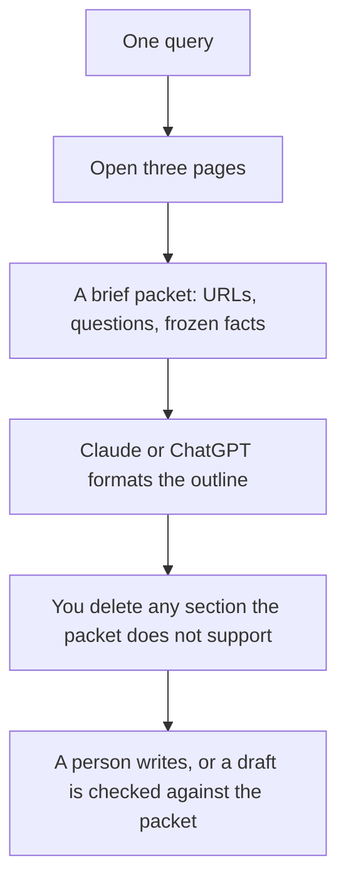

**An SEO brief made with AI is a set of decisions a writer can check: the query, the pages you opened, the questions those pages answer, and the facts your article is allowed to use.** The model can format that packet. It cannot replace the packet. A brief that is only a prompt will produce an article that is only a guess.

The tool roundup is [best AI SEO tools](/blog/best-ai-seo-tools-2026/). The two optimization desks are [Surfer vs Frase](/blog/surfer-seo-vs-frase-2026/). Prices are US list prices excluding tax from directory pages checked October 16, 2026. Published October 24, 2026. We did not score rankings.

## What the brief contains

| Section | Who fills it | Done when |
|---|---|---|
| Query and reader | You | One query, one reader, one action |
| Pages you opened | You, from a research tool or the results page | Three URLs, with one sentence each on what they actually say |
| Questions to answer | You, edited from a tool's list | Every question maps to a section, or you cut it |
| Facts that cannot move | You | Prices, dates, and product limits with a source |
| Outline | The model, from the rows above | Each H2 names a question. No section exists for a fact you do not have |
| Internal links | You | Two real URLs on your site, or "none yet" |
| What this article will not claim | You | A short ban list, including competitor numbers you did not verify |

Competitive pages you might cite are gathered the same way as [how to use AI for competitive analysis](/blog/how-to-use-ai-for-competitive-analysis-2026/). The voice on the finished article is [how to create a brand voice with AI](/blog/how-to-create-a-brand-voice-with-ai-2026/). The claim check is [how to fact-check AI writing](/blog/how-to-fact-check-ai-writing-2026/).

## Which tool supplies which row

**The research suite.** [Semrush](/tools/semrush/) is the place to pull a query's data when the brief will be attached to a report. The SEO plan is $117.33 a month billed yearly, or $139 monthly, on the October 16 card. Free is one project and 10 reports a day, which is enough to see the product and too small for a team that briefs every week. Semrush One, with AI-search tracking, starts at $165.17 a month on annual billing on that same card. Buy it when that chart is part of the brief. Do not paste Semrush's screen into an article as if you had opened the underlying pages.

**The brief desk.** [Frase](/tools/frase/) Starter is $39 a month billed yearly, or $49 monthly: one seat, one site, 10 articles and 50 audit pages a month. Professional is $103 yearly or $129 monthly. [Surfer](/tools/surfer-seo/) Standard is $99 a month billed yearly, with 360 documents and 25 AI prompts tracked weekly on the card we used. Surfer's cheaper AI Search Analytics plan is $82 a month yearly and is a tracking product, not the document editor. Use Frase or Surfer to propose questions and a content structure. Then open the pages. A question list nobody checked is how the outline drifts toward topics the top results do not cover, or toward topics you cannot source.

**The formatter.** [Claude](/tools/claude/) Pro is $20 a month, or $17 billed annually. [ChatGPT](/tools/chatgpt/) Plus is $20. Paste the packet and ask for the outline table. The writing steps after the brief are [how to write a blog post with Claude](/blog/how-to-write-a-blog-post-with-claude-2026/). The model is finished when the outline exists. It is not the author of the prices inside it.

**The AI-answer watch.** [Writesonic](/tools/writesonic/) Starter at $79 a month billed annually tracks prompts across answer engines and still offers AI articles. That is a measurement add-on for a team that must report citations. It is a heavy way to format one brief. One project on the Starter card means a second site is another plan.

## A brief you can hand to a writer

Use this shape:

"Query: how to use AI for SEO briefs. Reader: a content lead who will not invent prices. Pages opened: [three URLs and one sentence each]. Questions: [the list you kept]. Frozen facts: [only figures with sources and dates]. Internal links: [real paths]. Do not claim a ranking change. Outline in H2s that match the questions. If a section needs a fact we do not have, title it 'source needed' and stop."

That prompt is [what prompt engineering is](/blog/what-is-prompt-engineering-2026/), applied to a brief. Few-shot helps if you paste one brief you already liked. The definition is [what few-shot prompting is](/blog/what-is-few-shot-prompting-2026/).

Then read the outline for sections you cannot source. Delete them before a writer spends a day on them. A content calendar of briefs is [how to build an AI content calendar](/blog/how-to-build-an-ai-content-calendar-2026/). The marketers' stack around this is [best AI tools for marketers](/blog/best-ai-tools-for-marketers-2026/).

## FAQ

### Can ChatGPT write the brief without Semrush?

Yes, if you paste the three pages you opened and the facts you will allow. You do not need a $117 research plan to brief one article. You need the plan when the team wants the data in the brief every week and will cite it. The free Semrush limits are the trial of that habit.

### Should the brief include a target word count?

A range is enough, taken from the pages you opened, and it is a weak requirement next to the questions. An outline that answers the questions will find a length. A word count with no questions produces padding.

### Is an AI visibility score part of the brief?

Only if someone will act on it. Writesonic, Surfer's AI Search Analytics plan, and Semrush One sell versions of that chart. Put the chart in the brief when the article's job includes being cited by answer engines, and keep it out when the job is a clear page for a human query.

### Who approves the brief?

The person who owns the facts. A model can format. A writer can draft. The content lead, or the subject owner, checks the frozen-facts row before anyone writes the introduction.

## Last verified

October 16, 2026 for Semrush, Frase, Surfer, Claude, ChatGPT, and Writesonic prices. Published October 24, 2026.

**Sources:** [Semrush pricing](https://www.semrush.com/pricing/), [Frase pricing](https://www.frase.io/pricing), [Surfer pricing](https://get.surferseo.com/surfer-pricing).

*Published by Andrew for [AI Tools Optimizer](https://aitoolsoptimizer.com).*

[Semrush](/tools/semrush/) and [Frase](/tools/frase/) are in the [marketing directory](/tools/category/marketing-seo/). Directory pages may use affiliate links. A purchase through them may earn us a commission at no extra cost to you.
