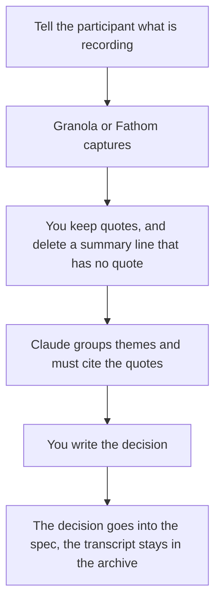

**AI interview notes are a transcript and a short list of quotes, with decisions written by a person after they check the quotes.** The model can clean the transcript and group themes. It should not invent a user need that nobody said. A theme without a quote is a hypothesis, and the note should label it that way.

The meeting habit this sits on is [how to summarize meetings with AI](/blog/how-to-summarize-meetings-with-ai-2026/). The spec those notes should feed is [how to draft a product spec with AI](/blog/how-to-draft-a-product-spec-with-ai-2026/). Product managers choosing the rest of the stack can start from [best AI tools for product managers](/blog/best-ai-tools-for-product-managers-2026/).

Granola's prices were read for the October 24, 2026 pricing article. Fathom and Fireflies prices are from directory pages checked October 16, 2026, and match the pricing articles linked below. Published October 24, 2026. We did not score transcription accuracy.

## What the note contains

| Section | Who fills it | Done when |
|---|---|---|
| Consent and the recording | You, before the interview | The participant knows a tool is capturing, and what will be shared |
| Quotes | The transcript, checked by you | Each quote has a timestamp or a clear location |
| Themes | The model, then you | Every theme points at two quotes, or you mark it as one person's comment |
| Decisions | You | A change to the spec, or "no change" |
| What you will not claim | You | No counts of "users want" from three conversations |

## Which capture tool

**No bot in the room.** [Granola](/tools/granola/) listens from your computer. Basic is free with 30 days of history. Business is $14 per user per month for unlimited history. Enterprise is $35 when you need the heavier integrations. The invoice is [Granola pricing explained](/blog/granola-pricing-explained-2026/). Thirty days is short for a research repository. Business is the plan if you will quote an interview next quarter.

**A bot is acceptable.** [Fathom](/tools/fathom/) lists unlimited recordings on the free plan in the pricing article, and Premium at $16 a month billed annually. Confirm the free line on the day you rely on it. The article is [Fathom pricing explained](/blog/fathom-pricing-explained-2026/). Use Fathom when the participant has agreed to a bot and you want the library.

**A dialer or a team that already lives in Fireflies.** [Fireflies](/tools/fireflies-ai/) Pro is $10 per user per month on annual billing, or $18 month to month. The seat math is [Fireflies pricing explained](/blog/fireflies-pricing-explained-2026/). One research team should pick one capture tool. Two transcripts of the same interview will disagree, and someone will cite the wrong one.

**The writeup.** [Claude](/tools/claude/) Pro is $20 a month, or $17 billed annually. Paste the quotes, not the whole hour, unless you have read the hour. Ask for themes that cite a quote, and for a separate list of one-off comments. [Notion AI](/tools/notion-ai/) is where the research repository lives if that is the team wiki. Business is $20 per seat per month. The comparison with a blank chat is [Notion AI vs ChatGPT for notes](/blog/notion-ai-vs-chatgpt-for-notes-2026/).

A prompt that protects the quotes:

"Quotes are below, each with a label. Group them into themes. Under each theme, repeat the quote labels you used. If a theme has one quote, call it a single comment. Do not write 'users want.' Write 'one participant said,' with the label."

That is still a draft. You listen to the minute before you put the sentence in a spec or a slide. The failure mode is [what an AI hallucination is](/blog/what-is-ai-hallucination-2026/), applied to a person who can be misquoted.

## Consent and the archive

Say what is recording, where the note will live, and who inside the company will see it. A tool's default sharing is not the participant's consent. Customer names and companies stay out of a digest that will be forwarded widely. The research digest format, if you circulate themes, is [how to build an AI research digest](/blog/how-to-build-an-ai-research-digest-2026/). Put themes and quote labels in the digest. Leave the recording in the archive.

Support teams who mine tickets rather than interviews are doing a different job. The FAQ built from those tickets is [how to create FAQ pages with AI](/blog/how-to-create-faq-pages-with-ai-2026/). Do not paste a support ticket into a user-research note and call it an interview.

## FAQ

### Can I skip the recording and type notes?

Yes. Type the quotes you are sure of, and let the model group those. A recording you did not tell the participant about is the wrong shortcut.

### How many interviews before a theme is real?

The note should not answer that with a fake percentage. Mark a theme as a pattern only when you can point at quotes from more than one session. Otherwise it stays a single comment.

### Should the model write the persona?

A persona is a hypothesis you own. The model can format it from the quotes. It should not add demographics nobody stated. If the quotes do not support a persona, you do not have one yet.

### Where do action items go?

Into the spec's open questions or the decision row, with an owner. A transcript full of highlighted lines is not a plan. The spec workflow is linked above.

## Last verified

October 24, 2026 for Granola's plan prices as published in the Granola pricing article. October 16, 2026 for Fathom, Fireflies, Claude, and Notion in the directory and the pricing articles those tools already have. Published October 24, 2026.

**Sources:** [Granola pricing](https://www.granola.ai/pricing), [Fathom pricing](https://www.fathom.ai/pricing), [Fireflies pricing](https://fireflies.ai/pricing).

*Published by Andrew for [AI Tools Optimizer](https://aitoolsoptimizer.com).*

[Granola](/tools/granola/) and [Fathom](/tools/fathom/) are in the [meetings directory](/tools/category/meetings-transcription/). Directory pages may use affiliate links. A purchase through them may earn us a commission at no extra cost to you.
