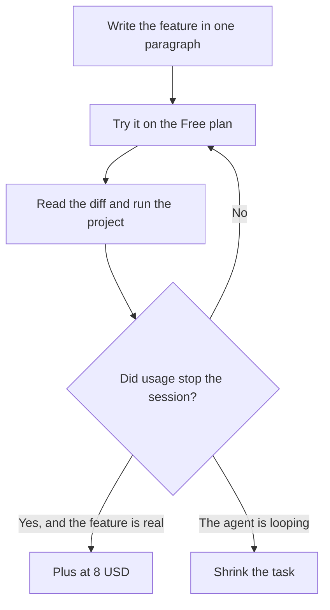

**Give Cursor one feature, a small repo, and a rule that you read the diff.** A side project dies when the agent is asked to "build the app" and the repo becomes a pile of files nobody can explain. The workflow below fits an evening and a cheap plan.

Prices are US list prices excluding tax, from Cursor's pricing notes as checked October 16, 2026, published here on October 24, 2026. A live refetch of the pricing URL that day did not return numbers. New customers buy Cursor through The X Subscription, which also covers [Grok](/tools/grok/) and X. The product review is [Cursor review](/blog/cursor-review-2026/). The daily-coding comparison is [Cursor vs GitHub Copilot](/blog/cursor-vs-github-copilot-2026/).

## The plan for a project that is not your job

| Plan | Price | What a side project should do with it |
|---|---|---|
| Free | $0 | Agent, Chat, and Tab on Cursor models, with limited usage. This is the first week |
| Plus | $8/month, or $80/year | The first paid step when the free cap interrupts a session you are still finishing |
| Premium | $30/month, or $300/year | 4x Plus usage, and the same band as Grok Premium. Buy it when Plus ran out on a project you are still shipping |
| Super and Ultra | $100 and $200 a month | Not a side-project default. Super is 15x Plus usage. Ultra is 50x |
| Legacy Pro | $20/month | Only if you already have it. New work starts on The X Subscription. Switching off a legacy plan is permanent |

Team seats at $30, $100, and $200 are for a group. A side project with no collaborators does not need one.

## Step 1: Write a paragraph the agent is allowed to finish

One feature. Name the files it may touch, the thing the user can do when it works, and the thing it must not add. "A page that saves a note locally" is a feature. "An AI startup" is not.

Put that paragraph in the repo as a short README section or a scratch note. You will paste it into [Cursor](/tools/cursor/) so the chat is anchored to a decision you made while you were not watching it generate code.

Create an empty project or a tiny one you understand. An agent dropped into a large unfamiliar codebase will "help" by inventing structure. A side project can stay small enough that you still recognize every file.

## Step 2: Use Agent for the feature and Tab for the typos

Cursor's split is the practical one. Tab and a small chat edit are how you fix a function you already meant to write. Agent mode is how you let it create the feature across files. Start in the smaller mode when you know the change. Use Agent when the change is the paragraph from step 1, and you have time to review it the same night.

Ask for the feature, not for a stack. If you have a stack, name it. If you do not, say you want the smallest thing that runs. Unrequested dependencies are the usual way a side project becomes a maintenance job.

## Step 3: Run it, then read the diff like a reviewer

Run the project. Click the feature. Then read the diff before you commit. Look for secrets, for a new dependency you did not want, and for a change outside the files you named. Reject the parts that fail that test and ask for a smaller patch. Do not "fix forward" on a diff you have not read. That is how a weekend project becomes an incident.

Keep API keys in the environment, not in a file the agent can casually rewrite into a client component. If a key has been pasted into chat, rotate it. The chat is not a vault.

## Step 4: Stop when it loops

If the agent is on its third attempt at the same error, the task is too big or the error is outside the repo. Read the error yourself. Paste the relevant lines back with a narrower ask: "change this function so this test passes," not "fix the app." The usage multipliers on Premium, Super, and Ultra exist for people who burn a pool. They are a bad substitute for a smaller prompt. A side project that needs Ultra is either a product or a loop.

Plus at $8 is the correct upgrade when Free stops you in the middle of a feature you have already proven you will finish. Premium at $30 is the correct upgrade when you can point at a month of Plus limits, or you were going to buy Grok Premium anyway and the usage band is the same subscription. The bundle is real: one pool covers Grok and Cursor. See [Grok review](/blog/grok-review-2026/).

## When the side project should not be in Cursor

- You want to stay in VS Code or JetBrains and the code is on GitHub. [GitHub Copilot](/tools/github-copilot/) Free is 2,000 completions a month. Pro is $10. The credit math is [GitHub Copilot pricing explained](/blog/github-copilot-pricing-explained-2026/).
- You want a terminal agent and you already pay for [Claude](/tools/claude/). [Claude Code](/tools/claude-code/) rides on a Claude plan. The introduction is [Claude Code for beginners](/blog/claude-code-for-beginners-2026/).
- You already pay for ChatGPT and want the coding agent on that subscription. That is [OpenAI Codex](/tools/openai-codex/).
- You do not want to look at code. A site builder such as [Lovable](/tools/lovable/) or [Bolt.new](/tools/bolt-new/) is a different product. Lovable Pro is $25/month. Bolt Pro is $25/month. The comparison is [Lovable vs Bolt vs Replit](/blog/lovable-vs-bolt-vs-replit/).
- You wanted a survey of the whole category. That is [best AI coding assistants](/blog/best-ai-coding-assistants-2026/).

## FAQ

### Is Cursor free for a side project?

Yes, within the free usage limit on Agent, Chat, and Tab. Ship the first feature there. Plus at $8 is the step when the limit, not boredom, stops you.

### Do I need a GitHub account?

No, to edit a local project. Yes, if you want the GitHub review and PR features. Copilot assumes GitHub more strongly than Cursor does.

### Can I use my own API keys?

Cursor's current plans are usage on The X Subscription, not a bring-your-own-key tutorial. If a setting offers keys, read the billing note in the app so you do not pay twice. This guide assumes the subscription pool.

### How do I keep the code mine?

Read and understand the diff before you commit it. You can ship code you did not write line by line. You should not ship code you cannot explain. The agent is a fast drafter. You are still the person who merges.

## Last verified

October 16, 2026 for plan prices. Published October 24, 2026. The pricing page did not return a fresh fetch that day. Usage multipliers are relative to Plus, not a count of features.

**Sources:** [Cursor pricing](https://cursor.com/help/account-and-billing/pricing), [The X Subscription pricing](https://docs.x.ai/x-subscription/pricing).

[Cursor](/tools/cursor/) is in the [coding directory](/tools/category/coding/). Directory pages may use affiliate links. A purchase through them may earn us a commission at no extra cost to you.
